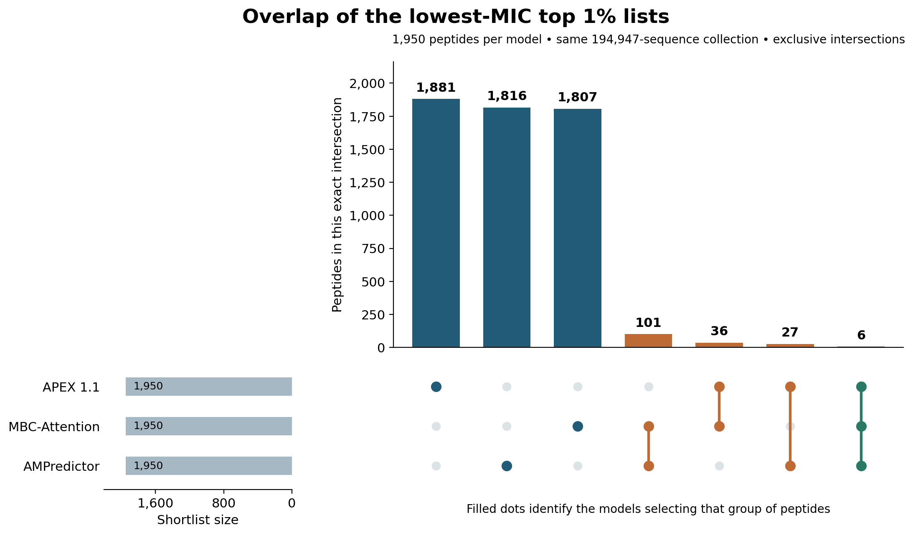
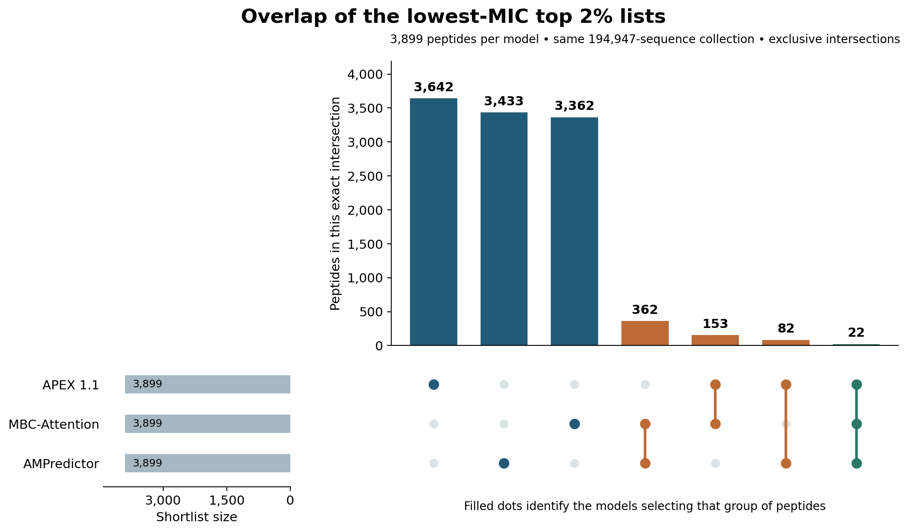
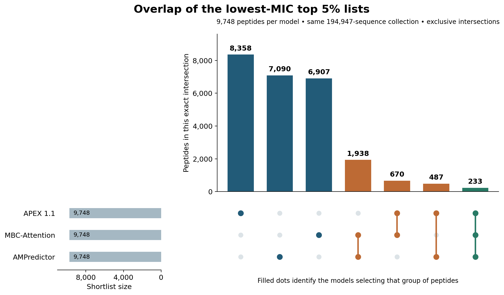
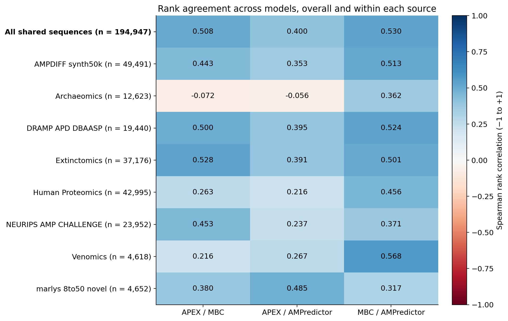
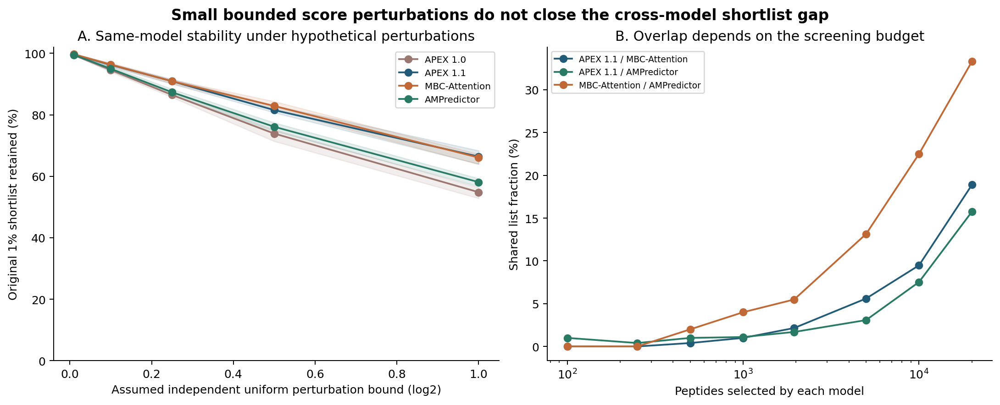

# Section 1: different models choose different peptides

This companion asks whether different tools would send the same peptides to the laboratory. It follows the shortlist comparison in [section 1 of the final report](FINAL_ANALYSIS.md#1-different-models-choose-different-peptides), then checks whether the result changes with the testing budget or the sequences included.

- A shortlist contains the peptides nominated for testing. The overlap counts below describe shared nominations, rather than measured activity.

- The tools predict related E. coli targets. APEX 1.1 specifies strain ATCC 11775, while MBC-Attention and AMPredictor use broader E. coli targets. Their recommendations can be compared, but differences may partly reflect those target choices. This analysis does not establish which prediction is correct.

## 1. The screening decision

- The first check gives every tool the same testing budget: its **1,950 lowest predicted MICs** among the same **194,947 sequences**, approximately the best 1%. Equal list sizes prevent a tool from gaining more overlap simply by nominating more peptides.

- The **union** means all peptides selected by at least one tool. It contains **5,674 sequences**: **5,504 selected by only one model**, **164 by exactly two**, and **six by all three**.

- An **UpSet plot** gives each exact model combination its own bar. Filled dots identify the selecting models; a bar excludes every unmarked model. A pair-only bar therefore excludes peptides selected by the third model. An **inclusive pairwise overlap** adds those triple-shared peptides back.

- **Figure 1** displays that split into exact selection combinations; the left-hand bars give each model's total nominations.

*Figure 1. Each column represents one exact combination of selecting models, identified by filled dots underneath. Blue bars count single-model selections, orange bars exactly two, and green all three. The 36 APEX/MBC-only peptides plus the six triple-shared peptides give their inclusive pairwise overlap of 42. Each list contains 1,950 entries.*

- Including the triple-shared peptides, the pairwise overlaps are **42 for APEX/MBC**, **33 for APEX/AMPredictor**, and **107 for MBC/AMPredictor**. Multiplying every prediction from one model by the same positive number leaves its ordering, and therefore its shortlist, unchanged.

- [Top-1% peptide membership](../analysis_review/outputs/shortlist_overlap/shortlist_membership.csv) · [exclusive counts](../analysis_review/outputs/shortlist_overlap/exclusive_intersections.csv) · [calculation and plotting script](../analysis_review/plot_shortlist_upset.py).

## 2. What changes at top 2% and top 5%?

- A laboratory might test more than 1% of the collection. The next check widens each list while keeping the **194,947-sequence starting set** fixed. Each tool still gets the same number of nominations; list sizes round upward to a whole peptide.

- **Figure 2** repeats the exact-overlap calculation at 2%, to show which combinations grow when the budget doubles.

*Figure 2. Each model selects 3,899 peptides at 2%. Together the lists contain 11,056 peptides: 10,437 selected by exactly one model, 597 by exactly two, and 22 by all three. Each bar counts only the marked combination, as in Figure 1.*

- **Figure 3** widens the budget to 5%. Reading it alongside Figure 2 distinguishes greater absolute overlap from identical lists.

*Figure 3. Each model selects 9,748 peptides at 5%. Together the lists contain 25,683 peptides: 22,355 selected by exactly one model, 3,095 by exactly two, and 233 by all three. Every selected peptide belongs to exactly one bar.*

| Budget per model | List size | Selected by any model | Selected by all three |
|---|---:|---:|---:|
| Top 1% | 1,950 | 5,674 | 6 |
| Top 2% | 3,899 | 11,056 | 22 |
| Top 5% | 9,748 | 25,683 | 233 |

- Larger lists usually share more peptides. The next table therefore reports **shared count divided by either list's size**, including triple-shared entries. For example, APEX and MBC share **903/9,748 entries (9.26%)** at the 5% budget.

| Model pair | Top-1% overlap | Top-2% overlap | Top-5% overlap |
|---|---:|---:|---:|
| APEX / MBC | 2.15% | 4.49% | 9.26% |
| APEX / AMPredictor | 1.69% | 2.67% | 7.39% |
| MBC / AMPredictor | 5.49% | 9.85% | 22.27% |

- Overlap grows with the budget, especially for MBC/AMPredictor. Yet at 5%, even that pair shares only about **22% of either list**. The tools still nominate substantially different candidates. Report overlap with the intended testing budget; it is not a universal disagreement rate or an accuracy score.

- [Budget summary](../analysis_review/outputs/shortlist_overlap/budget_summary.csv) · [pairwise counts and overlap fractions](../analysis_review/outputs/shortlist_overlap/budget_pairwise_overlaps.csv) · [top-2% membership](../analysis_review/outputs/shortlist_overlap/top_2pct/shortlist_membership.csv) · [top-5% membership](../analysis_review/outputs/shortlist_overlap/top_5pct/shortlist_membership.csv).

## 3. Rank agreement across models and sources

- **Spearman correlation** asks whether peptides ranked favorably by one model also tend to rank favorably by another, using all shared sequences. **+1** means identical ranks, **0** no overall rank association, and **−1** reversed ranks. It measures ordering, rather than accuracy or shortlist overlap.

| Model pair | Shared sequences | Spearman correlation |
|---|---:|---:|
| APEX / MBC | 194,947 | 0.508 |
| APEX / AMPredictor | 194,947 | 0.400 |
| MBC / AMPredictor | 194,947 | 0.530 |

- These positive correlations show some shared ordering across the full collection, despite small shortlist overlaps. The next check repeats the calculation within each source, so a large collection cannot hide a different pattern in another.

- **Figure 4** separates the pooled rank correlations from those within each source, so the overall values can be checked against collection-specific behavior.

*Figure 4. Each row uses the shared sequence count printed beside it. Correlations cover all eligible sequences in that row, not only shortlisted peptides. Equal predictions receive average tied ranks; these values describe model outputs, not experimental accuracy.*

- **Figure 4** shows why the source matters. In Archaeomics, APEX correlates **−0.072 with MBC** and **−0.056 with AMPredictor**, while MBC/AMPredictor correlate **0.362**. In Venomics, MBC/AMPredictor correlate **0.568**, versus **0.216–0.267** for pairs involving APEX. The overall result does not describe every collection equally well.

- [Correlation table](../analysis_review/outputs/shortlist_overlap/spearman_correlations.csv) · [calculation and plotting code](../analysis_review/plot_shortlist_upset.py) · [definitions and checks](../analysis_review/outputs/shortlist_overlap/budget_extension_manifest.json).

## 4. The result is larger than a sorting or small-perturbation effect

- The first check tests whether sorting equal scores could create the apparent difference. At all three plotted budgets, every model has just one sequence at its cutoff, so a tied boundary does not explain the result. Separate selection implementations and changes to row order also recovered the same 1% lists.

- A second check asks whether small prediction changes replace most nominations. A simulation changes each prediction independently by a randomly chosen amount on the **log2 scale**, where adding one doubles the MIC. A bound of **0.1** multiplies predictions by factors between **0.933 and 1.072**. Each bound is tried **25 times**; these are assumed disturbances, not measured model uncertainty.

- **Retention** is the number of original candidates still selected after a disturbance, divided by **1,950**. Cross-model overlap instead counts candidates shared by two disturbed lists, also divided by 1,950.

- With the 0.1 bound, each model keeps a median **94.6–96.4%** of its original 1% list across the four E. coli outputs, including APEX 1.0. Cross-family overlaps remain around **1.7%, 2.2%, and 5.6%**. Most nominations survive these small disturbances, while the tools still choose different lists (Figure 5).

- **Figure 5** compares two sensitivities: changing individual scores on the left and changing the nomination budget on the right.

*Figure 5. Left: original-versus-perturbed same-model retention; shaded ranges summarize the simulated runs. Right: pairwise shared fractions across a wider range of testing budgets. These assumed disturbances are not measured model uncertainty, assay variation, or confidence intervals.*

- Larger disturbances replace more candidates. This check shows that the specified small, independent changes are insufficient to explain the between-tool difference. Errors shared across predictions, retraining, and incorrect preprocessing remain separate possibilities.

- Supporting analysis: [Earlier boundary checks](../analysis_review/outputs/sanity_checks/shortlist_ties_and_boundaries.csv) · [perturbation summaries](../analysis_review/outputs/sanity_checks/bounded_score_perturbation_summary.csv).

## 5. The budget matters, but no tested budget makes the lists interchangeable

- An earlier scan tried **100 to 20,000 candidates** per tool. At 100, APEX/MBC, APEX/AMPredictor, and MBC/AMPredictor share **zero, one, and zero** peptides. At 20,000, they share **18.89%, 15.76%, and 33.31%** of either list. The budget changes the size of overlap without making the lists interchangeable.

- Supporting analysis: [All absolute budgets](../analysis_review/outputs/sanity_checks/absolute_screening_budgets.csv).

- A **reference comparison** asks how much overlap could arise from source and length preferences alone. It builds hypothetical independent lists keeping each model's selected count within every source/exact-length category. At 1%, expected shared counts are **15.09, 12.81, and 44.33**, versus **42, 33, and 107 observed**, in the same model-pair order as above.

- The tools share more candidates than this reference expects, but still differ enough to change a small laboratory screen. The reference assumes equally likely, independent selection within each category. It is a way to interpret shared preferences, rather than a model of peptide biology or a significance test.

- Supporting analysis: [Observed and reference intersections](../analysis_review/outputs/shortlists_with_selection_references.csv).

## 6. Related variants and collection composition explain part of the picture

- A collection may contain many small variants of one sequence. Counting every variant equally could exaggerate diversity, or make tools look different when they choose variants of the same group. The next checks reduce the influence of those repeated variants.

- A **terminal extension** adds residues at one end. A **one-substitution link** joins equal-length sequences differing at one position. These links form **110,491 groups** represented in the shared prediction set. Members may connect through intermediate sequences, so a group can join distant endpoints. These are observed sequence relationships, not verified evolutionary families.

- One check keeps one sequence from each related group, choosing without looking at predictions. Twelve repeatable choices use identifiers calculated from sequence text (**hashes**). Median 1%-list overlaps remain **2.81% for APEX/MBC**, **2.94% for APEX/AMPredictor**, and **6.65% for MBC/AMPredictor**.

- Two further checks use each group's median prediction, or count a group as shared when both lists contain any of its members. These checks suggest that selecting different variants within a group does not explain the original low overlap. They do not make the groups independent biological samples.

- Supporting analysis: [Representative summaries](../analysis_review/outputs/sanity_checks/broader_component_representative_summary.csv) · [group-median selection](../analysis_review/outputs/sanity_checks/component_median_shortlists.csv) · [original group overlaps](../analysis_review/outputs/sanity_checks/original_shortlists_component_overlap.csv).

- **Cysteine** is the amino acid written C. Checking sequences without C and of length 8–39 asks whether the result changes nearer AMPredictor's reported training composition. Passing this restriction does not establish that a peptide resembles every aspect of its training examples.

- Other checks remove one source at a time, the two APEX-selected collections together, or exact matches to the cached APEX/AMPredictor development lists. Low cross-family overlap remains.

- Giving each source its own 1% budget yields **1,953 nominations per tool**, with pairwise overlap **3.07%, 2.76%, and 8.70%** in the model-pair order above. Among **122,813 cysteine-free sequences of length 8–39**, MBC/AMPredictor overlap rises to **13.02%**, while APEX/AMPredictor remains **1.71%**. These checks change the eligible sequences; they do not establish whether the retained peptides were used during training.

- Supporting analysis: [Population restrictions](../analysis_review/outputs/sanity_checks/population_shortlist_sensitivity.csv) · [source budgets](../analysis_review/outputs/sanity_checks/source_proportional_shortlists.csv).

## 7. Missing scores cannot plausibly turn this into near-complete overlap

- Missing predictions could hide candidates that change the lists. A generous check allows every missing score to take any finite value, then bounds the possible shared count at **1,950 candidates per tool**. It calculates limits rather than guessing the missing values.

- The conservative full-dataset bounds are **0–42 shared candidates for APEX/MBC**, **22–33 for APEX/AMPredictor**, and **0–118 for MBC/AMPredictor**. Even the upper limits are far below 1,950. The bounds need not be attainable or likely, but missing scores cannot turn these into nearly identical lists.

- Supporting analysis: [Bounds and derivation checks](../analysis_review/outputs/sanity_checks/missing_prediction_bounds.csv).

## 8. A changed ordering is more persuasive when the predicted difference is substantial

- Swapping the order of two nearly equal predictions may have little practical meaning. This check requires **both models to separate the two peptides by more than twofold**. It uses **1,999,991 sampled pairs** of distinct sequences; a sequence can appear in several pairs.

- **Opposing order** means one model gives the lower MIC to the first peptide and the other gives it to the second. The reported fraction divides opposing pairs by pairs meeting the separation rule in both models.

- For APEX versions, opposing order falls from **19.68%** among strictly ordered pairs to **1.47% of the 596,145 pairs** meeting the twofold rule. APEX 1.1/MBC still oppose order in **20.29% of 763,863 eligible pairs**; APEX 1.1/AMPredictor in **25.25% of 739,281**. Each percentage has its own denominator, and pairs are related observations.

- Candidates near a selection boundary can change membership even when large distinctions between APEX versions are broadly preserved.

- Supporting analysis: [Margins and eligible counts](../analysis_review/outputs/sanity_checks/order_reversals_with_effect_margins.csv).

- The reportable result is that tool choice changes which candidates fit a testing budget. The checks narrow some explanations, while leaving assay differences, incomplete inference reconstruction, and more distant sequence relationships unresolved. They do not identify a correct model.

- Supporting analysis: [model review](03_matched_targets.md#model-targets-training-and-conversions) · [assay-evidence limits](07_interpretation.md#2-existing-assay-matches-do-not-identify-a-winner) · [detailed methods](METHODS.md#further-falsification-audit-methods-and-limits).
