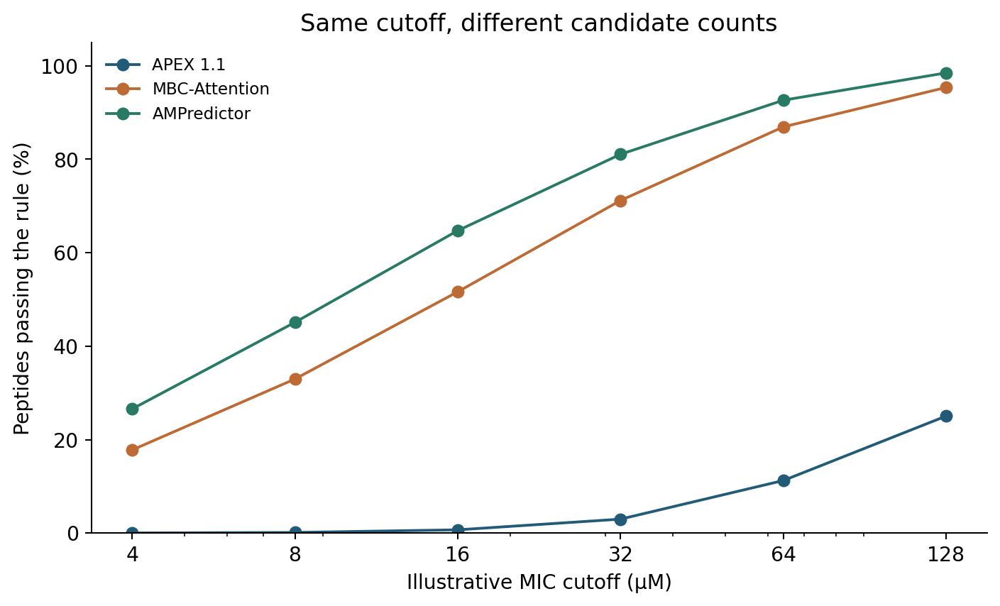
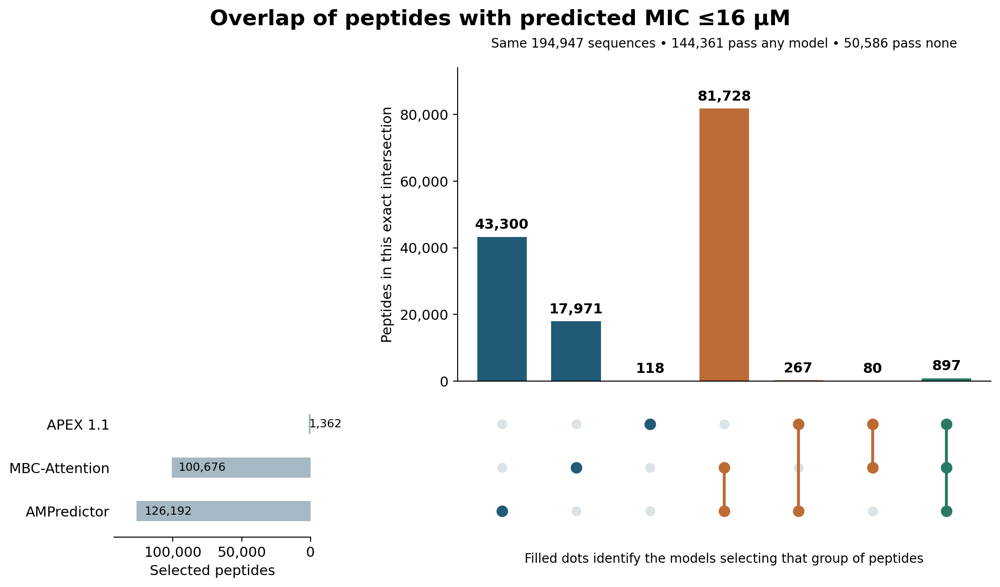
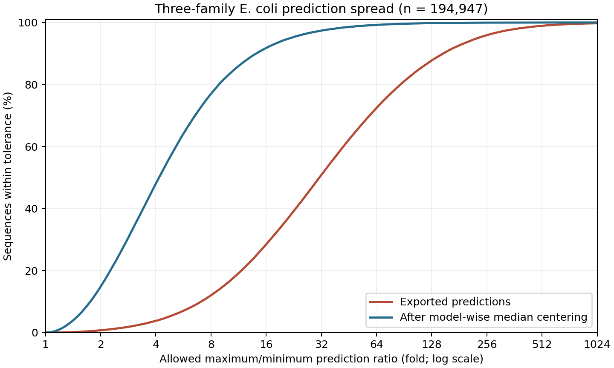
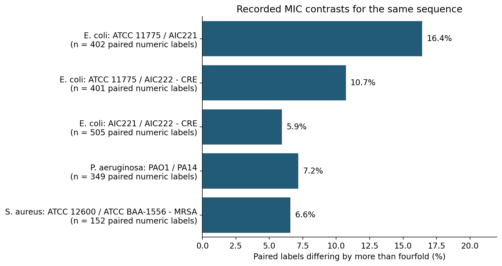

# Section 2: a concentration cutoff changes the screening decision

This companion follows [section 2 of the final report](FINAL_ANALYSIS.md#2-a-concentration-cutoff-changes-the-screening-decision). A fixed budget chooses the best-ranked peptides. A concentration cutoff chooses every peptide below a specified prediction. The latter can produce very different list sizes when tools usually predict different concentration ranges.

## The cutoff comparison

- Here, **pass** means predicted MIC at or below the cutoff; **fail** means above it. A pass fraction divides the passing count by all **194,947 sequences with all three predictions**, including joint failures. Missing predictions are excluded before this comparison.

- At **predicted MIC ≤16 µM**, APEX 1.1 selects **1,362/194,947 sequences (0.70%)**, MBC-Attention **100,676 (51.64%)**, and AMPredictor **126,192 (64.73%)**. All three select **897**; at least one selects **144,361**. This is an illustrative screening rule. It is not a clinical breakpoint, a measured active fraction, or the models' own activity-classification rule.

- **Figure 1** follows the passing fraction as the concentration cutoff changes; the 16 µM counts above are one point on each curve.

*Figure 1. Each model uses the same 194,947 shared sequences. The ordering of pass counts also holds when each source collection is examined separately, when peptide length/cysteine content is restricted, and when related variants' influence is reduced. Those checks do not make the training targets or label conventions identical.*

- **Figure 2** shows which peptides those lists share. Its **UpSet bars** count exact combinations: filled dots identify the selecting models, and each bar excludes every unmarked model. Unlike the equal-budget lists in section 1, these lists have different sizes.

*Figure 2. The seven bars partition the 144,361 peptides passing at least one model. Another 50,586 of the 194,947 shared sequences pass none and are reported above the plot, outside those bars. Left-hand bars give each model's total selections, including every shared combination.*

- The largest exact group in **Figure 2** contains **81,728 peptides passing MBC and AMPredictor but failing APEX**. Another **897 pass all three**, and **118 pass APEX alone**. The cutoff changes both list sizes and membership. APEX's strain-specific E. coli target also differs from the broader targets of the other tools, so these counts cannot identify the biologically correct recommendation.

- Supporting analysis: [Exact counts](../analysis_review/outputs/shortlist_overlap/cutoff_16uM/exclusive_intersections.csv) · [sequence memberships](../analysis_review/outputs/shortlist_overlap/cutoff_16uM/cutoff_membership.csv.gz) · [definitions and checks](../analysis_review/outputs/shortlist_overlap/cutoff_16uM/manifest.json).

- [Cutoff counts](../analysis_review/outputs/screening_decision_trends/MIC_cutoff_counts.csv) · [source-specific results](../analysis_review/outputs/screening_decision_trends/MIC_cutoff_by_source.csv) · [margin sensitivity](../analysis_review/outputs/screening_decision_trends/cutoff_margin_sensitivity.csv).

- Measured MIC depends on peptide chemistry, bacterial strain, growth medium, starting cell density, exposure time, and how growth is assessed. The sequence string alone does not describe the whole test.

- The tools can learn from different mixtures of laboratory conditions. Converting their outputs to the same unit therefore does not make them predictions of an identical experiment. The next sections examine prediction ranges and recorded laboratory labels separately; neither estimates a universal acceptable model error.

## 1. Different output scales account for part of the numerical spread

- **Fold spread** is the largest predicted MIC divided by the smallest across the three tools, calculated separately for each of the **194,947 shared sequences**. One means identical values; two means a twofold gap. A **within-fourfold fraction**, for example, counts sequences with spread ≤4 and divides by 194,947.

- The median spread is **31.22-fold**. To test how much typical prediction levels contribute, **median centering** puts predictions on a log2 scale (one step is a doubling), then subtracts each model's own median. This aligns typical levels while preserving each model's ordering.

- After centering, median spread falls to **4.17-fold**, and the fraction within fourfold rises from **3.80% to 48.00%** (Figure 3). The centered numbers describe relative predictions; they are not corrected MIC measurements.

- **Figure 3** shows how many sequences fall within each allowed fold difference before and after centering. It tests numerical scale differences, without fitting predictions to measured activity.

*Figure 3. The transformation aligns the models' typical log predictions. Centered outputs are relative quantities, not calibrated MICs. No plotted tolerance is established as an acceptable experimental error.*

- Typical prediction levels account for part of the numerical spread. This check does not tell how much biological error was removed or how much spread comes from assay variation. Because rankings stay unchanged, centering also leaves every fixed-budget shortlist unchanged.

- Training choices could contribute to these shifts. MBC combines E. coli measurements across conditions; APEX predicts a specified strain and assigns artificial concentrations to inactive observations. AMPredictor uses collected antimicrobial peptides (AMPs) with MIC labels. These are plausible contributors, but their separate effects have not been measured.

- Supporting analysis: [model comparison report](03_matched_targets.md#model-targets-training-and-conversions).

- [Calculation](../scratchpad/mic_variability.py) · [tolerance counts](../analysis_outputs/mic_variability_tolerance.csv) · [centering summary](../analysis_outputs/mic_variability_summary.json).

## 2. Recorded MICs can differ for the same sequence across strains

- The saved APEXDB dataset contains laboratory concentration labels alongside sequence identities. Here, a **label** means a recorded concentration rather than a new prediction. Pairing positive numeric labels for the same sequence in two strains gives a limited comparison. The larger label divided by the smaller measures the fold difference.

- For **E. coli ATCC 11775 versus AIC221**, **402 sequences** have numeric labels for both strains. The median larger/smaller ratio is **two**, and **16.4%** differ by more than fourfold. That percentage uses the **402 paired labels**, rather than all predicted sequences (Figure 4).

- **Figure 4** compares the fraction exceeding a fourfold label difference in each available strain pairing, using that pairing's own count.

*Figure 4. Each bar uses the numeric-pair count shown beside that strain comparison. The labels can differ in strain, assay, chemistry, and reporting conditions; this does not isolate a causal strain effect or estimate technical repeatability.*

- Nonnumeric and inactive entries are excluded rather than assigned invented concentrations. The retained records can still differ in assay conditions and peptide chemistry, so the contrast does not isolate a strain effect. They also belong to an APEX development/evaluation dataset and cannot serve as new independent APEX validation.

- Supporting analysis: [Paired-label estimates](../analysis_outputs/mic_variability_strain_labels.csv).

## 3. Experimental variation is a reason for care, not a ready-made correction

- Published experiments show why those conditions matter. Comparing methods for positively charged peptides produced **2–4-fold** MIC differences. Another study changed **inoculum size**—the number of bacterial cells at the start—and found that large changes could produce much larger MIC shifts. Neither result defines repeatability for the DAMP records or explains every model disagreement as laboratory noise.

- Supporting analysis: [Method comparison](https://doi.org/10.1128/AAC.44.6.1694-1696.2000) · [inoculum study](https://doi.org/10.1073/pnas.2014364118).

- The growth medium can affect different peptides and strains differently, so one correction factor need not apply to all. A sequence string may also omit terminal modifications, amino-acid stereochemistry, or disulfide bonds. The same string can therefore refer to chemically different peptides.

- Supporting analysis: [Medium and cation study](https://doi.org/10.1186/1471-2180-8-196).

- The current table does not provide repeat measurements under matched conditions from which to estimate an experimental noise baseline. The available evidence cannot assign all disagreement to model error, or all of it to laboratory variation. Agreement between tools also does not establish reliable experimental activity.

## 4. What would resolve the uncertainty?

- A useful validation set would test the same peptide batches with documented strains and assay conditions, repeating measurements on different days. It should include candidates favored by different tools and controlled sequence-order variants. A result recorded as **“>64 µM”** should remain a bound, not become an exact concentration.

- That design could distinguish repeated-test variation from changes between conditions, then compare predictions against a specified experimental target. The current results support conclusions about screening choices; stronger accuracy claims need that additional evidence.

- Supporting analysis: [validation report](07_interpretation.md#2-existing-assay-matches-do-not-identify-a-winner) · [main analysis](FINAL_ANALYSIS.md).
