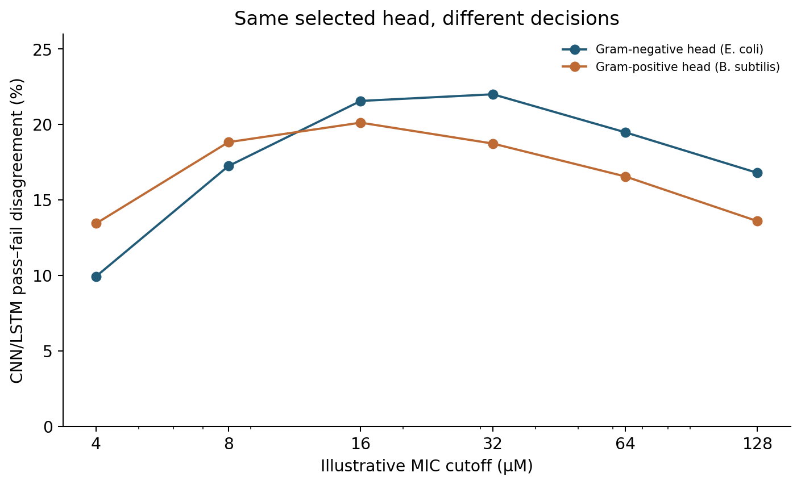
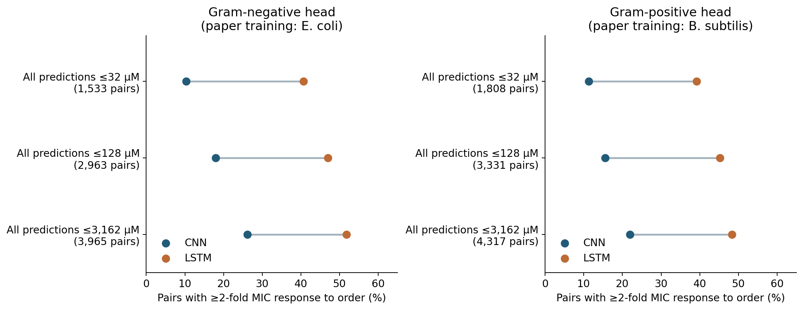
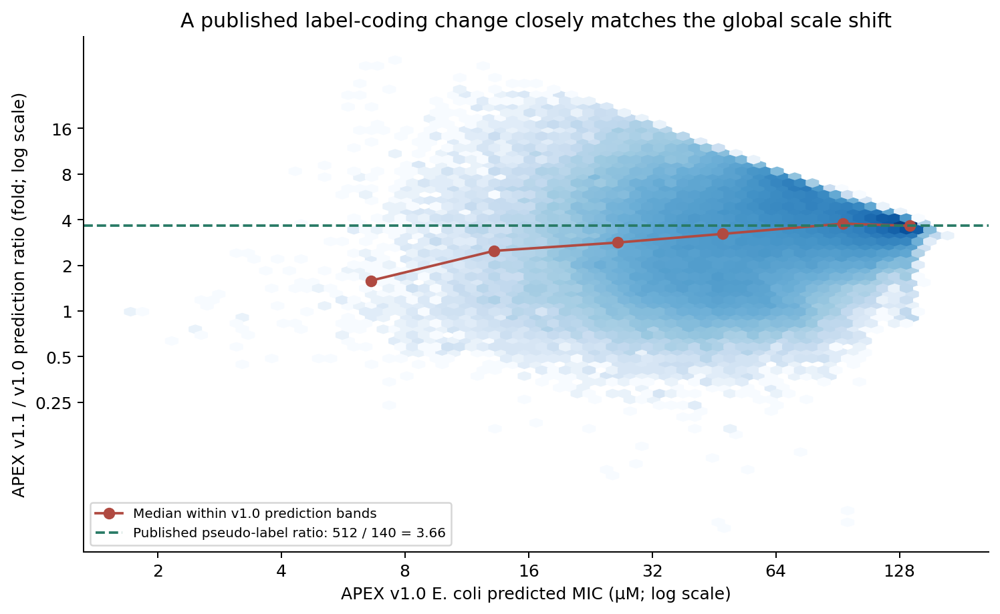

# Section 3: differences remain when the declared target is matched

This companion follows [section 3 of the final report](FINAL_ANALYSIS.md#3-differences-remain-when-the-declared-target-is-matched). It asks whether tools still recommend different peptides when their declared biological target is the same. Matching the strain or training species removes one difference; training examples, assigned labels, model weights, and input preparation can still differ.

- DeepAMP uses two model designs: a **convolutional neural network (CNN)** and a **long short-term memory network (LSTM)**. These comparisons concern the saved models, rather than every CNN or LSTM.

## 1. DeepAMP models differ within the same output head

- An **output head** is the model output trained for a particular target. DeepAMP's paper reports E. coli measurements for the head exported as “Gram-negative,” and B. subtilis for “Gram-positive.” Those broad names do not establish activity across every species in either group. Training also includes non-antimicrobial sequences with artificial high-concentration labels.

- Comparing CNN with LSTM within one head keeps the declared training species the same. This is the closer target match used here; it does not guarantee identical training records or assay conditions.

- Supporting analysis: [Model review and methods](03_matched_targets.md#model-targets-training-and-conversions).

- At **16 µM**, a **pass means predicted MIC ≤16 µM** and a **fail means >16 µM**. A disagreement means exactly one model passes.

- CNN and LSTM disagree on **41,165/190,876 sequences (21.57%)** for E. coli and **38,421/190,876 (20.13%)** for B. subtilis. Both denominators include all sequences with paired predictions, including joint passes and joint failures. These are decision differences, not experimental error rates (Figure 1).

- **Figure 1** extends the 16 µM comparison across cutoffs, always comparing CNN and LSTM for the same training species.

*Figure 1. Each line compares CNN and LSTM for one training species. Each point counts exactly-one-pass decisions divided by all 190,876 paired sequences. Changing the cutoff changes the rate, but does not remove disagreement. These illustrative concentration rules differ from DeepAMP's own activity-classification thresholds.*

- The **LSTM/CNN ratio** divides the two predictions for one peptide. One means identical predictions; above one means LSTM predicts the higher MIC. The median ratios are **1.014 for E. coli** and **0.948 for B. subtilis**, close to one.

- Yet **11,646 and 11,685 sequences**, respectively, have one prediction **≤8 µM** and the other **>32 µM**—about **6.1%** of paired sequences. Similar typical levels can coexist with large differences for individual peptides.

- The next checks reduce obvious differences in the sequences being compared. **Cysteine** is the amino acid written C. Keeping only sequences without C and of length **8–39** leaves disagreement rates of **23.01% for E. coli** and **21.07% for B. subtilis**.

- A separate check keeps one representative per related-sequence group. These groups connect observed one-residue substitutions and terminal extensions, including chains through intermediate sequences. Disagreement remains **15.14% and 14.65%**. Each percentage uses the paired sequences retained by that restriction.

- The sequence-group map omits **678 DeepAMP-eligible sequences**. Representatives reduce the influence of repeated variants, but the groups are not established independent biological families. These checks change the size of the result without removing it.

- Supporting analysis: [Decision tables](../analysis_review/outputs/screening_decision_trends/matched_target_cutoff_decisions.csv) · [coverage](../analysis_review/outputs/screening_decision_trends/matched_target_coverage.csv) · [output ratios](../analysis_review/outputs/screening_decision_trends/matched_target_output_shifts.csv) · [margin checks](../analysis_review/outputs/screening_decision_trends/cutoff_margin_sensitivity.csv).

## 2. APEX versions illustrate why the denominator matters

- Both APEX versions predict **E. coli ATCC 11775**. At the same **16 µM** rule, their **195,625 shared sequences** divide into **736 both pass**, **1,959 only the older version passes**, **626 only the newer version passes**, and **192,304 both fail**.

- Across all predictions, the versions agree on **193,040/195,625 sequences (98.68%)**. Most agreement comes from joint failures.

- Among the **3,321 peptides passing at least one version**, however, **2,585/3,321 (77.84%) pass only one**. This second denominator excludes joint failures and asks how often the versions differ among candidates either would select. High overall agreement can therefore hide a large change in screening choices.

- **Inactive pseudo-labels** are artificial concentrations assigned during training when there is no exact measured MIC for an inactive observation. APEX's assigned values changed from **140 to 512 µM** between versions. Training data and fitted models also changed, so the comparison cannot attribute the output shift to that label change alone.

- Supporting analysis: [model review's scale diagnostic](03_matched_targets.md#5-apex-label-changes-give-a-concrete-scale-hypothesis-rather-than-a-correction).

- Another check compares two peptides only when both APEX versions separate them by **more than twofold**. Just **1.47%** of those sampled pairs reverse order: one version gives the lower MIC to the first peptide while the other favors the second. Large distinctions can remain similar even when candidates near a selection boundary move into or out of a list.

- Supporting analysis: [section 1 companion](01_shortlists.md#8-a-changed-ordering-is-more-persuasive-when-the-predicted-difference-is-substantial).

## 3. What target matching resolves

- Matching a strain or training species makes the disagreement easier to interpret. It still does not isolate the effect of model design or establish correctness. The next sequence question is whether the models respond differently to changed residue order while the amino-acid counts stay fixed. Broader target-panel and source-weighting checks remain supporting analyses.

- Supporting analysis: [section 5](05_sequence_responses.md) · [preliminary analyses](PRELIMINARY_ANALYSES.md).

## Model targets, training, and conversions

- Programs are easiest to compare when they predict the same biological test. DAMP only partly meets that condition: the units may match while the training targets, sequence coverage, assigned inactive labels, and output processing differ.

- Comparing the tools' screening choices remains useful. Explaining *why* they differ requires more care. The review below checks the papers and the saved code versions; it does not reconstruct the training history of every set of model weights.

- Supporting analysis: [main analysis](FINAL_ANALYSIS.md).

### 1. The targets are related, but not interchangeable

- APEX's selected output concerns **E. coli ATCC 11775**. MBC-Attention averages repeated E. coli measurements across experimental conditions. AMPredictor also uses E. coli MIC data without the same fixed-strain output. Different shortlists therefore need not be conflicting estimates of one identical assay.

- The review did not independently reconstruct exactly when or how MBC averages its measurements. It does not assume a particular arithmetic or geometric averaging procedure.

- Supporting analysis: [APEX 1.1 methods](https://pmc.ncbi.nlm.nih.gov/articles/PMC12408343/) · [MBC-Attention methods](https://journals.asm.org/doi/10.1128/msystems.00345-23).

- The DeepAMP head names need the same qualification throughout the analysis: the paper reports **E. coli** and **B. subtilis** training measurements, rather than evidence for every species in the two Gram groups. Comparing CNN/LSTM within a head keeps that species fixed; comparing the heads changes it.

- Supporting analysis: [DeepAMP methods](https://www.nature.com/articles/s41467-023-42434-9).

- Tables keep the original column names so results can be traced to the input file. The three-tool UpSet comparison is deliberately APEX/MBC/AMPredictor. Adding DeepAMP would require a defined choice of model weights and eligible sequences, and care over related model variants; the current plot is not an intersection of every E. coli-related output.

### 2. Training examples help explain why a common cutoff is difficult

- A **training pool** is the set of examples used to fit a model. AMPredictor's paper describes **3,280 E. coli antimicrobial peptides**, all without cysteine and shorter than **40 residues**. Its code accepting a longer or cysteine-containing sequence does not establish that similar examples were used in training.

- Predictions outside that reported composition deserve caution. This is a reason to check the result, rather than evidence that cysteine itself causes disagreement.

- Supporting analysis: [AMPredictor data curation](https://elifesciences.org/articles/97330#s4).

- APEX 1.1 assigns **512 µM** to inactive observations above the tested maximum. DeepAMP assigns some non-antimicrobial examples **log10 MIC = 4**, equivalent to **10,000 µM** in the saved concentrations. These are training conventions, not exact laboratory measurements. They can shape output ranges, but their separate contributions to the observed shifts have not been isolated.

- Supporting analysis: [APEX 1.1 label handling](https://pmc.ncbi.nlm.nih.gov/articles/PMC12408343/) · [DeepAMP training](https://www.nature.com/articles/s41467-023-42434-9).

- The shared **16 µM** rule is therefore an analysis choice, rather than a recreation of each tool's own antimicrobial classification. Different pass counts do not establish which model is stricter in a biological sense or more accurate. Multiplying all outputs from a model by one positive factor can change cutoff decisions while leaving its rankings unchanged.

### 3. The order-response difference also appears below the high-output tail

- Artificial high labels raise a specific question: does the order-response contrast also appear when predictions are lower? The check keeps a pair only when both peptides' predictions from both models are at or below a stated **cap**, within one target head.

- The paired peptides contain identical amino-acid counts in different orders. A **twofold order response** means one model predicts an MIC at least twice as high for one member as for the other. Each plotted percentage divides responding pairs by pairs retained at that cap, using the count printed for that target.

- **Figure 2** follows the twofold-response fraction as the upper prediction cap changes. The printed counts show how many pairs each cap retains.

*Figure 2. Each row keeps pairs whose four predictions (two peptides × two models for one target) are at or below the cap. Points count pairs with larger/smaller MIC ≥2, divided by the retained count printed for that target. The subsets are selected using predictions; no new laboratory measurements are tested.*

- At a **128 µM cap**, **2,963 E. coli pairs** remain. Twofold responses occur in **17.95% for CNN** and **46.98% for LSTM**. Among **3,331 B. subtilis pairs**, the rates are **15.55% and 45.21%**. Each percentage uses its retained pairs, not the original **5,306** (Figure 2).

- The difference also appears below the very high outputs. Selecting on model predictions cannot establish whether inactive-label handling caused it. A stronger response is not evidence of greater biological accuracy or a general property of all models with that design.

- [Check script](../analysis_review/review_mic_model_scope.py) · [selected-pair results](../analysis_review/outputs/model_scope_review/DeepAMP_order_low_prediction_sensitivity.csv) · [full sequence report](05_sequence_responses.md).

### 4. The unit conversions have been checked at the adapter level

- The programs use different internal numerical scales. The **adapter** is the code converting each model's internal output into the saved concentration column. Here, **pMIC means −log10(MIC in µM)**; log10 expresses changes in factors of ten. The table gives the conversions already applied to the saved outputs.

| Model | Conversion to declared exported µM |
|---|---|
| APEX | `10 ** (6 − native_output)`, then mean across ensemble members on the concentration scale |
| MBC-Attention | Undo configured scale/bias, then `10 ** (−pMIC)` |
| AMPredictor | `10 ** log10_MIC` |
| DeepAMP | `10 ** log10_MIC` |

- The saved concentrations should therefore not be exponentiated again or given a second mass-to-molar conversion. **AMP-Read is excluded** from concentration comparisons because its original concentration unit and matched target remain unresolved.

- Pinned code: [APEX](https://github.com/szczurek-lab/BattleAMP-apex/blob/04600373e597842b45255418fdec391f3cb53644/predict.py#L132), [MBC](https://github.com/szczurek-lab/BattleAMP-mbc-attention/blob/df9e03fbc47714a4cf99dac5cd5fe0c572158a4f/benchmark_utils.py#L65), [AMPredictor](https://github.com/szczurek-lab/BattleAMP-ampredictor/blob/d1dd89bb730b3c524a0efbb4e0d28d556c58783e/predict.py#L216), and [DeepAMP](https://github.com/szczurek-lab/BattleAMP-deep-amp/blob/0a31ad796732b5e5874c3f92e771057e887f58a9/benchmark_utils.py#L80).

- The code checks support the conversion logic. They do not independently establish the origin or accuracy of every saved value. Replaying model inference and checking laboratory matches address different remaining questions.

- Supporting analysis: [reproducibility report](REPRODUCIBILITY.md) · [section 7](07_interpretation.md) · [review record](../analysis_review/outputs/model_scope_review/review_record.json).

### 5. APEX label changes give a concrete scale hypothesis, rather than a correction

- The **version ratio** is the newer APEX prediction divided by the older one for the same peptide. **Prediction bands** group peptides by the older version's concentration. Figure 3 asks whether one multiplier could describe the version change across both low and high predictions.

- The original APEX assigns an inactive label of **140 µM** to observations above **128 µM**; APEX 1.1 uses **512 µM** above the tested maximum. Their ratio, **3.657**, is close to the observed median E. coli version ratio of **3.628**. Dividing by this published factor puts the eight matched-target medians within **0.833–1.055**. This suggests a contributor to the shift, rather than proving its cause.

- Supporting analysis: [Original APEX methods](https://pmc.ncbi.nlm.nih.gov/articles/PMC11310081/) · [APEX 1.1 methods](https://www.nature.com/articles/s41564-025-02061-0).

- **Figure 3** checks whether the version ratio stays near that fixed multiplier across the older model's predicted concentration range.

*Figure 3. Hexagons group the saved E. coli newer/older prediction ratios; red points give medians within bands of the older prediction. The dashed line marks the published 512/140 training-label ratio. The observed ratio changes with prediction level, so one multiplier does not describe every peptide.*

- The ratio is not constant in **Figure 3**. It has median **1.58** among **230 peptides** predicted at **≤8 µM** by APEX 1.0, versus **3.65** among **28,618** predicted above **128 µM**. Grouping a ratio by its own denominator can itself create a pattern. Changes in data and fitted models also remain possible causes; controlled retraining would be needed to separate them.

- Supporting analysis: [Target-level sensitivity](../analysis_review/outputs/sanity_checks/apex_pseudolabel_scale_sensitivity.csv) · [prediction bands](../analysis_review/outputs/sanity_checks/apex_pseudolabel_scale_by_prediction_regime.csv).

- A final check asks whether large disagreement clusters near the artificial inactive label. The **high-disagreement tail** is the 5% with the largest cross-model log2 spread; the middle group contains the sequences between the two 5% tails. APEX predictions **≥500 µM** occur in **6.65%** of the high tail versus **9.11%** of the middle group.

- Some predictions exceed **512 µM**, so this label is not a hard ceiling. This check does not support a simple explanation in which all large disagreements come from predictions near that value.

- Supporting analysis: [Proximity check](../analysis_review/outputs/inactive_label_proximity.csv).
