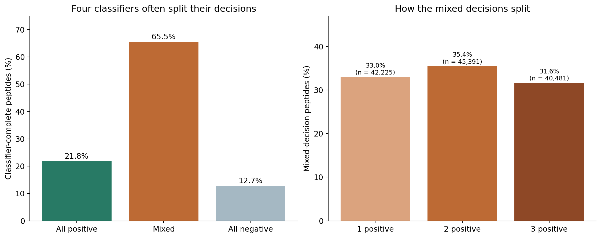
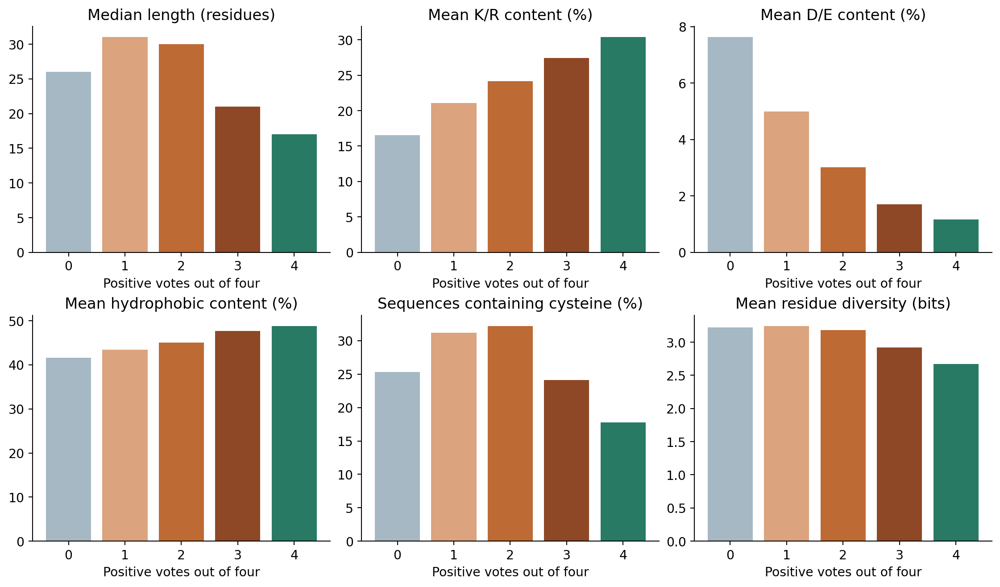
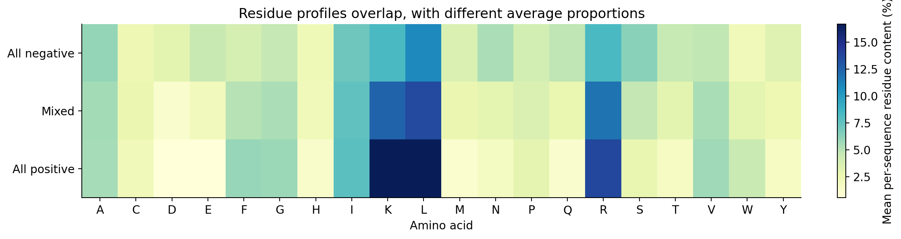
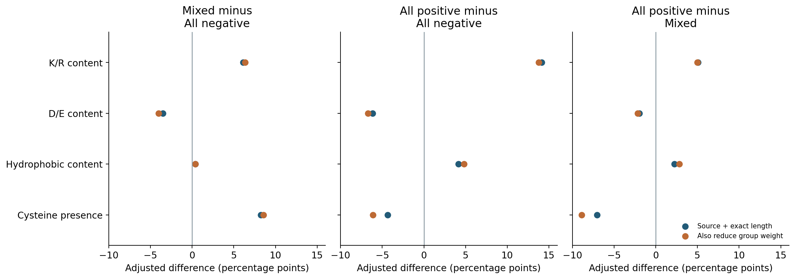
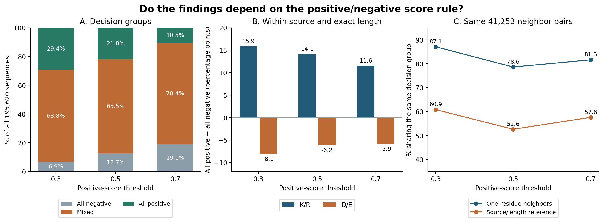
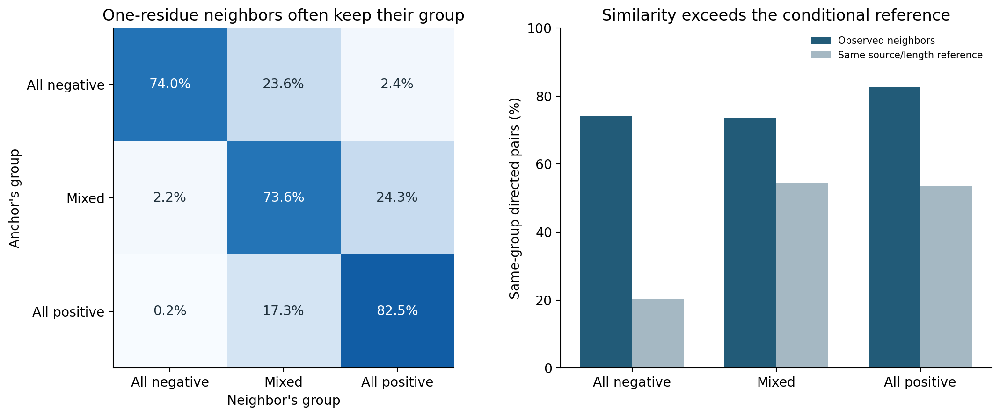

# Section 4: general activity classifiers often split their decisions

This companion follows [section 4 of the final report](FINAL_ANALYSIS.md#4-general-activity-classifiers-often-split-their-decisions). It asks how often four activity classifiers agree, whether their decision groups contain different kinds of sequences, and whether nearly identical sequences tend to receive similar decisions. These are predictions, rather than measured antimicrobial activity.

- These classifiers give activity scores or labels, rather than MIC concentrations. Differences in residue content below are reported in **percentage points**: 30% minus 20% is 10 points.

## 1. Mixed decisions include three substantially represented groups

- The comparison uses **195,620 sequences** with outputs from MACREL, AI4AMP, AMP-CLIP, and AMPlify. The baseline rule calls a score **≥0.5 positive** and **<0.5 negative**. “All positive” means four positive votes, “all negative” means zero, and “mixed” means one, two, or three.

- AMP-CLIP already gives binary 0/1 outputs. The other scores have not been established as comparable probabilities of activity, so applying a common number is an illustrative decision rule.

- **Figure 1** first shows the three overall decision groups, then expands the mixed group into its one-, two-, and three-positive vote counts.

*Figure 1. Left: the denominator is all 195,620 classifier-complete sequences. Right: the denominator is the 128,097 mixed sequences. The mixed bars sum to 100% of that subset; they do not divide by the full collection.*

| Positive votes | Sequences | Of all complete sequences | Of the mixed group |
|---|---:|---:|---:|
| 0 — all negative | 24,878 | 12.72% | — |
| 1 | 42,225 | 21.59% | 32.96% |
| 2 | 45,391 | 23.20% | 35.43% |
| 3 | 40,481 | 20.69% | 31.60% |
| 4 — all positive | 42,645 | 21.80% | — |

- The mixed group contains substantial numbers with one, two, and three positive votes (Figure 1). It is not mainly a single dissenting model or a two-versus-two split. The linked 16-pattern table keeps track of *which* classifiers vote positive, information that vote totals alone lose.

- Supporting analysis: [16-pattern table](../analysis_review/outputs/screening_decision_trends/classifier_vote_patterns.csv) · [single-dissent counts](../analysis_review/outputs/screening_decision_trends/classifier_single_dissent.csv) · [Vote totals](../analysis_review/outputs/classifier_sequences/vote_counts.csv).

## 2. The groups share residues, but in different proportions

- The next table compares amino-acid content, giving each peptide equal influence. **K/R content** is the percentage of residues that are lysine (K) or arginine (R); **D/E content** is the percentage that are aspartic acid (D) or glutamic acid (E). Each percentage counts those residues and divides by peptide length.

- **Hydrophobic content** counts A/I/L/M/F/W/V/Y residues, a selected set with water-avoiding properties. **Cysteine presence** is the percentage of peptides containing any cysteine (C), rather than their average C content.

| Sequence summary | All negative | Mixed | All positive |
|---|---:|---:|---:|
| Median length, residues | 26 | 26 | 17 |
| Mean K/R content | 16.52% | 24.18% | 30.36% |
| Mean D/E content | 7.62% | 3.25% | 1.16% |
| Mean hydrophobic content | 41.62% | 45.33% | 48.79% |
| Sequences containing cysteine | 25.33% | 29.31% | 17.78% |

- More positive votes generally accompany more K/R and less D/E. The **charge proxy** `(K+R−D−E)/length` combines those counts. It is only a sequence summary: it omits histidine, pH, terminal chemistry, and modifications, so it is not a measured molecular charge.

- **Residue diversity** measures how evenly the amino-acid types are represented. The plot expresses this as Shannon composition entropy in bits. It describes the mix of ingredients, rather than folding or structural complexity.

- **Figure 2** follows these features across all five vote counts, rather than combining the three mixed groups.

*Figure 2. Every bar summarizes its own vote-count group. Length uses the median; content and diversity use the average across peptides; cysteine presence counts peptides containing C. Diversity measures the mix of residues, not structural complexity. Length and cysteine do not rise or fall steadily with votes.*

- **Figure 2** also shows variation inside the mixed group. One- and two-positive groups have median lengths **31 and 30**, versus **21** for three-positive peptides and **17** for all-positive peptides. Mean K/R content rises **21.07% → 24.17% → 27.43%** across the mixed groups. Cysteine presence peaks around one and two votes instead of falling steadily.

- **Figure 3** expands the K/R and D/E summaries to each amino-acid type. Its cell colors show the mean percentage for that residue within each decision group.

*Figure 3. Each cell averages a residue's fraction separately within each sequence, then across sequences in that decision group. Longer peptides therefore do not automatically contribute more weight. The exported table also includes a separately labelled pooled-residue calculation.*

- The groups overlap in composition (Figures 2–3). The middle half of K/R fractions spans **9.1–22.5% in all-negative**, **16.7–31.0% in mixed**, and **21.4–38.5% in all-positive** peptides. All groups include peptides with and without cysteine. These averages do not define an exclusive motif or identify correct activity labels.

- Supporting analysis: [Profiles and quartiles](../analysis_review/outputs/classifier_sequences/sequence_profiles.csv) · [residue composition](../analysis_review/outputs/classifier_sequences/residue_composition.csv) · [sequence-level annotations](../analysis_review/outputs/classifier_sequences/sequence_groups.csv.gz).

## 3. Length and source do not account for the whole K/R and D/E contrast

- All-positive peptides are shorter, and the source collections contain different sequence types. To reduce those differences, the next check compares groups only within the **same source and exact length**. Each category must contain both decision groups. This is a descriptive adjustment, rather than an experiment that assigns labels.

- A **matched contrast** subtracts one group's mean content from the other's within each shared source/length category. It then averages the differences, weighting each category by its smaller group count. For all-positive minus all-negative, a positive value means higher content in the all-positive group. MIC and classifier score are not additional matching criteria.

- After this adjustment, all-positive peptides still have **14.13 percentage points more K/R** and **6.15 points less D/E**. K/R is higher and D/E lower within every source, although the available comparison is small in some.

- **Common support** means categories containing both groups. Here, **245 categories** contain **23,039 all-negative** and **34,051 all-positive** sequences. Adding the smaller group count in each category gives **12,617**, a measure of matching capacity rather than independent experiments. This capacity is only **39 for Venomics** and **43 for Archaeomics**.

- **Related-sequence groups** connect observed one-residue substitutions and additions at a sequence end, including chains through intermediate members. Giving large groups less weight checks whether many similar variants drive the result. These groups are not verified evolutionary families.

- **Figure 4** compares the source/length contrasts with and without reducing large related groups' influence. The comparison asks which directions survive those changes in weighting.

*Figure 4. Points subtract the named left group's mean from the right group's, in percentage points. Blue gives peptides equal weight within shared source/length categories; orange also reduces large related groups' influence. Each comparison uses categories containing both groups. Points are differences, not confidence intervals.*

- The map covers **194,947** of the classifier-complete sequences; **673 unmapped sequences** are excluded from this weighting check. Each mapped sequence receives weight **1 divided by its group's size within that source**.

- The all-positive-minus-all-negative differences remain **+13.77 points in K/R** and **−6.70 in D/E** (Figure 4). Summed weights are amounts of influence, not numbers of independent samples.

- Other features are less consistent. Mixed peptides have **3.71 percentage points more hydrophobic content** than all-negative peptides before matching, but only **0.39 points** within shared source/length categories. Much of the initial difference reflects which sequences the groups contain.

- Cysteine can also reverse direction between sources: in marlys, **98.9% of all-positive** versus **67.7% of all-negative** peptides contain C. These patterns argue against a universal residue rule.

- Supporting analysis: [Matched contrasts and support](../analysis_review/outputs/classifier_sequences/source_length_matched_contrasts.csv) · [within-source contrasts](../analysis_review/outputs/classifier_sequences/within_source_length_contrasts.csv) · [source profiles](../analysis_review/outputs/classifier_sequences/source_profiles.csv).

## 4. Do two other positive/negative definitions change the findings?

- The **0.5 boundary** is an analysis choice. Two checks change the meaning of a positive and negative vote while keeping the same **195,620 sequences**:

- **More permissive:** positive means score **≥0.3**, negative means **<0.3**.
- **Stricter:** positive means score **≥0.7**, negative means **<0.7**.

- The group definitions stay the same: four positives, zero positives, or mixed votes. **AMP-CLIP stays fixed** because it is binary. A score of 0.3 or 0.7 should not be read as a 30% or 70% probability of activity; these rules are not established equivalent operating points across the tools.

- Every percentage in the next table uses **195,620 sequences**. The starting set stays fixed, so the changes come from the decision rules rather than missing scores.

| Positive-score threshold | All negative | Mixed | All positive |
|---|---:|---:|---:|
| 0.3 | 13,409 (6.85%) | 124,748 (63.77%) | 57,463 (29.37%) |
| 0.5 | 24,878 (12.72%) | 128,097 (65.48%) | 42,645 (21.80%) |
| 0.7 | 37,305 (19.07%) | 137,698 (70.39%) | 20,617 (10.54%) |

- The stricter rule reduces unanimous positives, but **mixed decisions remain the majority under both alternatives**. It changes candidate selection without establishing which rule is more accurate.

- Repeating the source/length comparison gives the same direction of sequence differences. All-positive minus all-negative K/R content is **+15.87 points at 0.3**, **+14.13 at 0.5**, and **+11.56 at 0.7**. D/E differences are **−8.10, −6.15, and −5.86 points**, respectively. The sizes and group memberships change, but the K/R and D/E directions persist.

- **One-residue neighbors** are equal-length peptides from the same source differing at exactly one amino-acid position. The same **41,253 observed pairs** are used under every rule.

- The **source/length reference** asks how often a pair would share a group if a comparison peptide were chosen from the same source and exact length, without requiring that one-residue similarity. It excludes the starting peptide itself and is recalculated after each rule changes the groups.

- At **0.3**, **87.05%** of neighbors share a group versus **60.86%** under that reference. At **0.5**, the figures are **78.60% versus 52.64%**; at **0.7**, **81.62% versus 57.62%**. Changed group sizes can raise raw agreement, but the observed rate exceeds its own reference under every rule (Figure 5).

- **Figure 5** brings these checks together: group proportions on the left, matched K/R and D/E contrasts in the middle, and neighbor agreement against its recalculated reference on the right. The neighbor definitions and dependence limits are developed further in section 5.

*Figure 5. Positive means score ≥ the horizontal-axis value; negative means below it. Left: percentages of all 195,620 sequences. Middle: all-positive minus all-negative content, in percentage points, comparing shared source/length categories separately for each rule. Right: percentages of the same 41,253 pairs sharing their decision group, compared with each rule's reference. These are descriptive results, not biological error rates or confidence intervals.*

- The main composition and neighbor-similarity findings survive these two changes to the 0.5 rule. This does not establish that every possible definition would agree, make related peptides independent, or turn scores into calibrated probabilities.

- Supporting analysis: [Vote counts](../analysis_review/outputs/classifier_sequences/rule_sensitivity/vote_counts.csv) · [matched contrasts and support](../analysis_review/outputs/classifier_sequences/rule_sensitivity/matched_contrasts.csv) · [neighbor results](../analysis_review/outputs/classifier_sequences/rule_sensitivity/neighbor_similarity.csv) · [changes from the baseline groups](../analysis_review/outputs/classifier_sequences/rule_sensitivity/group_transitions.csv) · [definitions and checks](../analysis_review/outputs/classifier_sequences/rule_sensitivity/manifest.json) · [script](../analysis_review/classifier_rule_sensitivity.py).

## 5. One-residue neighbors usually retain the decision group

- The baseline **0.5** analysis examines the neighbor result more closely. The **41,253 pairs** span **3,354 connected groups**, joined directly or through observed sequence links. The catalogue was built on peptides with complete MIC predictions; it is not an exhaustive neighbor search over all **195,620** classifier-complete sequences.

- **Local continuity** here simply means that changing one residue usually leaves the pair in the same all-positive, mixed, or all-negative group.

- The reference is the same source/length comparison defined in section 4. For each starting peptide, it calculates expected group agreement with another peptide from that source and exact length, excluding itself. The two starting-peptide references are averaged for each observed pair.

- At **0.5**, **78.60%** of pairs share the same all-positive/mixed/all-negative group, **69.93%** keep the same number of positive votes, and **68.75%** keep all four classifiers' individual decisions. These are different questions: two mixed peptides can have the same vote count but different models voting positive.

- **Figure 6** shows which groups one-residue neighbors move between on the left, and compares their observed agreement with the source/length reference on the right.

*Figure 6. Left: start with the group named on a row and ask which groups its neighbors occupy. Each pair is read in both directions, so row percentages use different starting-group counts and are related observations. Right: observed group agreement versus choosing another peptide from the same source and exact length, excluding the starting peptide itself.*

- The observed **78.60%** group agreement exceeds the **52.64%** source/length reference (Figure 6). Excluding the starting peptide's entire related group from the reference lowers it to **50.20%**. Observed agreement exceeds the source/length reference in every source. This shows local structure in the decisions, without identifying its biological cause or the role of training exposure.

- Pairs can reuse peptides or come from the same related group. To reduce large groups' influence, one check gives every group the same total weight: agreement is **89.36% observed versus 52.57% reference**. Keeping one pair per group, chosen from sequence text without predictions, gives **88.94% versus 52.61%** across **3,354 pairs**.

- These are alternative summaries of the same related observations, not independent biological replications or confidence intervals.

- Direct all-positive-to-all-negative changes occur in **73/41,253 pairs (0.177%)**, across **11 groups**. The three largest groups supply **62 of those 73**. All four individual classifier decisions change in **86 pairs overall**, since some mixed patterns can also reverse every vote. These are sharp prediction changes, not measured jumps in activity.

- Supporting analysis: [Neighbor summaries](../analysis_review/outputs/classifier_sequences/neighbor_similarity.csv) · [directed transitions](../analysis_review/outputs/classifier_sequences/neighbor_group_transitions.csv) · [individual pairs](../analysis_review/outputs/classifier_sequences/one_substitution_pairs.csv.gz) · [source checks](../analysis_review/outputs/classifier_sequences/neighbor_by_source.csv) · [vote-change counts](../analysis_review/outputs/classifier_sequences/neighbor_decision_changes.csv).

## 6. What this adds to screening

- The classifiers' decisions have structure: their groups differ in average composition, and nearly identical sequences often share a group. The profiles still overlap. Neither unanimous positive votes nor local similarity proves that a peptide is active.

- **Retention** asks how many of a MIC model's original **1,950 shortlisted candidates** survive an extra filter, divided by that original list size. Requiring all four classifiers to vote positive retains **76.97% of APEX's**, **29.23% of MBC's**, and **22.41% of AMPredictor's** list.

- The filter therefore favors some models' candidates more than others. That is a pipeline effect, rather than independent confirmation of their MIC accuracy.

- Supporting analysis: [Retention results](../analysis_review/outputs/additional_trends/classifier_filter_retention.csv).

- The linked scripts and checks preserve the definitions and calculations. A separate recalculation verified vote totals, the matched K/R estimate, neighbor reference sets, and changed model decisions. These checks establish calculation consistency; testing whether the profiles improve biological selection requires an independent laboratory panel.

- Supporting analysis: [analysis script](../analysis_review/classifier_sequence_analysis.py) · [definitions and input hashes](../analysis_review/outputs/classifier_sequences/manifest.json) · [implementation checks](../analysis_review/outputs/classifier_sequences/checks.csv) · [independent recalculation](../analysis_review/outputs/classifier_sequences/independent_verification.json) · [reproducibility report](REPRODUCIBILITY.md).
