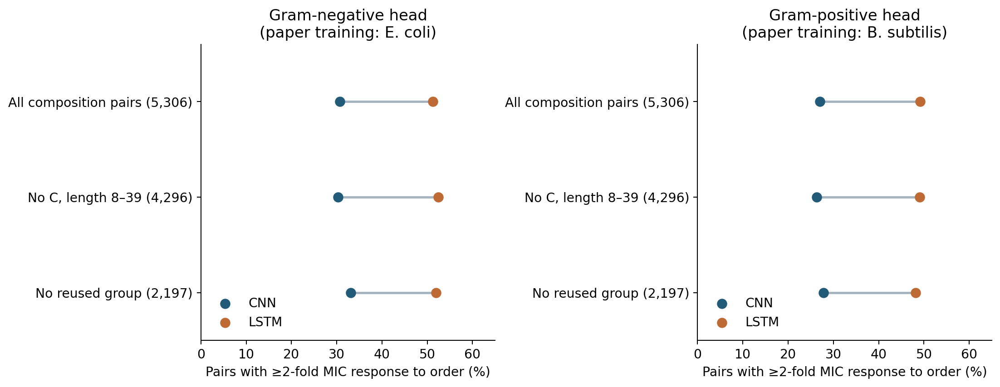
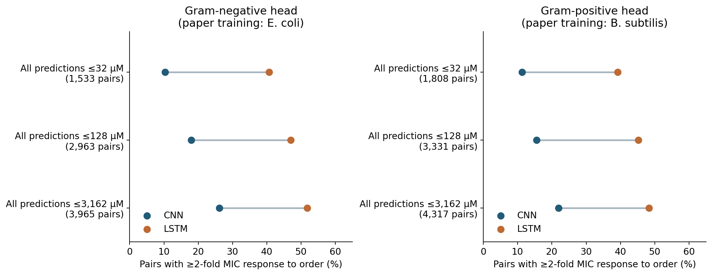
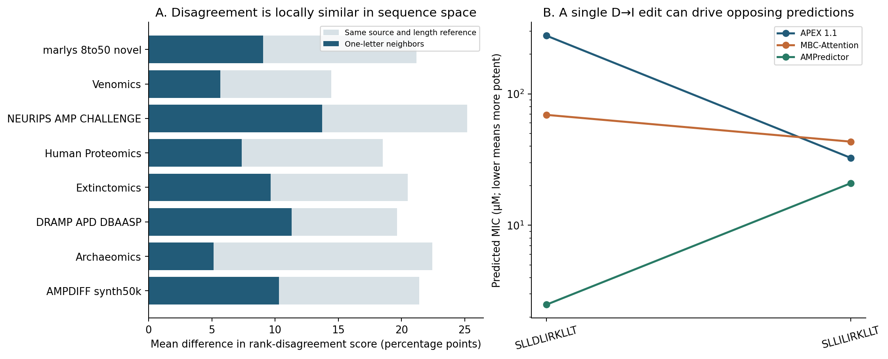
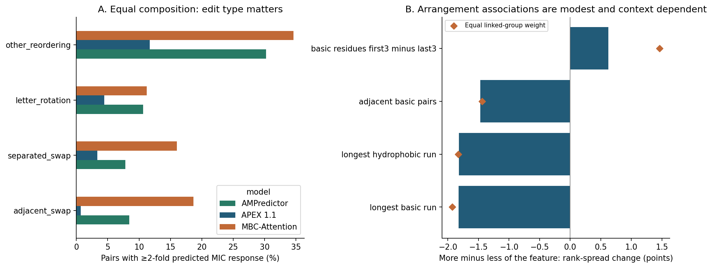
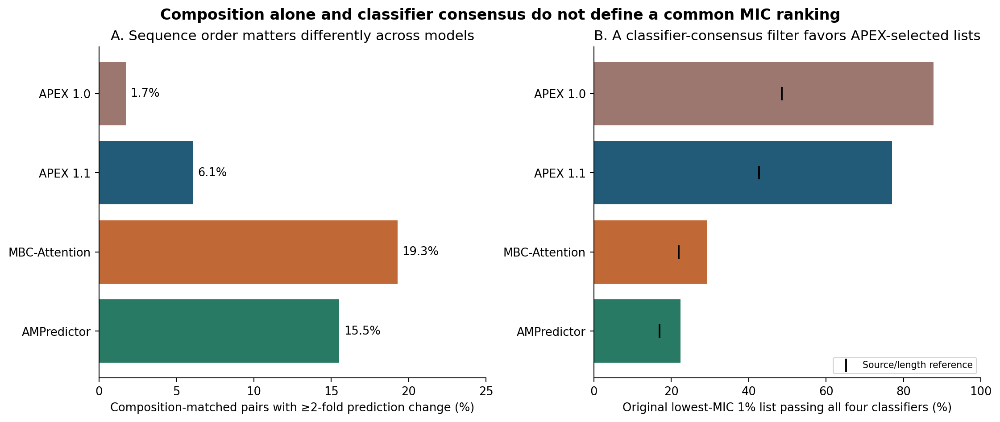

# Section 5: sequence order affects models differently even for the same target

This companion follows [section 5 of the final report](FINAL_ANALYSIS.md#5-sequence-order-affects-models-differently-even-for-the-same-target). It asks how saved predictions change when residue order changes or a small sequence edit is made. Classifier-group profiles are examined separately in [section 4](04_classifier_sequences.md).

- A peptide is an ordered chain of amino acids. Rearranging the same ingredients can test sensitivity to order; replacing or adding an ingredient asks a different question. The comparisons below keep those questions separate.

- The comparisons distinguish the amino-acid ingredients (**composition**) from their order in the chain. This matters because replacing an ingredient and rearranging the same ingredients test different model responses.

- The clearest finding is that models respond differently to changed order. One-residue neighbors also tend to have similar disagreement scores, with a few strong exceptions. These are patterns in predictions; they do not measure effects on bacterial growth.

- Supporting analysis: [main report](FINAL_ANALYSIS.md).

## 1. The same ingredients can receive different predictions

- The order comparison uses **5,306 observed pairs from the same source**, with identical counts of every amino acid. Length and any summary based only on those counts stay fixed. Each sequence appears in only one pair, although related groups can supply more than one pair.

- The fixed summaries include a **charge proxy**, `(K+R−D−E)/length`, where K/R are lysine/arginine and D/E are aspartic acid/glutamic acid. They also include **hydrophobic content**, the fraction of A/I/L/M/F/W/V/Y residues, and **residue diversity**, how evenly amino-acid types are represented. These summaries do not measure pH-dependent charge or folding.

- DeepAMP uses a **convolutional neural network (CNN)** and a **long short-term memory network (LSTM)**. An **output head** is the output trained for a particular target. Within each head, CNN and LSTM predict the same paper-reported training species.

- The saved “Gram-negative” head used **E. coli** measurements; “Gram-positive” used **B. subtilis**. Those names do not establish activity across every species in the two groups.

- A **twofold response** means that, within a pair, the larger predicted MIC is at least twice the smaller. Each percentage in the next table counts responding pairs and divides by **5,306**. It measures response size, not whether the response is biologically correct.

| DeepAMP output | CNN | LSTM |
|---|---:|---:|
| “Gram-negative” — paper: E. coli | 30.74% | 51.23% |
| “Gram-positive” — paper: B. subtilis | 27.04% | 49.15% |

- **Figure 1** compares those full-set response frequencies with restrictions on length, cysteine, and reuse of related sequence groups.

*Figure 1. The contrast remains after restricting length/cysteine content and after selecting 2,197 pairs without reusing either observed sequence group. The points count predicted responses, not correctly predicted biological changes.*

- **Figure 1** shows a more frequent LSTM response. This holds in **seven of eight sources**; the smaller marlys set, with **86 pairs**, is the exception. Both models read ordered inputs, so some response to order is expected.

- The finding is that these saved models respond at different frequencies. It does not establish that LSTMs generally understand biological order better. Training choices, prediction ranges, and artificial inactive labels remain possible contributors.

- A narrower check asks whether very high predictions drive the difference. A **cap** is the maximum allowed prediction: at **128 µM**, both peptides' predictions from both models must be **≤128 µM**, within the same target head. Each response percentage then uses the pairs retained for that target and cap, rather than all **5,306**.

- **Figure 2** follows the CNN/LSTM response contrast as the prediction cap changes, making the reduction in eligible pairs explicit.

*Figure 2. At a 128 µM cap, 2,963 E. coli-head pairs give rates of 17.95% for CNN and 46.98% for LSTM; 3,331 B. subtilis-head pairs give 15.55% and 45.21%. These are output-selected subsets, not a causal test of inactive-label handling or independent laboratory validation.*

- The CNN/LSTM difference also appears below the very high outputs (Figure 2). This does not establish whether artificial inactive labels caused it, because the restriction itself selects pairs using model predictions.

- Supporting analysis: [cap-specific table](../analysis_review/outputs/model_scope_review/DeepAMP_order_low_prediction_sensitivity.csv) · [model review](03_matched_targets.md#model-targets-training-and-conversions).

- The linked methods and pair tables give the exact sequence restrictions and counts, so the order comparison can be traced to individual pairs.

- Supporting analysis: [controlled-pair methods](METHODS.md#controlled-sequence-order-comparison) · [pair-level data](../analysis_review/outputs/screening_decision_trends/DeepAMP_composition_controlled_pairs.csv) · [response summaries](../analysis_review/outputs/screening_decision_trends/DeepAMP_composition_controlled_order.csv).

## 2. Neighboring sequences usually have similar disagreement, with sharp exceptions

- The next comparison uses **41,253 same-source pairs differing at exactly one amino acid**, across **3,354 linked groups**. A linked group joins observed substitutions and additions at sequence ends, directly or through other members. Pairs can reuse sequences and are not independent experiments.

- This comparison uses APEX 1.1, MBC-Attention, and AMPredictor. Their E. coli targets are related but not identical, so interpretation is less direct than CNN/LSTM within one target.

- A **percentile** expresses a peptide's position among the **194,947 shared sequences** for one model; lower means more favorable in its lowest-MIC-first ordering. The **rank-gap score** is that peptide's highest minus lowest model percentile, on a **0–100 scale**. A gap of **40** means a **40-percentage-point placement difference**, not a probability of error.

- The **source/length reference** asks how similar disagreement scores would be when comparing with another peptide from the same collection and exact length, without requiring a one-residue difference and excluding the starting peptide itself. Both members of each observed pair supply a starting-peptide reference, and the two are averaged. The difference in scores is taken as an absolute value, so opposite signs cannot cancel.

- One-residue neighbors differ in rank-gap score by about **11 percentage points on average**, versus **21 points** for the reference (Figure 3). The pattern appears in all eight sources and when large related groups receive less weight. These are differences between disagreement scores, not MIC changes.

- **Figure 3** shows the ordinary neighbor-versus-reference comparison on the left and an unusual opposing-response example on the right.

*Figure 3. Left: one-letter neighbors have more similar rank-gap scores than the source/length reference. Right: the selected D-to-I edit illustrates an exception, not the average edit.*

- **Figure 3** also shows an exception: **SLLDLIRKLLT → SLLILIRKLLT**. APEX predicts an MIC decrease from about **277 to 33 µM**, while AMPredictor predicts an increase from **2.5 to 21 µM**—roughly eightfold changes in opposite directions.

- Across all observed one-residue pairs, these two tools make at least twofold opposing changes in **298/41,253 cases (about 0.72%)**, spanning **41 linked groups**. Strong exceptions occur, but they are uncommon under this rule.

- The methods record the reference, weighting, and example selection. Neighboring peptides also share most ingredients and may share training exposure, so local similarity does not identify a biological mechanism or the correct prediction.

- Supporting analysis: [sequence-neighborhood analysis](METHODS.md#sequence-level-disagreement-extension).

## 3. Small order edits matter, but simple residue rules do not follow

- A narrower order check uses **285 pairs** that swap neighboring residues. With ingredients fixed, twofold prediction changes occur in **53 pairs for MBC (18.6%)**, **24 for AMPredictor (8.4%)**, and **two for APEX 1.1 (0.7%)**. Every percentage uses **285 pairs**. Greater response frequency does not establish greater accuracy.

- A **run** is a consecutive stretch of a chosen residue type; “basic” means K/R here. The next plot asks whether having more of such a feature accompanies a different rank-gap score when composition stays fixed. It subtracts the score of the member with less of the feature from the score of the member with more. A negative value means less rank disagreement in the latter.

- **Figure 4** separates responses to observed rearrangement types from associations with these simpler arrangement features. Its edit categories have different pair counts.

*Figure 4. Left: each percentage uses that edit category's pair count. The adjacent-swap-only category has 284 pairs; adding one pair also classed as a rotation gives the 285 above. Categories are observed groups, not matched experiments on edit size. Right: rank-gap differences for the member with more of a feature are small, around two percentage points or less. Diamonds give large related groups less influence. “Basic” means K/R; a run is a consecutive stretch.*

- The simple arrangement clues are weaker (Figure 4). A longer hydrophobic run accompanies only about a **two-percentage-point decrease** in rank-gap score. Cysteine and charge associations change with the disagreement definition and group weighting.

- Among **1,667 edits introducing a first cysteine**, three related groups supply about **55%** of cases. AMPredictor's reported training examples exclude cysteine. That raises a question about unfamiliar inputs; it does not demonstrate a cysteine-specific biological effect.

- Models respond to more than amino-acid counts, but the checks do not reveal a universal motif or a simple charge/cysteine rule. Laboratory measurements of controlled variants would be needed to test whether the predicted responses are appropriate.

- Supporting analysis: [model report](03_matched_targets.md#model-targets-training-and-conversions) · [sequence tables](../analysis_review/outputs/sequence_disagreement) · [validation findings](07_interpretation.md#2-existing-assay-matches-do-not-identify-a-winner).

## 4. Terminal changes give a second view of local sensitivity

- A **terminal extension** adds residues at one end, changing both length and composition. Among **92,225 observed extension pairs**, APEX 1.1 and AMPredictor both change at least twofold in **400**, with opposing directions in **147**.

- The opposing rate is **36.8% of those 400 strong-response pairs**, but only **0.159% of all eligible extensions**. Both denominators matter. Pairs reuse sequences and groups; the examples are prediction changes, not measured activity cliffs.

- Supporting analysis: [Extension-response summaries](../analysis_review/outputs/terminal_extension_prediction_changes.csv) · [opposing examples](../analysis_review/outputs/opposed_extension_examples.csv).

- A more controlled check uses **2,222 pairs** with the same sequence core and the same added residue, placed at opposite ends. Their composition is identical. Twofold prediction changes occur in **4.05% for APEX 1.1**, **9.90% for MBC**, and **10.62% for AMPredictor**.

- A **signed effect** retains which terminal placement receives the higher prediction. Its median is close to zero, so the analysis finds no universally favored end. These pairs overlap the other composition comparisons, and sequence text alone does not establish terminal chemistry.

- Supporting analysis: [Terminal-position results](../analysis_review/outputs/additional_trends/terminal_position_summary.csv).

- The earlier three-tool order comparison uses **5,410 same-source groups with exactly two sequences of identical composition**, slightly more than the DeepAMP-complete subset. Twofold responses occur in **6.10% for APEX 1.1**, **19.28% for MBC**, and **15.53% for AMPredictor**.

- Different biological targets, training choices, and prediction ranges complicate explanations across these model families. The main report therefore emphasizes CNN/LSTM comparisons within one target. Figure 5 retains the broader comparison as supporting evidence.

- Supporting analysis: [Original composition summaries](../analysis_review/outputs/additional_trends/composition_matched_order_sensitivity.csv) · [source restrictions](../analysis_review/outputs/additional_trends/composition_matched_by_source.csv).

- The right panel of **Figure 5** concerns a different screening step. A classifier gives an antimicrobial-activity label; a positive vote here uses score **≥0.5**. **Filter retention** counts shortlisted peptides passing all four classifiers and divides by that MIC model's original **1,950-candidate list**. The black reference marks estimate retention from source and length preferences alone.

- **Figure 5** places the earlier cross-family order-response results alongside the effect of the classifier filter. Each panel therefore uses its own denominator.

*Figure 5. Left: twofold responses among 5,410 pairs with identical amino-acid counts, including the older APEX version for context. Right: the fraction of each original 1,950-candidate MIC list passing all four classifiers; black marks give source/length reference rates. The panels show prediction responses and a later filtering step. Neither identifies the most accurate model or the cause of a training difference.*

## 5. Related sequences and opposite model preferences qualify the pooled result

- An **extreme tail** is a small set selected for especially high or low disagreement, rather than a separate biological class. An early check found a one-residue neighbor somewhere in the dataset for **117/200 selected extreme sequences (58.5%)**, versus **90/200 source/length-matched controls (45.0%)**.

- That observation motivated stronger checks on repeated variants. The selected examples, shared neighbors, and incomplete map of related sequences do not show that repeated variants cause disagreement or provide 200 independent observations.

- Supporting analysis: [Neighbor summary](../analysis_outputs/sequence_neighbor_summary.csv) · [controls](../analysis_outputs/sequence_neighbor_controls.csv).

- DeepAMP models also sometimes favor opposite orders. A stricter check keeps only pairs with **more than twofold responses in both CNN and LSTM**: **937 E. coli pairs** and **843 B. subtilis pairs**. They favor opposite members in **335/937 (35.75%)** and **284/843 (33.69%)**, respectively.

- These percentages apply only to pairs where both models respond strongly, not all **5,306 pairs**. This check uses **more than twofold**, while the main response tables use **at least twofold**.

- Supporting analysis: [Direction summaries](../analysis_review/outputs/screening_decision_trends/DeepAMP_order_direction_agreement.csv).

- Another check compares peptides passing only CNN with those passing only LSTM. At **16 µM**, **pass means predicted MIC ≤16 µM** and fail means **>16 µM**. “CNN-only” therefore means CNN passes while LSTM fails.

- Within the same source and exact length, CNN-only peptides have about **1.99 percentage points more K/R for E. coli** and **2.96 points more for B. subtilis**. Other features change by target and adjustment. These are profiles of model-selected groups, not causal residue effects or a validated motif.

- Supporting analysis: [Directional profiles and overlap support](../analysis_review/outputs/screening_decision_trends/DeepAMP_directional_sequence_profiles.csv).

- Broader high/low-disagreement profiles deserve less emphasis: their length trends reverse when disagreement is defined differently, and cysteine-edit directions change when related groups receive different weight. The supporting reports retain those results and a related Venomics weighting reversal. They explain why controlled pair comparisons carry more weight than a broad sequence rule.

- Supporting analysis: [agreement report](PRELIMINARY_ANALYSES.md#agreement-definitions-and-profiles) · [wider output report](PRELIMINARY_ANALYSES.md#wider-output-patterns).
