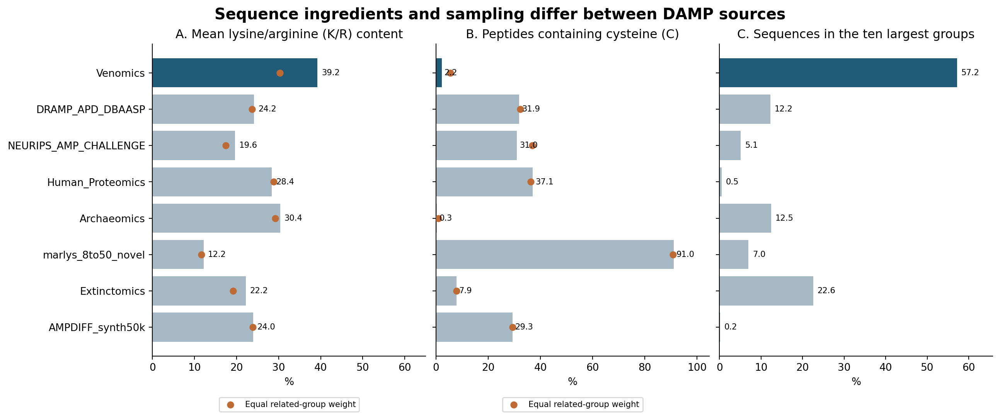
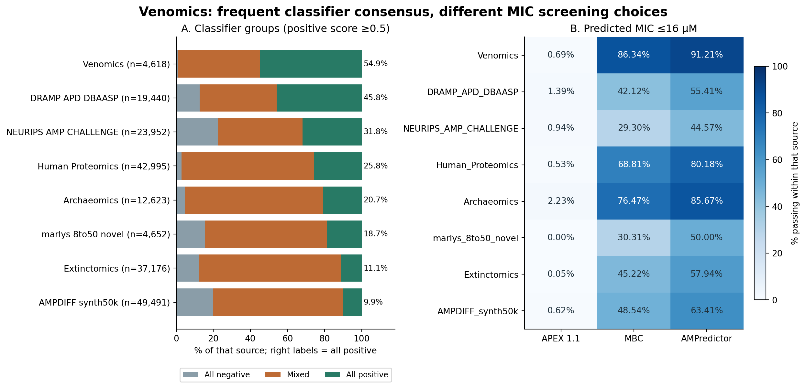
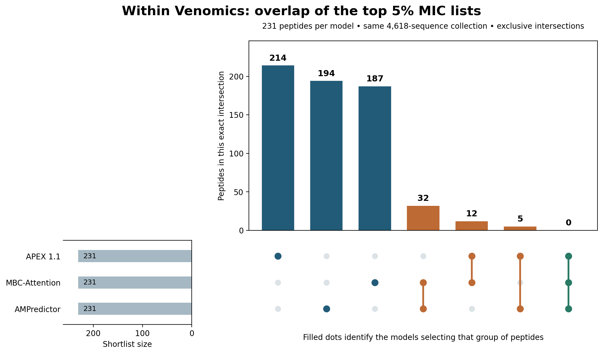
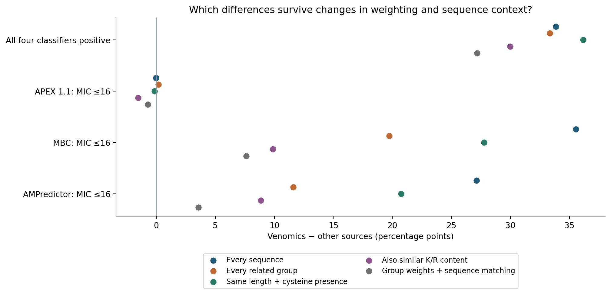

# Section 6: Venomics gets more unanimous positive votes, while MIC shortlists differ

This companion follows [section 6 of the final report](FINAL_ANALYSIS.md#6-venomics-gets-more-unanimous-positive-votes-while-mic-shortlists-differ). It asks what distinguishes DAMP's Venomics collection from the other seven sources, and which differences survive checks for length, composition, and repeated variants.

## 1. What is being compared?

- The comparison uses the **194,947 sequences with all three primary MIC predictions**, which also have all four classifier outputs and a related-sequence group assignment. **Venomics contributes 4,618; the other sources contribute 190,329.** All Venomics sequences in DAMP are retained. The other sources lose some rows with missing MIC predictions, so their counts can differ from the full classifier analysis in section 4.

- These are saved model predictions for the 4,618 sequences, rather than new laboratory measurements.

- The source paper mined fragments from venom proteins and used APEX to screen them. It describes a median predicted MIC ≤32 µM selection stage. This is therefore a prediction-selected collection, not a random sample of natural venom peptides. [Venomics paper](https://pmc.ncbi.nlm.nih.gov/articles/PMC12254355/).

- The repository imports the paper's Supplementary Data 1 sequence column and labels it Venomics. That identifies the source of DAMP's retained sequences, rather than implying that all were synthesized or experimentally active. [Import code](../scratchpad/1_DATA_PROBE.py) and [source assignments](../scratchpad/source_sequences.tsv).

- A numerical check supports this selection history. In the saved APEX 1.0 outputs, **4,616/4,618** have a median ≤32 µM across the eleven relevant targets; all **4,618** fall below **32.01 µM**, with maximum **32.00284 µM**. The small excess in two rows is recorded rather than silently counted as exact compliance. [Selection-context counts](../analysis_review/outputs/venomics/original_selection_context.csv).

## 2. High K/R content and many related variants set this collection apart

- **K/R content** counts lysine (K) and arginine (R) residues and divides by sequence length. **Cysteine presence** asks whether a peptide contains any cysteine (C). Each peptide contributes equally to the initial averages.

- Venomics has **39.23% mean K/R content**, the highest of the eight collections; the next highest is **30.36% in Archaeomics**. Only **103/4,618 peptides (2.23%) contain C**. Low C is not unique to Venomics: Archaeomics is lower at **0.35%**. These are ingredient counts, rather than measured molecular charge or folding.

- Many peptides are small variations of one another. The analysis groups sequences connected by a one-residue replacement or an addition at one end, including connections through other observed sequences. Venomics has **401 such groups**. Its ten largest contain **2,641/4,618 sequences (57.19%)**, versus **22.56%** in Extinctomics, the next largest fraction. These are groups of observed variants, not verified evolutionary families.

- A large group can dominate an average simply because it contains many variants. A second calculation therefore gives every group the same total influence: each member receives weight **1 divided by its group's size within that source**. Venomics mean K/R content then falls from **39.23% to 30.27%**, while the percentage containing C rises from **2.23% to 5.51%**. Some of the original profile reflects repeated variants.

- **Figure 1** shows the sequence features and group concentration across all sources. Bars count every sequence equally; orange dots in the first two panels give every related group equal influence. The dots change the sampling question, rather than correct the data to a known biological truth.

*Figure 1. Every source uses its MIC-complete count from Figure 2. Left: mean K/R fraction per peptide. Middle: percentage containing C. Orange dots use inverse group-size weights within the source. Right: percentage of sequences in that source's ten largest groups. Groups describe observed edit links, not verified evolutionary families or independent samples.*

- **4,275/4,618 peptides (92.57%)** lack C and have length **8–39**, two simple features of AMPredictor's reported training composition. This does not establish training exposure or full similarity to its training examples. Venomics is not unusually short: its median length is **26**, the same as AMPDIFF's in this shared set. **Hydrophobic content** counts A/I/L/M/F/W/V/Y residues divided by length; Venomics does not have the highest average under this definition. [Source profiles and coverage](../analysis_review/outputs/venomics/source_context.csv).

## 3. Classifiers often agree positively, while MIC cutoffs give different decisions

- A **positive classifier vote** means score **≥0.5** and negative means below it. All positive means four positive votes; all negative means zero; mixed means one, two, or three. AMP-CLIP is already binary, and the other scores are not established as comparable probabilities.

- Venomics has **2,536/4,618 all-positive peptides (54.92%)**, the highest source fraction at this rule. The other seven sources pooled have **21.07%** all positive; giving each of those sources equal influence gives **23.39%**. Venomics also has **2,043 mixed (44.24%)** and only **39 all negative (0.84%)**.

- A MIC **pass** instead means predicted MIC **≤16 µM** and fail means **>16 µM**. APEX 1.1 passes **32/4,618 (0.69%)**, MBC **3,987/4,618 (86.34%)**, and AMPredictor **4,212/4,618 (91.21%)**. MBC and AMPredictor have their highest source-level passing fractions here. APEX's fraction is close to its **0.70%** among the other sources pooled.

- These are different prediction tasks. General activity classifiers ask whether a sequence looks antimicrobial; the MIC models estimate a concentration for related E. coli targets. APEX specifies ATCC 11775, while MBC and AMPredictor use broader targets. Frequent positive votes therefore need not imply a shared MIC estimate or candidate list.

- **Figure 2** puts classifier consensus beside the MIC rule for every source. Its left panel counts activity votes; its right panel counts concentration-based selections. Each row's denominator is printed on the left.

*Figure 2. Left: fractions of each source with all-negative, mixed, or all-positive votes at score ≥0.5; right-hand labels give the all-positive percentage. Right: fractions at predicted MIC ≤16 µM for each model. The same eligible sequences are used in both panels, with each source's own denominator. These are screening decisions, not measured active fractions or clinical breakpoints.*

- The old APEX selection rule does not contradict the low current APEX pass rate. That history uses a **different APEX version**, a **median across eleven targets**, and a **32 µM** boundary. The present screen uses **APEX 1.1 for one E. coli strain at 16 µM**. A common model name does not make those decisions equivalent.

- The classifier ranking also depends on the score rule. At **≥0.3**, **69.47%** of Venomics is all positive, still highest. At **≥0.7**, the fraction is **25.23%**, below **28.47% for DRAMP/APD/DBAASP**. “Highest consensus” should therefore be qualified by the baseline rule. [Rule-specific counts](../analysis_review/outputs/venomics/classifier_rule_sensitivity.csv), [other cutoffs](../analysis_review/outputs/venomics/source_cutoffs.csv), and [equal-source comparison](../analysis_review/outputs/venomics/equal_source_reference.csv).

## 4. Agreement on activity does not produce a common Venomics shortlist

- The shortlist comparison starts with Venomics alone, so every tool chooses from the same candidates. Each takes its **231 lowest predicted MICs**, or approximately **5%** of the 4,618 sequences. The shared percentage divides the number chosen by both tools by **231**, including any chosen by all three.

- The last column of the table compares the ordering of all 4,618 peptides, rather than only the 231 shortlisted candidates. MBC/AMPredictor have the strongest such rank agreement of that pair across the eight sources, yet their top candidates still differ. Both pairs involving APEX have the **lowest observed 5% overlap among the eight sources**. These describe the current collections, not statistically established differences in biological performance.

| Model pair | Shared Venomics candidates | Fraction of either 231-peptide list | Spearman correlation across all 4,618 |
|---|---:|---:|---:|
| APEX / MBC | 12 | 5.19% | 0.216 |
| APEX / AMPredictor | 5 | 2.16% | 0.267 |
| MBC / AMPredictor | 32 | 13.85% | 0.568 |

- **Figure 3** shows every exact combination of selecting models. Filled dots mark the models selecting each bar's peptides; every unmarked model excludes them. The lists contain **644 distinct candidates in total**, with **none selected by all three**. Their boundaries are untied, so sorting equal scores does not explain the counts.

*Figure 3. Each model nominates 231 of the same 4,618 Venomics peptides. Bars count exact combinations and sum to 644 selected sequences. The two-model bars also equal the inclusive pairwise counts here because the triple intersection is zero. This is a fixed-budget decision, separate from Figure 2's concentration cutoff.*

- At the **1% budget**, each list contains **47** and no pair shares a candidate. At **10%**, each contains **462** and **25** appear in all three. Report the intended budget alongside these counts rather than presenting a universal disagreement fraction.

- The low overlap remains after simpler sequence restrictions. Among **4,275** peptides without C and of length **8–39**, each 5% list contains **214** entries. APEX shares **16 with MBC** and **five with AMPredictor**, with no peptide in all three lists.

- A separate check keeps one actual peptide from each related group, leaving **401 entries** and **21 nominations** per tool. Across **20 repeatable choices made without using predictions**, each APEX pair shares a median **one candidate (4.76%)**. Using each group's median prediction instead gives **zero APEX/MBC** and **one APEX/AMPredictor** shared nomination. Small lists can change by a large percentage when just one candidate moves, so the counts matter.

- A concentration rule answers a different question. At **≤16 µM**, **26** Venomics peptides pass all three, **3,775** pass MBC and AMPredictor only, and **217** pass none. There can be shared cutoff passes even with no triple-shared 5% candidates. [All budgets and sources](../analysis_review/outputs/venomics/within_source_shortlists.csv), [exact overlap cells](../analysis_review/outputs/venomics/venomics_exact_overlaps.csv), [group and sequence restrictions](../analysis_review/outputs/venomics/shortlist_sensitivities.csv), and [rank correlations](../analysis_review/outputs/venomics/source_correlations.csv).

## 5. Which differences remain after changing the comparison?

- The initial comparison counts every peptide equally. The following checks ask whether Venomics looks different because it contains many related variants, or because its peptides have different lengths and ingredients. Each table entry subtracts the other collections' rate from the Venomics rate, in **percentage points**. A positive value means a higher Venomics rate, not a more accurate prediction.

- Giving every related group equal influence leaves Venomics **52.35% all positive**, versus **19.01%** in the other collections. Its MIC passing rates fall to **66.93% for MBC** and **73.11% for AMPredictor**. Thus, repeated variants change the size of the MIC result more than the classifier result.

- A further check compares peptides of the **same length** and with the **same presence or absence of C**. It then adds similar K/R content, using bands **ten percentage points wide**, such as 20% to just below 30%. Within each category, the other collections' rates are averaged to match how often that category occurs in Venomics. This asks how the tools treat comparable sequence ingredients, while leaving other features free to differ.

- All **4,618 Venomics sequences** have comparison examples in the **222 length/C/K/R categories**. The final table row also reduces large groups' influence. Its retained Venomics weights add to **401**, because each group contributes one unit; that number is not 401 independent experiments. This comparison uses Venomics' category frequencies, whereas section 4 gives categories weight according to the smaller decision group.

| Comparison | All four classifiers positive | APEX passes 16 µM | MBC passes 16 µM | AMPredictor passes 16 µM |
|---|---:|---:|---:|---:|
| Every sequence | +33.84 | -0.01 | +35.54 | +27.12 |
| Every related group | +33.34 | +0.18 | +19.75 | +11.61 |
| Same length and C presence | +36.15 | -0.14 | +27.77 | +20.73 |
| Also similar K/R content | +29.96 | -1.52 | +9.88 | +8.87 |
| Group weights and all three sequence controls | +27.17 | -0.71 | +7.62 | +3.57 |

- **Figure 4** shows the table's rate differences. After changing how repeated variants and sequence ingredients are counted, the MBC/AMPredictor differences shrink, while Venomics still has a higher all-positive classifier rate. This shows which comparisons change the result; it does not measure how much of a biological effect has been explained.

*Figure 4. Points subtract the comparison rate from the Venomics rate, in percentage points; zero means equal rates. Colors show what changes when large groups receive less influence or peptides with similar ingredients are compared. Those comparisons follow how often each sequence category occurs in Venomics. Points show descriptive differences, not confidence intervals or causal effects.*

- With both checks together, the all-positive difference remains **+27.17 points**. The MBC and AMPredictor differences shrink from **+35.54 and +27.12** to **+7.62 and +3.57**. The same broad conclusion holds with K/R bands **five** or **twenty points** wide: the classifier difference remains **+27.16 to +28.55 points**. The five-point bands retain **99.87%** of Venomics group weight; the wider bands retain all of it.

- The classifier difference also stays positive when Venomics is compared with one other collection at a time. Some comparisons cover much less of Venomics, however. The marlys comparison retains only about **42%** of its group weight, so it cannot describe the entire collection.

- Details: [Controlled estimates and support](../analysis_review/outputs/venomics/controlled_comparisons.csv) · [bin choices](../analysis_review/outputs/venomics/matching_bin_sensitivity.csv) · [one-source comparisons](../analysis_review/outputs/venomics/one_source_at_a_time_controls.csv).

- An earlier check gives the same warning about repeated variants. The apparent relationship between a sequence-based charge estimate and APEX's preferences across bacterial targets changes direction when groups receive equal influence. The preliminary report retains that result; it is a reason to state how variants are counted, rather than infer a new charge mechanism.

- Details: [the preliminary report](PRELIMINARY_ANALYSES.md#4-venomics-shows-why-the-unit-receiving-weight-matters).

## 6. What can be reported?

- **DAMP's Venomics collection was already screened by a model and contains many related variants.** Its high K/R content and low C presence describe those retained peptides, rather than natural venom peptides generally. Giving large groups less influence makes some differences smaller.

- **Many classifiers vote positive at the baseline rule, while the MIC tools still choose different candidates.** Venomics is a particularly clear example of why “looks antimicrobial,” “passes a specified concentration,” and “makes the testing shortlist” should be reported separately.

### Other collections also stand out

- **Venomics comes first:** it has the most four-positive decisions at the baseline rule and particularly little overlap between APEX's shortlist and the other MIC shortlists. Other collections stand out on different questions.

- **marlys:** APEX and MBC often choose the same candidates from this collection.

- **Archaeomics:** ordering the peptides from lowest to highest predicted MIC gives APEX a very different list from the other tools.

- **Extinctomics:** the tools share more nominations when choosing related groups of peptides than when choosing exact sequences.

- **Human proteomics:** rearranging the same amino-acid ingredients often makes the models change their predictions.

- **AMPDIFF:** the DeepAMP models mostly agree on which peptides to reject, while differing more over the candidates that either would select.

- **DRAMP/APD/DBAASP:** the classifiers agree most often when both four-positive and four-negative decisions are counted. Venomics instead leads specifically for four-positive decisions.

- The [source comparison report](SOURCE_COMPARISONS.md) shows these results side by side, with the numbers of peptides or pairs behind each comparison. It also checks which conclusions change when the selection rule, the comparison set, or the influence of repeated variants changes.

- These results describe model behavior. They do not identify a Venomics-specific antimicrobial mechanism, the most accurate model, or the true fraction of active peptides. The remaining classifier difference could reflect other sequence features, prior screening, or training exposure. Independent laboratory measurements are needed to distinguish those possibilities.

- The [analysis script](../analysis_review/venomics_subgroup.py) rebuilds the results. [Sequence-level annotations](../analysis_review/outputs/venomics/venomics_sequence_annotations.csv), [5% list memberships](../analysis_review/outputs/venomics/venomics_top5_membership.csv), [cutoff memberships](../analysis_review/outputs/venomics/venomics_cutoff_membership.csv), [definitions and input hashes](../analysis_review/outputs/venomics/manifest.json), and [separate arithmetic checks](../analysis_review/outputs/venomics/independent_verification.json) preserve the calculation. The [interpretation companion](07_interpretation.md) explains the experimental evidence needed next.

