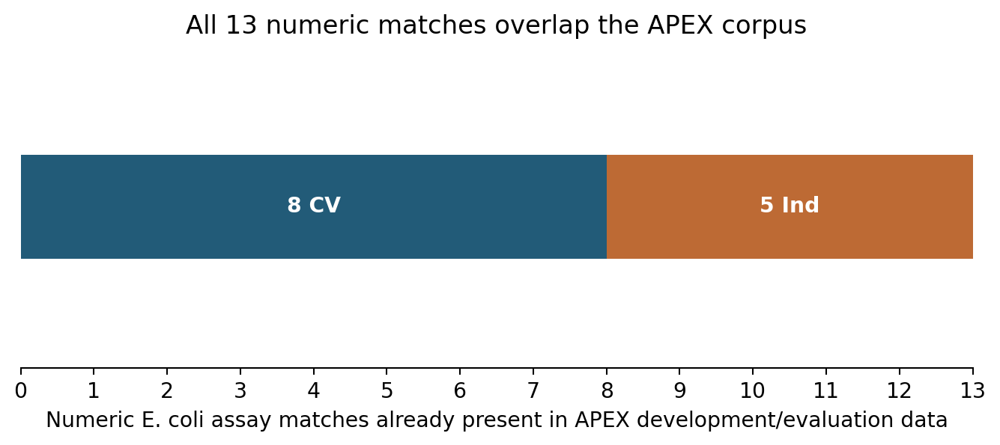

# Section 7: what the results support

This companion follows [section 7 of the final report](FINAL_ANALYSIS.md#7-what-the-results-support). It separates the computational findings from the laboratory evidence still needed. Accuracy claims require verified peptide identity, chemistry, assay conditions, and a test set independent of model development.

## 1. A defensible computational conclusion

- Changing the tool changes the fixed-budget shortlist. Concentration rules and classifier filters also change candidate numbers and membership. These are practical findings about which peptides would be selected for testing.

- Pairs with identical amino-acid counts show different model responses when residue order changes. Classifier groups also have different average composition and locally similar decisions. Together, these results show structure in model behavior, but do not identify the most accurate tool.

- Possible contributors include strain-specific versus mixed-condition training labels, AMPredictor's short cysteine-free training examples, and artificial concentrations assigned to inactive examples in APEX/DeepAMP. Their separate effects have not been isolated. Strain and assay variation also cannot supply one acceptable error allowance for all predictions.

- Supporting analysis: [model review in section 3](03_matched_targets.md#model-targets-training-and-conversions) · [MIC-context report](02_concentration_rules.md).

## 2. Existing assay matches do not identify a winner

- An **exact-sequence assay match** joins a saved prediction to a laboratory record with the same amino-acid string. Chemistry and assay conditions still need checking. **Corpus exposure** means the sequence occurs in a model's recorded development/evaluation dataset; such a match cannot automatically serve as a new independent test.

- All **13 numeric E. coli ATCC 11775 matches** occur in the saved APEX development/evaluation dataset: **eight marked CV** (cross-validation) and **five marked Ind** (the source's independent-set label). These names describe the original dataset splits, not a newly independent DAMP experiment (Figure 1).

- The matches do not establish exactly which saved model trained on each peptide. One assay label also differs from its dataset value, **16 versus 12 µM**, and terminal chemistry remains partly unresolved.

- **Figure 1** shows how all 13 numeric assay matches fall into the source corpus's CV or Ind splits. This is the exposure limitation behind the caution about accuracy.

*Figure 1. Bars count the 13 numeric laboratory matches by their labels in the saved APEX development/evaluation dataset. Those original split labels do not make this a new independent APEX test. AMPredictor's lack of exact matches in the checked list also does not make the small selected panel a general accuracy comparison.*

- Nonnumeric **`N.A.`** entries were not turned into zero or the maximum tested concentration. A larger recovered archaeasin panel adds provisional evidence, but its sequence identities were reconstructed, one synthesis sequence differs, and inactive observations may only establish a lower bound on MIC. Those limitations prevent a general model leaderboard.

- Supporting analysis: [Assay audit](../analysis_outputs/experimental_label_audit.csv) · [exact corpus matches](../analysis_outputs/experimental_training_overlap.csv) · [training-overlap counts](../analysis_outputs/training_overlap_counts.csv) · [experimental-data recovery](PRELIMINARY_ANALYSES.md#experimental-data-recovery).

## 3. What the next experiment should distinguish

- A new independent panel should include candidates favored by each tool, peptides with unanimous and mixed classifier votes, and paired sequence variants. Selecting only one tool's favorites would test a narrower population.

- Peptide identity needs more than a sequence string: record end modifications, amino-acid stereochemistry, and disulfide bonds. Those details can change the chemical entity being tested.

- Test the same batches with documented strains, media, starting cell densities, and exposure times. Repeat measurements on different days to separate within-condition variation from changes between conditions. Keep results such as **“>64 µM”** as bounds.

- **Calibration** means adjusting predictions using measured examples. Fit that adjustment on separate data from the final evaluation, and account for related variants rather than treating them as independent test cases.

- Those experiments could test whether consensus, local similarity, or order sensitivity helps identify active peptides. The current analysis supplies candidate contrasts and a reproducible computational record; it leaves their biological interpretation open.

- Supporting analysis: [reproducibility](REPRODUCIBILITY.md).
