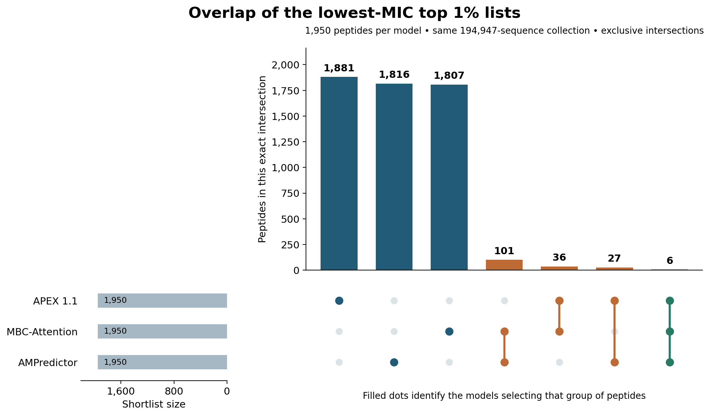
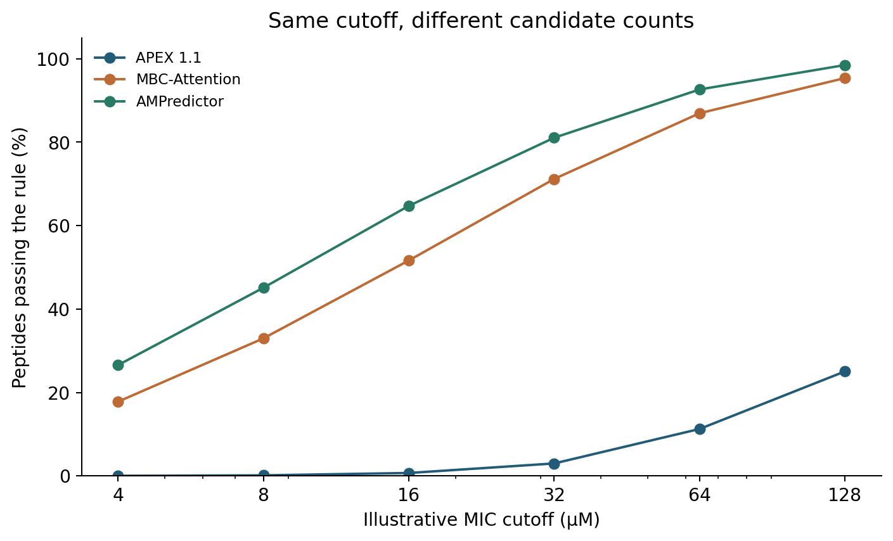
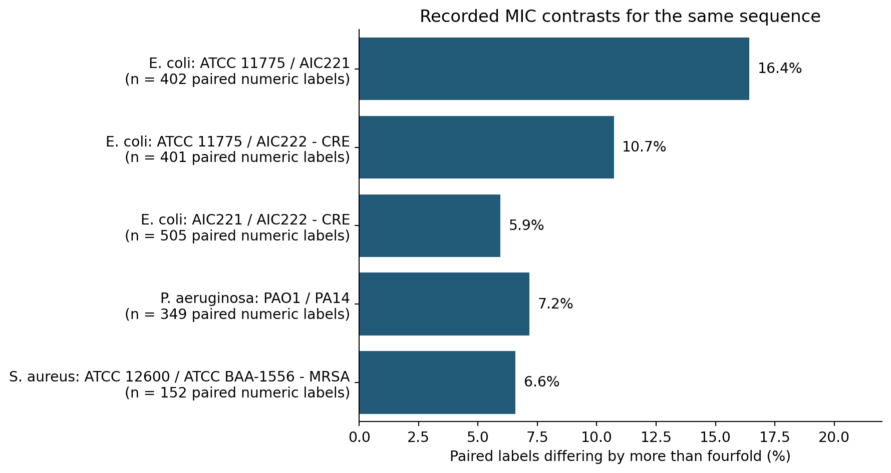
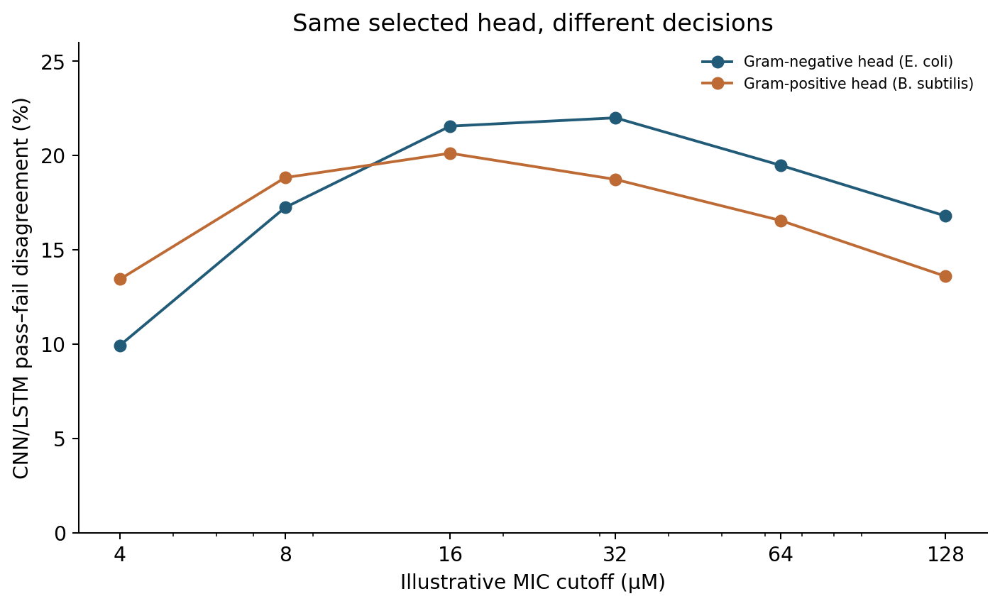
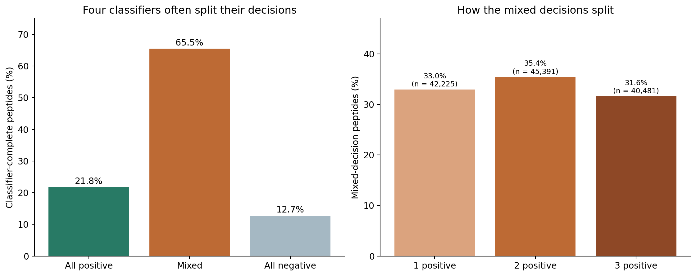
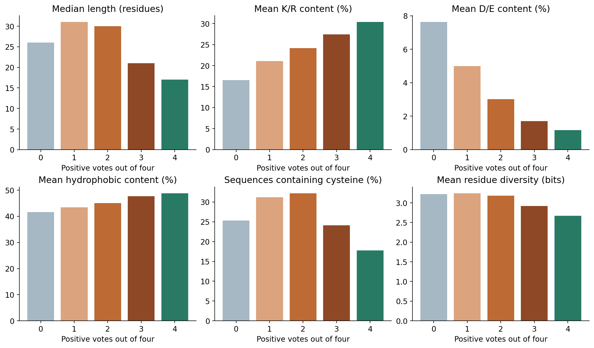
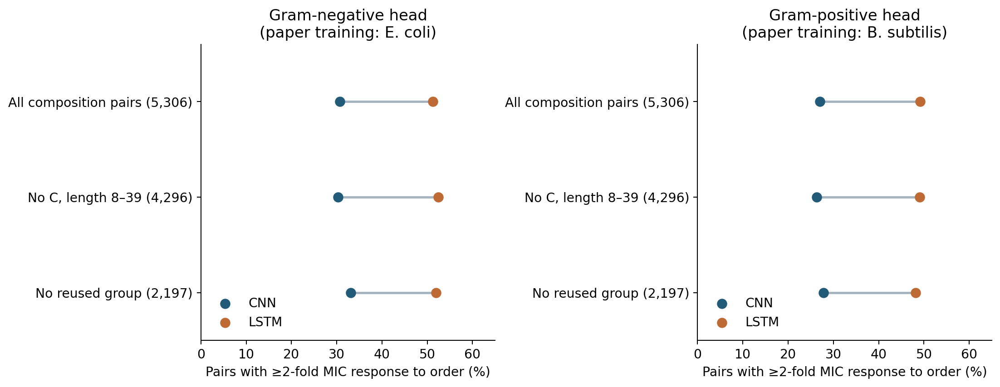
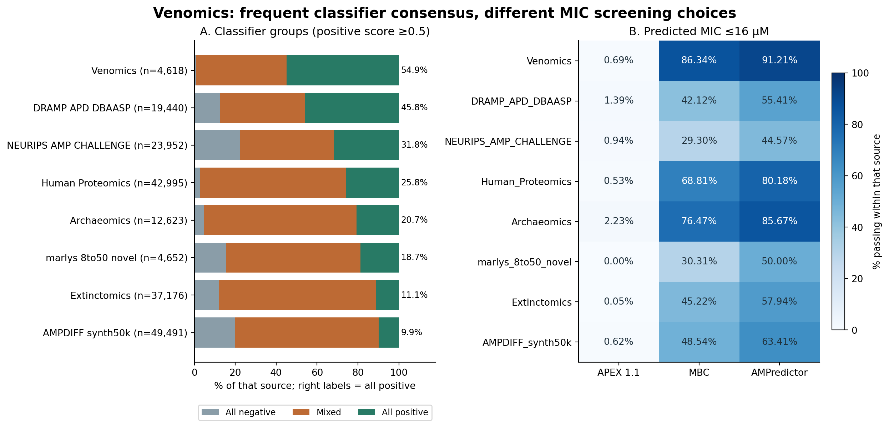

# DAMP Secondary Analysis

**Note:** Most of this work was agent driven, though I have orchestrated the follow-up work, directing the questions, priorities, and revisions.

This analysis asks how the decision on which peptides to test in vivo changes when the program that screens these peptides changes. It compares tools on shared peptide sequences, then uses closer target matches and sequence controls to understand the differences.

**MIC** (minimum inhibitory concentration) is the concentration needed to inhibit bacterial growth in a specified test. Lower predicted MIC means activity is predicted at a lower concentration. Concentrations here are reported in **µM** (micromoles per litre).

Note that different recommendations doesn't mean that a program is less 'accurate'. Agreement can also reflect shared training assumptions. Statements on accuracy require independent laboratory measurements, and the findings below only concern model behaviour during candidate selection.

In this markdown file, each numbered section is linked to a more detailed companion write-up, with additional plots, definitions, and controls. 

## 1. Different models choose different peptides

- Say we assume a fixed testing budget: each program selects its **1,950 lowest predicted MICs**, approximately the best 1% of the same collection. The question now is, do they select the same peptides? The short answer is: No.

- The three shortlists together contain **5,674 peptides**, of which **5,504 appear in only one list**. Just **six appear in all three**. The UpSet plot in **Figure 1** shows which exact combinations of tools select those peptides.

*Figure 1. Filled dots identify an exact combination of selecting models; bars count only that combination. The 36 APEX/MBC-only peptides plus the six triple-shared peptides give their inclusive overlap of 42. Inclusive overlaps are 33 for APEX/AMPredictor and 107 for MBC/AMPredictor. Each list contains 1,950 peptides.*

- Thus, switching tools therefore changes which candidates are shortlisted for activities like synthesis.

- Note that APEX's selected output concerns E. coli ATCC 11775, while MBC and AMPredictor use broader E. coli targets. This comparision is hence an approximate one.

- The [section 1 companion](01_shortlists.md) asks whether the different shortlists survive reasonable changes to the screen: testing more peptides, making small changes to predictions, or reducing the influence of many similar variants. It also checks whether missing predictions could hide substantial overlap. The aim is to distinguish a persistent difference between tools from a consequence of how the lists were constructed.

### Agreement on the broader rankings

- The models partly agree on the ordering of the full collection according to MICs while choosing different shortlists. This is shown by the spearman correlation across the model pairs. Each pair had 194,947 sequences.

| Model pair | Spearman correlation |
|---|---:|
| APEX / MBC | 0.508 |
| APEX / AMPredictor | 0.400 |
| MBC / AMPredictor | 0.530 |

- The [rank-agreement subsection in the companion](01_shortlists.md#3-rank-agreement-across-models-and-sources) repeats this ordering comparison separately for each collection supplying peptides. It asks whether the overall agreement reflects a pattern shared across collections, or hides different behavior in particular datasets.

## 2. A concentration cutoff changes the screening decision

- Instead of shortlisting peptides based on percentiles,  we could instead select every peptide predicted at or below a chosen concentration. At **16 µM**, APEX selects **1,362**, MBC **100,676**, and AMPredictor **126,192** from the same 194,947 sequences. Requiring all three to pass leaves **897**; accepting any one gives **144,361**. **Figure 2** shows how the fraction selected changes as the cutoff moves, rather than fixing it at 16 µM.

*Figure 2. A 'pass' means exported prediction ≤ the chosen concentration; each fraction divides passing sequences by 194,947. These are illustrative screening rules, not clinical breakpoints, native classifier thresholds, or measured active fractions.*

### Recorded MICs also differ across strains

- Laboratory records add useful context. In the cached APEXDB, **402 peptides** have numeric E. coli MIC labels for both **ATCC 11775 and AIC221**. The median difference is **twofold**, and **16.4%** of paired labels differ by more than fourfold. **Figure 3** puts this contrast alongside the other available strain comparisons.

*Figure 3. Bars show the percentage of paired numeric labels differing by more than fourfold, with each comparison's count beside it. These selected APEX development/evaluation records can differ in assay conditions and peptide chemistry as well as strain. They do not isolate a strain effect or provide a universal allowance for prediction error.*

- The [section 2 companion](02_concentration_rules.md) asks why the same concentration rule selects so many more peptides in some tools. It checks which candidates are shared, then tests whether one tool generally predicts higher concentrations and whether bringing those typical levels into line reduces the gaps. It also examines laboratory records for the same sequence in different strains, explaining why assay conditions matter without treating all model differences as experimental noise.

## 3. Differences remain when the declared target is matched

- So far, we've seen frequent 'cross-family' comparisons. This raises a concern: perhaps different recommendations mainly reflect different biological targets. To reduce that ambiguity, this section compares APEX versions predicting the same E. coli strain, and DeepAMP's CNN and LSTM models predicting the same training species. An ‘output head’ is the model output trained for that particular target. These comparisons match the declared target more closely; they still differ in training and fitted models.

- On inspecting DeepAMP's paper, the existing “Gram-negative” and “Gram-positive” names suggest greater generality than actually exists. The paper reports that the training MIC measurements were of **E. coli** and **B. subtilis** respectively. Hence, names do not establish general potency across every species in those groups. Its training also includes artificial high labels for non-AMP examples. The [model review](03_matched_targets.md#model-targets-training-and-conversions) checks which bacteria the outputs concern, which examples were used in training, and how internal scores became concentration predictions. Those details set the limits on what can be compared.

- At the illustrative **16 µM** screening rule, a **pass means predicted MIC ≤16 µM**, and a **fail means predicted MIC >16 µM**. A disagreement means one model passes a peptide while the other fails it. The DeepAMP denominator is **all 190,876 sequences with both CNN and LSTM predictions for the target**, including those both models pass or both fail. At 16 µM, disagreement occurs for **41,165/190,876 (21.57%)** in the E. coli-trained output and **38,421/190,876 (20.13%)** in the B. subtilis-trained output. **Figure 4** tracks those disagreement rates across concentration cutoffs.

*Figure 4. A disagreement means exactly one model passes the cutoff. Each point divides those cases by all 190,876 paired sequences. At 16 µM, 41,165/190,876 (21.57%) disagree for the E. coli-trained head and 38,421/190,876 (20.13%) for B. subtilis. These are fitted decision differences, not experimental error rates.*

- APEX versions illustrate why the denominator matters. At 16 µM they agree on **193,040/195,625 sequences (98.68%)**: both pass 736 and both fail 192,304. This denominator includes every sequence predicted by both versions. If we instead ask about the **3,321 peptides passing at least one version**, **2,585/3,321 (77.84%) pass only one**. The second denominator excludes joint failures and asks how often the versions differ among candidates either would select. High overall agreement can hence hide substantial changes in the candidates selected.

- The [section 3 companion](03_matched_targets.md) asks whether disagreement persists when the tools predict the same bacterial target, and when predictions are far enough apart to change the decision clearly. It also reviews their training examples and the artificial concentrations assigned to inactive examples. This helps distinguish differences in screening choices from differences in what the models were trained to predict; matching the target does not make their training identical.

## 4. General activity classifiers often split their decisions

- MACREL, AI4AMP, AMP-CLIP, and AMPlify are examined separately because they are classifiers, telling us whether a sequence 'looks antimicrobial' at all. A positive vote means a classifier score **≥0.5**; a negative vote means a score below 0.5. “All positive” means four positive votes, “all negative” means zero, and “mixed” means one, two, or three. This is a classifier-score rule, separate from the MIC concentration rule above. At this illustrative score rule, **21.80%** of complete sequences are positive in all four tools, **12.72%** negative in all four, and **65.48% mixed**. **Figure 5** separates this overall split from the one-, two-, and three-positive vote counts within the mixed group.

*Figure 5. Left: percentages use all 195,620 classifier-complete sequences. Right: percentages use the 128,097 mixed sequences. One, two, and three positive votes account for 42,225 (32.96%), 45,391 (35.43%), and 40,481 (31.60%) of that mixed pool. AMP-CLIP is already binary, and the other scores are not established as comparable probabilities.*

- Sequence composition means which amino acids make up a peptide, and in what proportions. **K/R content** is the percentage of residues that are lysine (K) or arginine (R); **D/E content** is the percentage that are aspartic acid (D) or glutamic acid (E). These residue counts help describe charge-related differences but are not measured molecular charge.

- The groups differ in sequence composition. All-positive peptides have median length **17**, versus **26** in both other groups. Their mean K/R content is **30.36%**, compared with **24.18% in mixed** and **16.52% in all-negative** sequences; mean D/E content is **1.16%, 3.25%, and 7.62%**, respectively.

- **Figure 6** follows these profiles across zero to four positive votes. It also shows hydrophobic content (the fraction of A, I, L, M, F, W, V, or Y residues), cysteine presence (whether a peptide contains any cysteine, C), and residue diversity (how evenly the amino-acid types are represented, measured using composition entropy). The last measure describes ingredients, not folding complexity.

*Figure 6. Each bar summarizes its own vote-count group. Length uses the median; other panels use per-sequence means or cysteine-presence frequency. K/R and D/E vary consistently with votes, while length and cysteine do not follow a simple stepwise pattern. Residue diversity is composition entropy, not folding complexity.*

- Comparing sequences within the same source and exact length retains an all-positive/all-negative difference of **+14.13 percentage points in K/R** and **−6.15 points in D/E**. Reducing the influence of densely sampled related groups retains those directions. The profiles overlap, and the cysteine direction can reverse between sources; they do not define exclusive motifs or prove which labels are right.

- The next comparison asks whether nearly identical sequences receive similar decisions. Here, **sequence neighbors** are equal-length peptides from the same source collection that differ at exactly one amino-acid position. “Continuity” means that such a change usually leaves the pair in the same all-positive, mixed, or all-negative group. Among **41,253 observed same-source one-substitution pairs**, **78.60% share the same decision group**, compared with **52.64%** expected when choosing another sequence from the same source and exact length, without requiring a one-residue difference. The pairs are dependent and come from the existing MIC-complete sequence catalogue. This demonstrates structure in the decisions, rather than validated biological stability.

- Two alternative definitions—positive at score **≥0.3** or **≥0.7**, negative below that boundary—leave **63.77%** and **70.39%** of the same 195,620 sequences mixed. The source/length-matched K/R and D/E contrasts retain their directions, and neighbors still agree more often than each rule's reference. AMP-CLIP stays binary. The [companion's rule comparison](04_classifier_sequences.md#4-do-two-other-positivenegative-definitions-change-the-findings) follows what changes when the positive-vote boundary moves: group sizes, amino-acid differences, and agreement between nearly identical sequences. Its Figure 5 brings those three questions together.

- The [section 4 companion](04_classifier_sequences.md) asks whether the all-positive, all-negative, and mixed groups contain different kinds of peptides. It compares their amino-acid content, checks whether length and the collection supplying a sequence account for those differences, and asks whether a one-residue change usually preserves the group. Together, these checks explore whether disagreement has a recognizable sequence pattern.

- A further check adds a **consensus filter**: keep a MIC-shortlisted peptide only if all four classifiers vote positive. Roughly **77% of APEX's original shortlist survives**, versus **29% of MBC's** and **22% of AMPredictor's**. The companion examines how this extra step favors different candidate lists; surviving the filter does not establish MIC accuracy.

## 5. Sequence order affects models differently even for the same target

- To separate order from ingredients, the analysis uses **5,306 same-source pairs with identical amino-acid counts** and all four DeepAMP predictions. Length and composition-based properties stay fixed; no sequence appears in more than one pair.

- For the E. coli-trained head, a twofold prediction response occurs in **30.74% of pairs for CNN** and **51.23% for LSTM**. For B. subtilis the rates are **27.04% and 49.15%**. **Figure 7** compares these full-set results with restrictions on sequence composition and related-group reuse.

*Figure 7. A response means larger/smaller predicted MIC ≥2 within a pair. Each row uses its own retained-pair count, shown in parentheses. Restricting length/cysteine or preventing reuse of observed sequence groups retains the CNN/LSTM contrast.*

- The contrast appears in seven of eight sources, with an exception in the smaller marlys subset. Both models receive ordered inputs, so order sensitivity itself is expected. The informative finding is its different frequency in these fitted models. Output range, training, and artificial inactive labels remain possible contributors; stronger responses do not establish greater biological accuracy or a general architecture rule.

- The [section 5 companion](05_sequence_responses.md) separates rearranging the same amino acids from replacing a residue or adding one at an end. It asks which edits change predictions, whether models respond in opposite directions, and whether very high predictions or many related variants drive the result. These are comparisons of existing sequence variants; laboratory tests are still needed to determine whether their predicted changes are real.

## 6. Venomics gets more unanimous positive votes, while MIC shortlists differ

This is a nascent development. Need to validate the results better.

- Venomics contributes **4,618 sequences**. This is an already prediction-selected collection: the source study used APEX to screen fragments of venom proteins. The findings below describe DAMP's retained Venomics sequences, rather than venom peptides generally.

- At **classifier score ≥0.5**, **54.92%** are positive in all four tools, the highest fraction among the eight sources. Yet at **predicted MIC ≤16 µM**, APEX 1.1 passes only **0.69%**, MBC **86.34%**, and AMPredictor **91.21%**. Each percentage uses those same 4,618 sequences. **Figure 8** places these two screening questions side by side; the tools predict different quantities and only approximately matched biological targets.

*Figure 8. Left: classifier groups at score ≥0.5; labels give the all-positive percentage. Right: fractions with predicted MIC ≤16 µM. Each row uses its own source count printed on the left, and the same eligible sequences in both panels. These are predicted screening outcomes, not measured active fractions.*

- The disagreement also affects which Venomics peptides would be tested. When each model takes its **231 lowest predicted MICs**, approximately **5%** of Venomics, **no peptide appears in all three lists**.

- The [section 6 companion](06_venomics.md) finds that many Venomics sequences are small variations of one another. Giving these related groups equal influence and comparing peptides with similar amino-acid content makes the MBC/AMPredictor passing-rate differences much smaller, while Venomics still gets more unanimous positive classifier votes. It also traces why the original APEX selection and the current screen answer different questions. The companion retains the detailed counts, figures, source paper, and supporting files, and links the [source-by-source analysis](SOURCE_COMPARISONS.md), where other collections stand out on different dimensions.

## 7. What the results support

- **Model choice and screening rules change experimental candidate selection.** The sequence analyses add two findings: classifier groups have different, overlapping sequence profiles and locally similar decisions; matched-head models respond differently to residue order even with composition fixed.

- The biological explanation for these results remains open because models differ in training targets, peptide coverage, label handling, and fitted behavior. Existing laboratory matches also have exposure, identity, chemistry, or censoring limitations. 

- The next experiment should independently include candidates favored by each tool, different classifier-vote groups, and controlled sequence variants, with exact chemistry and documented assay conditions. The [section 7 companion](07_interpretation.md) explains how such a panel could test the computational findings. It also checks why the existing laboratory matches cannot yet identify a winner: some sequences occur in model-development data, peptide chemistry is incompletely matched, and some measurements give only a concentration bound.

- [Other preliminary analyses](PRELIMINARY_ANALYSES.md) retain questions that helped interpret the main findings but support weaker conclusions. They include how changing the definition of disagreement changes the selected peptides, broader patterns across bacterial targets, and attempts to recover more laboratory measurements. Their purpose is to show both useful secondary results and explanations that did not hold up.

- The [analysis map](METHODS.md#analysis-map) shows which notebook or script produced each result. The [reproducibility report](REPRODUCIBILITY.md) separates two checks: recalculating the results from saved predictions, and running saved model weights to see whether they reproduce those predictions. It records what was checked and which model runs remain unverified.
