# DAMP methods, definitions, and analysis map

This appendix preserves the definitions, controls, calculation details, and notebook-to-report map behind the [final report](FINAL_ANALYSIS.md). Scientific interpretations are developed in the seven section reports and [preliminary analyses](PRELIMINARY_ANALYSES.md); implementation results are collected in [reproducibility](REPRODUCIBILITY.md). Figures discussed here are displayed alongside the methods that use them.

The appendix gives formulas as well as the reading-level explanations in the companions. A **source** is one of the eight sequence collections; a **cohort** is the set of sequences eligible for a particular comparison. A **residue** is one amino acid in a peptide. K/R means lysine/arginine and D/E means aspartic acid/glutamic acid; C means cysteine. A **component** or related-sequence group joins observed terminal extensions and one-residue substitutions, directly or through intermediate sequences; it is not a verified evolutionary family. **Strata** are categories such as source plus exact sequence length. These definitions matter whenever a comparison changes its population or weighting.

## Metric guide

A metric needs its quantity, unit, comparison set, and denominator. Unless a laboratory measurement is explicitly paired with a prediction, the metrics below describe model outputs or selection decisions rather than biological accuracy.

| Metric | What it measures and how to read it |
|---|---|
| Predicted MIC | A concentration for the model's intended target; µM means micromoles per litre. Lower means the model predicts less peptide is needed. Different strain/condition targets and synthetic inactive labels can give the same unit different training meanings. |
| Pass fraction | Count with prediction ≤ the stated cutoff, divided by the shared eligible sequence count. It is not the measured fraction of active peptides. |
| Shared shortlist fraction | For two equal lists of size k: shared peptides / k. An inclusive pairwise count includes triple-shared entries. An exclusive UpSet bar counts only the exact marked membership. Intersection-over-union instead divides by the union and is a different metric. |
| Overall / selected-pool disagreement | Overall disagreement counts exactly-one-pass cases / all paired eligible sequences. Selected-pool disagreement uses the same numerator / sequences passing either tool. Overall agreement instead counts joint passes plus joint rejections. Different denominators explain why apparently conflicting percentages can both be correct. |
| Classifier vote / retention fraction | A positive vote meets the stated score rule, not a common calibrated probability. Mixed means at least one positive and one negative. Retention is the number surviving a filter / the original model-specific shortlist size. |
| Fold spread / log2 range | For positive predictions, fold spread = largest/smallest and log2 range = log2(fold spread). Ratios 1, 2, and 4 correspond to log2 ranges 0, 1, and 2. A twofold sequence-pair response counts pairs with ratio ≥2; it is not the direction of the edit or a correctness score. |
| Signed log2 ratio / offset | `log2(right/left)` is +1 when right is twice left and −1 when half. An offset summarizes numerical displacement on that scale. Centering subtracts a model's median log prediction; it is a diagnostic transformation rather than calibration to measurements. |
| Percentile / rank gap | Percentile is 100 × average tied rank / eligible count; lower is more favored for MIC. Rank gap is the maximum minus minimum percentile for one peptide across models. Percentage-point changes in this gap describe placement, not MIC changes or probabilities of error. |
| Spearman / Kendall / Pearson correlation | Spearman summarizes agreement in ranks, Kendall in pair ordering with ties handled, and Pearson linear co-variation of its stated inputs. Values range from −1 to +1. High correlation can coexist with scale offsets or changing shortlists and is not a percentage of accurate predictions. |
| Cohen's kappa | `(observed agreement − expected agreement)/(1 − expected agreement)`, where expected agreement uses each classifier's marginal positive fraction. Zero matches that independence reference; one means identical labels. It is not accuracy and depends on class prevalence. |
| MAE / RMSE / signed difference | MAE averages absolute differences; RMSE takes the square root of the mean squared difference, weighting large gaps more. A signed difference retains direction, as defined in the table. Units match the compared values, including log units when used. Prediction–prediction differences are disagreement; prediction–measurement differences are sample-specific errors with that sample's validation limits. |
| SD / CV / median absolute deviation | SD measures spread around a mean; sample SD uses n−1 in the variance denominator. CV divides SD by the absolute mean. Median absolute deviation here is the unscaled median distance from the median. Across mixed targets, these are numerical summaries rather than assay repeatability or uncertainty. |
| Composition entropy / charge proxy | Entropy is `−sum(p_a log2 p_a)` in bits, where p_a is a residue fraction; it describes diversity, not fold. Charge proxy is `(K+R−D−E)/length`, not full pH-dependent charge. Fractions can be reported per peptide or pooled over residues; the weighting must be stated. |
| PCA / decomposition variance fraction | PC1's fraction is the share of variation in the stated numerical matrix captured by one fitted axis. Other variance fractions depend on their named decomposition and target panel. They are not predictive R², accuracy, or evidence of a biological mechanism. A covariance fraction is not a variance fraction. |
| Implementation-check count | The number of successful numerical/software assertions. Repetition across thresholds is useful verification, not independent scientific replication. |

A change from 10% to 20% is **10 percentage points**, not a 10% relative change. Tables and plots use their stated shared populations; missing predictions are excluded rather than counted as failures. The [model review](03_matched_targets.md#model-targets-training-and-conversions) explains which output differences limit biological interpretation.

## What was reproduced

Calculation reproduction and sampled inference replay are documented in [reproducibility](REPRODUCIBILITY.md). They establish implementation consistency, not biological accuracy.

## Corrections and qualifications

| Issue | Assessment and action |
|---|---|
| DeepAMP replay tolerance | Actual maximum absolute difference is 6.1713788959 × 10⁻⁶ log2 units. The original strict bound of 6 × 10⁻⁶ was slightly too small. Report and notebook prose now use 6.2 × 10⁻⁶. Scientific interpretation is unchanged. |
| “Low disagreement” | Valid for the stated raw log2-range definition; cannot stand in for confidence, reliability, rank agreement, or experimental robustness. New per-model percentiles make this concrete. |
| Length and entropy | The raw-tail contrast reproduces. Length reverses under centered/rank definitions. Entropy is constrained by sequence length and is not structural complexity. New source/exact-length residuals substantially attenuate its contrast. |
| Matching on predicted potency | A conditional descriptive comparison of model outputs. It can introduce selection effects and cannot estimate a causal sequence effect. Direct high/low matching has poor common support. |
| Near-random shortlists | Unconditional random overlap is a useful reference, but not a sufficient conclusion. Conditional source/length references show excess agreement despite small absolute overlap. No p values are inferred from these references. |
| Family weighting | Terminal components capture one relationship, not all homology. New one-representative analysis strengthens this particular sensitivity without creating independent biological replicates. |
| Experimental validation | Original 13 numeric labels remain exposure-limited. Additional archaeasin source data exist, but inferred identifiers, chemistry differences, selection, and censoring prevent a general model-ranking claim. |
| Assay variability | Different strain/condition targets can disagree systematically. Neither literature-wide variation nor within-species label contrasts estimate a universal noise allowance for these predictions. |

Original CSVs and executed outputs are preserved. Only the small replay-bound
wording and pointers to the reviewed interpretation were changed in the earlier
reports/notebook. Obsolete one-time construction scripts were removed; retained numerical scripts remain the reproducible sources.

## New question 1: what does agreement mean to a screening decision?

The question here is whether agreement in concentration also means agreement on which peptides to choose. Log2 expresses predictions in doubling steps. A low or high **tail** is the lowest or highest 5% under the stated disagreement score; the middle comparison uses the remaining sequences between the two tails. Percentiles in this section are fractions from 0 to 1, so a gap of 0.50 means 50 percentage points; later tables sometimes express them directly on a 0–100 scale.

Let z(i,m) = log2(predicted MIC) for sequence i and model m. Raw disagreement is
max_m z(i,m) − min_m z(i,m). Centering subtracts each model's cohort median;
rank disagreement instead uses max-minus-min within-model percentile. Centered
values are dimensionless relative predictions, not concentrations.

In the raw low tail, median model percentiles are 0.0958, 0.7161, and 0.7849 for
APEX 1.1, MBC-Attention, and AMPredictor. The median within-sequence percentile
range is 0.5708. Raw high and middle groups have corresponding ranges 0.5871 and
0.3020. This is the most useful new interpretation: similar absolute predictions
can mark very different positions in each model's own distribution.

The high/low length contrast also changes:

| Definition | Low-tail median length | High-tail median length |
|---|---:|---:|
| Raw log2 range | 14 | 36 |
| Model-median-centered log2 range | 26 | 17 |
| Within-model percentile range | 24 | 20 |

Quantile cutoffs include ties; the percentile low tail contains 9,749 sequences,
whereas the other tails contain 9,748. These are newly defined tails, not the
original groups after simply changing their labels.

Evidence: [group interpretation](../analysis_review/outputs/agreement_group_interpretation.csv),
[transition table](../analysis_review/outputs/agreement_definition_transitions.csv),
[definition-dependent profiles](../analysis_review/outputs/sequence_profiles_by_agreement_definition.csv),
Figure 2.

The figure below connects these definitions to the original selected groups: similar exported concentrations can still occupy different positions in each model's distribution.

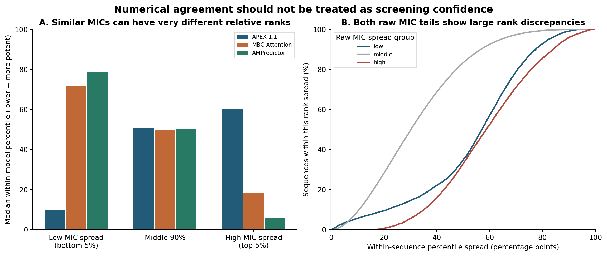

## New question 2: does small overlap mean absence of shared signal?

An **expected intersection** is the average number of shared selections under a specified hypothetical selection rule. It is useful as a reference for shared preferences, not as an estimate of correct selections.

For shortlists of size k from N sequences, independent uniform random lists have
expected intersection k²/N. More relevant references can preserve each model's
selected count within strata. With stratum size N(g) and selected counts A(g)
and B(g), expected intersection is the sum over g of A(g)B(g)/N(g). The formula
requires conditional uniformity and independence; it is a descriptive selection
reference rather than a biological null model.

For the top 1% lists on all complete cases:

| Pair | Observed shared | Unconditional reference | Source + exact-length reference |
|---|---:|---:|---:|
| APEX 1.1 / MBC | 42 | 19.51 | 15.09 |
| APEX 1.1 / AMPredictor | 33 | 19.51 | 12.81 |
| MBC / AMPredictor | 107 | 19.51 | 44.33 |

There is shared signal relative to these references. There is still little
agreement about which individual candidates occupy a small screening budget.
These statements are compatible. Correlation and shortlist overlap answer
different questions; neither evaluates accuracy without observations.

The new terminal-component sensitivity first constructs components across the
full input by exact one-residue terminal trimming, with shorter length at least
eight. In each component with complete predictions, it selects the sequence with
the lexicographically smallest SHA256 hash. No prediction is used for this
selection. There are 124,085 representatives, with 732 components spanning more
than one source label. Each representative retains its own source label.
Components and representative selection change the population and do not fully
remove homology. Restricting to this population preserves small overlaps.

Evidence: [all shortlist estimates and references](../analysis_review/outputs/shortlists_with_selection_references.csv),
Figure 3.

The figure below compares shortlist overlap and rank behavior across source collections and the stated population restrictions. It shows whether a pooled summary survives those changes in what is counted.

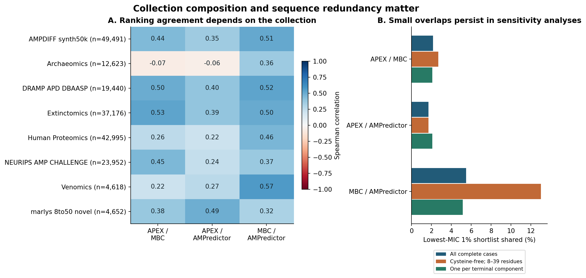

## New question 3: which disagreement survives scale alignment?

Pairwise median-offset removal subtracts the median of z(left) − z(right). It is
slightly different from subtracting each model's separate median. Both are
prediction-only diagnostics; neither fits an experimental calibration.

For the APEX versions on the common 194,947-sequence universe, pairwise twofold
agreement rises from 16.65% to 80.22% after offset removal. The same operation
raises APEX 1.1 / AMPredictor from 2.40% to 40.92%. All shortlist identities remain
unchanged because the transformations preserve order. These diagnostics isolate
an offset sensitivity, not the fraction of prediction error due to offsets.

An **opposite-order pair** has one model preferring the first peptide (lower MIC) and another preferring the second. Only pairs strictly ordered by both models enter that fraction; equal predictions are ties. The next formula handles those ties explicitly.

Opposite-order fractions are computed from exact Kendall tau-b together with
each model's tie counts and joint ties. If P is the total number of sequence
pairs, T(left/right) are model-specific tied pairs, and T(both) are jointly tied
pairs, the strictly comparable count is Q = P − T(left) − T(right) + T(both).
The concordant-minus-discordant count is tau-b times the square root of
(P − T(left))(P − T(right)). The discordant fraction is then (Q minus that count)/(2Q).
This avoids misreading (1 − tau-b)/2 when ties occur. Results are deterministic
finite-collection summaries, not iid hypothesis tests.

Leave-one-source-out centering estimates model offsets on the other seven
collections before applying them to the held-out source. It reduces median spread
in every source, but Archaeomics retains 5.39-fold versus 3.78-fold under local
centering. This shows some source dependence of offsets without using any truth
labels. It is not held-out predictive calibration.

An exact log-scale covariance decomposition separates covariance of source means
from mean within-source covariance. Between-source means contribute 39.5% and
38.6% of pooled log covariance for APEX 1.1 versus MBC and AMPredictor,
respectively. These are fractions of covariance, not explained prediction variance,
rank correlation, or causal source effects.

Evidence: [scale and ranking](../analysis_review/outputs/scale_and_ranking.csv),
[source offset transfer](../analysis_review/outputs/source_offset_transfer.csv),
[covariance decomposition](../analysis_review/outputs/source_covariance_decomposition.csv).

## New question 4: what survives a local sequence contrast?

**Entropy residualization** subtracts the mean composition entropy among sequences from the same source and exact length, then compares the remaining deviations. It asks whether a diversity difference remains after those background differences are reduced.

Source/exact-length entropy residualization reduces the raw high-minus-low
entropy difference from 0.732 to 0.094 bits. This is a population-standardized
descriptive contrast, not a matched causal estimate. There is no justification
for assuming residues in each peptide are independent draws from a stationary
distribution to manufacture an entropy correction.

Among 92,225 observed terminal-extension pairs with complete predictions,
APEX 1.1 and AMPredictor both change at least twofold for 400 pairs, of which
147 change in opposite directions. That is 36.8% of those selected strong-change
pairs but only 0.159% of all eligible extension pairs. Reporting the selected
denominator alone would exaggerate prevalence. Pairs share sequences and
components; no independence or measured activity cliff is inferred.

An inactive-label proximity check was also deliberately tested. APEX 1.1
predictions ≥500 µM occur in 6.65% of the raw high tail versus 9.11% of the
middle group. Thus, a simple “extreme disagreement is concentrated at an APEX
512 µM ceiling” story is unsupported by this diagnostic. Some predictions exceed
512; this is not a hard output ceiling. Label handling remains a possible source
of distributional differences, not an established cause.

Evidence: [entropy sensitivity](../analysis_review/outputs/entropy_length_sensitivity.csv),
[terminal-pair results](../analysis_review/outputs/terminal_extension_prediction_changes.csv),
[individual opposed-change examples](../analysis_review/outputs/opposed_extension_examples.csv),
[inactive-label proximity](../analysis_review/outputs/inactive_label_proximity.csv).

## Additional experimental source recovered: useful but provisional

The earlier analysis correctly rejected supplementary files 3 and 4 as composition
p values rather than measurements. However, the paper's **Source Data Fig. 2**
workbook contains the 80-peptide measured-activity table. Its **Extended Data
Fig. 4** workbook contains prediction/label pairs. The paper selected the cohort
using APEX 1.1 predictions, and documents coding inactive labels as 512 µM;
it is therefore a selected, label-processed cohort.
[Publication and methods](https://www.nature.com/articles/s41564-025-02061-0)

The exact supplementary downloads and synthesis-certificate archive are retained
with URLs, retrieval date, and SHA256 hashes in
[archaeasin_curation_manifest.json](../analysis_review/outputs/archaeasin_curation_manifest.json).
The archive hash matches the public Mendeley file metadata.
[Mendeley dataset v3](https://data.mendeley.com/datasets/d8yzgtdrcp/3)

**Identity linkage is inferred, not an explicit published identifier join.**
The measurement rows are numbered Archaeasin-1–80 but do not contain sequences.
For each row, the new script matches the 11-target published prediction vector
to the same 11 TSV outputs. Every best match has maximum absolute log2 difference
<0.01; every runner-up is >0.05. Dropping each target in turn preserves every
match, and the 80 predicted sequence matches are unique. Measured labels are
never used in matching. This is strong provenance evidence but remains a numerical
reconstruction requiring author confirmation of numbered identities.

**The chemical audit catches a real discrepancy.** Seventy-nine reconstructed
base sequences exactly match the 80 synthesis certificates. Archaeasin-31 maps
to predicted sequence `KWKKLIKGFVINKF`, whereas the otherwise unmatched certificate
specifies `VKWKKLIKGFVINKF`. The extra N-terminal valine makes it a different
chemical entity. That row is excluded; its E. coli measurement is 32 µM. The
certificate comparison confirms base sequence and TFA salt, while terminal
modifications remain independently unresolved. No silent terminal trimming is used.

**The label audit catches a second issue.** E. coli has 38 numeric source-data
measurements and 42 blanks. All numeric cells match the corresponding extended-data
labels exactly after log2 conversion; all blanks are coded there as log2 MIC = 9,
or 512 µM. That code must not become an exact observed concentration. After the
chemistry exclusion, **37 numeric measurements and 42 source-coded inactive rows**
remain. Their exact cached APEXDB and AMPredictor-training overlaps are both zero.
This limited audit does not exclude all training exposure or homology for every
model/checkpoint.

The numeric-only diagnostics are deliberately supplemental:

| Model | Numeric n | Mean absolute log2 error | Spearman correlation |
|---|---:|---:|---:|
| APEX 1.0 | 37 | 1.121 | −0.003 |
| APEX 1.1 | 37 | 1.271 | 0.016 |
| MBC-Attention | 37 | 1.562 | 0.322 |
| AMPredictor | 37 | 1.911 | 0.387 |

These calculations condition on a measurable, selected potency range and omit
the 42 source-coded inactive rows. They do not rank generalization. The apparent
ordering depends on the objective: the smallest numeric error and strongest
numeric rank correlation occur in different models. Endpoint mismatch, source
selection, limited dynamic range, sample size, uncertain numbered identifiers,
and unresolved chemistry still matter. They also show why the exceptionally small
APEX 1.1 error in the original 13 exposed labels should not be generalized.

The output table includes a separate conditional diagnostic interpreting source
inactives as >64 µM, the documented upper test concentration. Under that assumption,
90.5–97.6% of those rows receive ≤64 µM predictions across the four outputs.
This is a **sensitivity to the inactive interpretation**, not a primary accuracy
estimate. Neither the script nor this report imputes 512 as their true MIC.

Before promoting this cohort into a benchmark, confirm the numbered sequence map,
resolve Archaeasin-31 and terminal chemistry, preserve censoring bounds, audit
all training corpora, and state that evaluation is conditional on APEX selection.
It can answer a selected-cohort question; it cannot supply a neutral estimate of
discovery performance across all DAMP sources.

Evidence: [curation script](../analysis_review/curate_archaeasin_labels.py),
[provisional sequence map](../analysis_review/outputs/archaeasin_provisional_id_map.csv),
[certificate sequences](../analysis_review/outputs/archaeasin_certificate_sequences.csv),
[curated provisional E. coli records](../analysis_review/outputs/archaeasin_provisional_ecoli_labels.csv),
[numeric and conditional diagnostics](../analysis_review/outputs/archaeasin_provisional_diagnostics.csv),
[publication coding sensitivity](../analysis_review/outputs/archaeasin_publication_label_coding.csv).

## Further falsification audit: methods and limits

[stress_test_findings.py](../analysis_review/stress_test_findings.py) reads the original TSV and prior
curation outputs without changing them. It writes all additional results under
[outputs/sanity_checks](../analysis_review/outputs/sanity_checks). Its
[execution manifest](../analysis_review/outputs/sanity_checks/stress_test_manifest.json) records the
input checksum, runtime, software versions, seeds, and **32 passing computational
checks**. These checks are validations of arithmetic, provenance, and invariants;
their count is not a measure of biological confidence. The checks were designed
after inspecting earlier results and remain exploratory.

The main report now contains the numerical tables and reportable interpretations.
The following details explain what each stress test can and cannot establish.

### Independent calculation and perturbation checks

Shortlists are compared between NumPy partition selection and pandas selection,
and before/after row permutation. All four models have a single sequence at the
1% cutoff; no arbitrary boundary tie can account for their tiny intersections.
The pair-reversal formula is verified against explicit enumeration of all pairs
in a 250-sequence sample rounded to introduce ties. Invariance to a common
concentration-unit change and log-base change is also checked.

For bounded perturbations, each log2 score receives independent uniform noise
in [−b,b], for b = 0.01, 0.1, 0.25, 0.5, and 1. Each bound has 25 repeats.
Original-versus-perturbed same-model overlap and perturbed-versus-perturbed
cross-model overlap are both reported. The noise is deliberately hypothetical;
no claim is made that model stochasticity, assay variation, or retraining error
is independent, uniform, or of this size. The min/median/max summaries describe
the specified simulation and are not confidence intervals.

Evidence: [boundary/tie counts](../analysis_review/outputs/sanity_checks/shortlist_ties_and_boundaries.csv),
[perturbation summaries](../analysis_review/outputs/sanity_checks/bounded_score_perturbation_summary.csv),
[individual runs](../analysis_review/outputs/sanity_checks/bounded_score_perturbations.csv).

### Pair margins and budget dependence

Uniform index pairs are sampled with replacement using a fixed seed, and
identical indices are excluded, leaving 1,999,991 sampled pairs. The sample is
not a set of independent biological observations; it approximates a statistic
of a fixed prediction matrix. Reversals are reported conditional on both models
showing absolute log2 differences greater than 0, 0.5, 1, or 2. Each conditional
fraction is accompanied by its eligible-pair count and fraction.

This changes the interpretation of APEX version disagreement: its approximately
19.7% all-pair reversal fraction falls to 1.47% for differences greater than
twofold in both models. The corresponding cross-family fractions remain
approximately 20–25%. A model-version shortlist can change substantially while
its large pairwise potency distinctions are broadly preserved.

Absolute budgets of 100–20,000 candidates and directed cross-model percentile
positions document where list differences occur. In particular, the directed
margin test compares each model to its own cutoff, so arbitrary log intercepts
cannot create or remove that criterion.

Evidence: [margin-dependent reversals](../analysis_review/outputs/sanity_checks/order_reversals_with_effect_margins.csv),
[budget dependence](../analysis_review/outputs/sanity_checks/absolute_screening_budgets.csv),
[directed shortlist positions](../analysis_review/outputs/sanity_checks/cross_model_shortlist_positions.csv).

### Source restriction and missing-score bounds

The new population analyses remove each source, the two APEX-selected collections
together, the database collection, or exact matches to the two cached training
corpora. Within-source 1% budgets are also combined, yielding 1,953 candidates
per model. None of these operations establishes an unbiased discovery population
or complete exclusion of training exposure.

The missing-score bound uses fixed k = 1,950. Starting from a pairwise-complete
universe, a model can lose old shortlist members only to newly admitted candidates.
A conservative maximum number of replacements is its own missing-score count
plus the count of newly admitted known scores no higher than its old cutoff,
capped at k. If these replacement bounds are r(left) and r(right) and the old
intersection is I, then a conservative new-intersection bound is:

`max(0, I − r(left) − r(right)) ≤ new intersection ≤ min(k, I + min(r(left),r(right)))`.

Old candidates cannot newly enter a model's list when only extra candidates are
added. Any gained intersection must therefore involve an added row. The bound
is checked against 50 arbitrary log-score completions for each pair. These
completions test implementation, not whether every possible completion has been
enumerated or whether the loose bound is attainable. The derivation supplies
the guarantee. Extrapolation into MBC's excluded short-length domain remains
hypothetical.

Evidence: [population sensitivities](../analysis_review/outputs/sanity_checks/population_shortlist_sensitivity.csv),
[source-proportional budgets](../analysis_review/outputs/sanity_checks/source_proportional_shortlists.csv),
[missingness bounds and random completion checks](../analysis_review/outputs/sanity_checks/missing_prediction_bounds.csv).

### Broader sequence dependence

A **graph** represents sequences as points and observed edit relationships as links, or edges. A **connected component** contains sequences reachable through any chain of those links. This lets the analysis reduce the influence of densely sampled variants without claiming to identify every biological family.

The graph adds equal-length one-substitution edges to exact terminal-extension
edges. The substitution search is exact: within each length and deletion position,
sequences sharing the remaining string differ only at that position. Processing
one length/position at a time avoids an all-pairs search and retains the full
dataset as possible connecting intermediates. Minimum length is eight for
substitution edges and for the shorter member of terminal edges.

There are 111,162 full-input components and 110,491 with complete predictions.
Single linkage can connect distant endpoints and should not be described as a
homology threshold. The largest represented component has 2,073 sequences, so
it is particularly important not to treat every component member as a replicate.

Twelve representative choices minimize SHA256(seed + sequence) within each
component. They do not use predictions or experimental labels. Component-median
prediction summaries provide another sensitivity, and component-set overlaps
compare the original shortlists without requiring the same exact variant.
All three approaches preserve small cross-family overlap. These results do not
exclude more distant homologues, different-length internal indels, or dependence
between disconnected components.

Evidence: [component summary](../analysis_review/outputs/sanity_checks/broader_component_summary.csv),
[membership map](../analysis_review/outputs/sanity_checks/broader_sequence_components.csv),
[representative sensitivity](../analysis_review/outputs/sanity_checks/broader_component_representative_summary.csv),
[original component-set overlap](../analysis_review/outputs/sanity_checks/original_shortlists_component_overlap.csv),
[component-median selection](../analysis_review/outputs/sanity_checks/component_median_shortlists.csv).

### Permutation controls and reference dependence

A **permutation control** reassigns existing predictions to different sequence labels. This keeps the set of predicted values unchanged while breaking some correspondence to individual peptides, asking which patterns can arise from distributions and selection rules alone.

Independent model-wise permutations are run 30 times globally and 30 times
within source/exact-length strata. Predictions and their corresponding global
percentiles are permuted together, preserving each model's marginal distribution.
The stratified variant also preserves its observed association with those strata,
while destroying peptide-specific alignment within them. No p value is calculated;
these are constructed controls for the interpretation of an exploratory score.
They do not preserve all family structure or constitute a uniquely correct null
model of peptide biology.

The observed raw-low-group rank spread is lower than either permutation reference.
Thus, the finding that this group has large rank spread does not establish an
unexpected class of biological failures. Similarly, source/length-preserving
permutations retain a 20-residue high-minus-low length contrast, close to 22
observed. That is not an estimate that a certain percentage of a causal effect
is explained by these factors.

Within-source and source/length percentiles are computed separately from the
global percentiles. The equal-source-weighted ECDF gives every source the same
total weight, with exact ties sharing their weighted midpoint. Small strata have
coarse ranks. All these sensitivities retain large numerical-versus-priority
differences, with different exact magnitudes.

Evidence: [permutation runs](../analysis_review/outputs/sanity_checks/agreement_geometry_permutations.csv),
[flat summary](../analysis_review/outputs/sanity_checks/agreement_geometry_permutation_summary.csv),
[rank-reference sensitivity](../analysis_review/outputs/sanity_checks/rank_reference_sensitivity.csv),
permutation figure.

The figure below puts the observed low-tail rank gap beside the independently reassigned controls. The distributions show constructed reference runs, rather than measurement uncertainty.

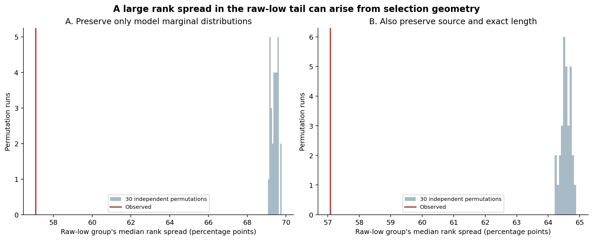

### APEX label semantics: a concrete new qualification

A **pseudo-label** assigns an artificial numeric concentration to an observation without an exact measured MIC, for example one exceeding the assay's tested maximum. The **version ratio** below is the newer prediction divided by the older prediction for the same peptide. A single multiplier would make this ratio constant across prediction bands.

The original APEX methods assign observations above 128 µM an inactive pseudo-label
of 140 µM; APEX 1.1 instead uses 512 µM for observations above the tested maximum.
The resulting ratio is 3.657. This closely matches the observed median E. coli
version ratio, 3.628, and aligns the eight matched-target median ratios to a
range of 0.833–1.055. This is a plausible contributor to global scale differences,
while changed data and fitted models prevent causal attribution.
[Original APEX methods](https://pmc.ncbi.nlm.nih.gov/articles/PMC11310081/),
[APEX 1.1 methods](https://www.nature.com/articles/s41564-025-02061-0)

The fixed factor is taken from published methods, not fitted to minimize an error
on this cohort. It remains a diagnostic. The version ratio is not constant across
prediction regimes, and none of the transformations demonstrates calibration
against measured MIC. Same-strain and same-unit outputs therefore still need a
label-processing audit before interpreting a scale change biologically.
Stratifying a ratio by its own denominator can also induce apparent structure;
the prediction-band analysis is a conditional sensitivity, not independent
evidence of a causal dependence on potency.

Evidence: [target-level scaling sensitivity](../analysis_review/outputs/sanity_checks/apex_pseudolabel_scale_sensitivity.csv),
[prediction-regime sensitivity](../analysis_review/outputs/sanity_checks/apex_pseudolabel_scale_by_prediction_regime.csv),
[primary-source record](../analysis_review/outputs/sanity_checks/apex_label_coding_sources.json),
figure.

The figure below compares the newer/older APEX prediction ratio with the published pseudo-label multiplier across the older version's prediction bands. A changing ratio argues against a universal correction.

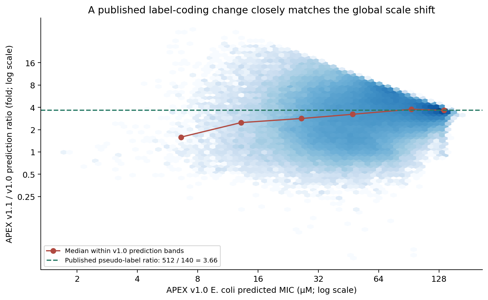

### Experimental labels and loss functions

For numeric MIC M, the sensitivity interval is `(M/2, M]` under a monotone
doubling-dilution threshold model. Every numeric E. coli value in this cohort is
at least 4 µM, so the presumed lower dilution is within the published assay
range. Distance in log2 space is zero inside the interval and the distance to
the closest boundary outside it. For source-coded inactive rows, one-sided
distance to `(64, infinity)` is used conditionally, without imputing an exact MIC.
The open-boundary distance is its infimum; zero loss at the boundary is not an
assertion of compatibility with a strict inequality.

These distances are compatibility losses and lower bounds on latent-threshold
error, not actual MAE or estimated uncertainty. They do not model replicate
variation or establish interval coverage. The different APEX ordering under
numeric-only and all-row conditional losses demonstrates the importance of
endpoint/censoring assumptions. A one-numeric-peptide deletion analysis shows
that no single numeric outlier reverses the numeric-only ordering; it cannot
repair systematic cohort selection or uncertain numbered identities.

All downloaded source hashes are rechecked, as are uniqueness and the recorded
leave-target-out linkage checks. The number-to-sequence map remains inferred;
rechecking a recorded fingerprint result is not equivalent to obtaining an
author-confirmed identifier mapping.

Evidence: [label/loss sensitivities](../analysis_review/outputs/sanity_checks/experimental_label_loss_sensitivity.csv),
[one-peptide deletions](../analysis_review/outputs/sanity_checks/experimental_leave_one_numeric_out.csv),
[new check results](../analysis_review/outputs/sanity_checks/sanity_check_results.csv).

## Claims to retain, demote, and exclude

**Retain as main results:** fixed-budget prioritization instability; same-strain
version-dependent screening changes; scale/rank separation; definition-sensitive sequence associations;
matched-target-panel correction; sampled preprocessing reproducibility.

**Retain as supporting or exploratory analyses:** source dependence, partial
redundancy controls, conditional shortlist references, local sequence contrasts,
training-domain hypotheses, and the provisional archaeasin diagnostic.
Present raw-low-tail rank spread primarily as an agreement-definition warning;
the new permutations limit its interpretation as an unexpected sequence-specific
finding. Present APEX scale drift alongside the documented pseudo-label change.

**Exclude as conclusions:** best predictor; consensus as validated confidence;
biological potency or source superiority from predicted MICs; cysteine, folding,
or charge as the established mechanism; a universal experimental tolerance; a
causal fraction of disagreement attributed to assay heterogeneity.

This is enough for a substantive computational final report. A publication-level
superiority or discovery claim needs independent outcome evidence and a separate
novelty assessment. The analysis should not be expanded indefinitely merely to
increase the number of outputs.

## Additional-trend extension

[Additional-trend methods](METHODS.md#additional-trend-extension)
adds four exploratory questions beyond the disagreement tails. All original
inputs and earlier output tables are retained. The script
[explore_additional_trends.py](../analysis_review/explore_additional_trends.py) writes to
[outputs/additional_trends](../analysis_review/outputs/additional_trends); its
[manifest](../analysis_review/outputs/additional_trends/additional_trends_manifest.json) records input
and dependency hashes, denominators, and **25 passing checks**. These checks
confirm implementation and algebraic invariants, not biological accuracy.

### Exact-composition comparisons

Sorting a sequence's residues produces an exact amino-acid-count signature.
Grouping by that signature and source holds all analyzed composition descriptors
fixed. There are 6,886 multi-member groups with 16,815 sequences. The primary
comparison uses 5,410 exactly two-member groups so that differing group sizes
cannot themselves generate different maximum-minus-minimum ranges. Both members
have complete predictions for the same four E. coli outputs. Larger groups,
source strata, and a cysteine-free length-8–39 restriction are reported separately.

The twofold-change fraction is 6.10% for APEX 1.1, 19.28% for MBC-Attention, and
15.53% for AMPredictor. Median fold differences are much smaller. Within-model
percentile spreads are also reported because the models have different overall
output dispersions. These are sensitivities to ordered sequence inputs, not a
controlled comparison of architectures, proof that a model learned a biological
motif, or an activity-cliff benchmark.

Two-member pairs have a fixed lexical orientation shared by every model;
direction-agreement tables require each model to exceed the stated change
margin. The terminal-position subset holds the observed core and added residue
fixed while changing the terminus. Unordered longer-sequence pairs are deduplicated;
the N/C longer sequences must have the same source, while the observed core's
source need not be identical. These pairs overlap the composition analysis and
are not independent corroboration. Terminal chemistry is not inferred from the
sequence strings.

Evidence: [composition summaries](../analysis_review/outputs/additional_trends/composition_matched_order_sensitivity.csv),
[source strata](../analysis_review/outputs/additional_trends/composition_matched_by_source.csv),
[domain sensitivity](../analysis_review/outputs/additional_trends/composition_matched_domain_restriction.csv),
[shared pair list](../analysis_review/outputs/additional_trends/exact_composition_two_member_pairs.csv),
[direction agreement](../analysis_review/outputs/additional_trends/composition_matched_direction_agreement.csv),
[terminal-position summary](../analysis_review/outputs/additional_trends/terminal_position_summary.csv).

### Classifier filtering as a pipeline choice

All four classifier outputs are available on the 194,947-sequence common MIC
cohort. A positive decision means output ≥ the stated exploratory threshold;
the binary AMP-CLIP output is unchanged at thresholds 0.3, 0.5, and 0.7. A
classifier threshold is not assumed calibrated, and four votes are not four
independent biological measurements.

At 0.5, unanimous filtering retains 76.97% of APEX 1.1's original 1,950-member
list, 29.23% of MBC's, and 22.41% of AMPredictor's. The original list is selected
before filtering, so the result measures attrition rather than a re-ranked list
of unchanged size. Source/length reference rates are averaged over the actual
selected candidates. Their excess-retention contrasts are descriptive and do
not remove all composition, selection, or training-exposure effects.

The restriction and one-component-representative sensitivities recompute each
model's lowest-MIC 1% list on their own population. The representative is selected
without predictions by the minimum sequence SHA256 per observed component.
General AMP labels and relative E. coli MIC ranks target different questions;
neither the attrition numbers nor the unanimous-positive peptides outside the
MIC top 10% estimate a false-positive rate.

Evidence: [retention tables](../analysis_review/outputs/additional_trends/classifier_filter_retention.csv),
[vote-count and MIC-rank summaries](../analysis_review/outputs/additional_trends/classifier_votes_vs_MIC_priority.csv),
composition/filtering figure.

The figure below connects two separate screening questions: response to fixed-composition rearrangements on the left, and retention of MIC-shortlisted candidates by the classifier filter on the right. Each uses its own eligible set.

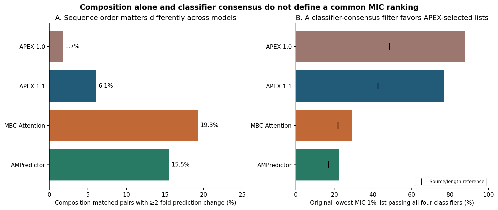

### Relative target contrast

The **target contrast** compares typical predicted MICs for the four selected Gram-positive versus four selected Gram-negative targets. A geometric mean averages log concentrations and converts back; its ratio describes this particular panel, not universal selectivity. **PC1** is the fitted direction capturing the most numerical variation, and a **residual** is what remains after removing the stated fitted relationship.

The Gram-group contrast uses the same eight unambiguous targets in both APEX
versions. It is a difference of mean log2 predictions, equivalently a log2 ratio
of geometric means. It removes a common log intercept and an arbitrary per-peptide
additive term shared by every target. These invariances are checked directly.
They do not remove a general-potency axis with unequal target-specific loadings.

The cross-version Spearman correlation is 0.734 on 195,625 sequences, positive
in all eight sources, and 0.700 at component medians on the common 194,947-row
cohort. Leave-one-target-out contrasts have three versus four targets or four
versus three, with each remaining group re-averaged; correlations range
0.540–0.863. This panel sensitivity limits a claim of general Gram-class selectivity.

A further adjustment fits a cubic relationship between ranked contrast and
ranked first principal component within each version. PCA uses deterministic full
SVD on the eight-target log prediction matrix. The cross-version Pearson
correlation of the rank residuals is 0.530; it is not another Spearman coefficient.
The adjustment is fitted on the same finite collection and has no experimental
calibration interpretation. It shows a remaining partial association under that
particular general-potency control. The two model versions share development
history, so their agreement is not independent biological validation.

Evidence: [Gram contrast](../analysis_review/outputs/additional_trends/Gram_contrast_reproducibility.csv),
[all target-pair contrasts](../analysis_review/outputs/additional_trends/target_pair_contrast_reproducibility.csv),
[leave-target-out sensitivity](../analysis_review/outputs/additional_trends/Gram_contrast_leave_one_target_out.csv),
[component medians](../analysis_review/outputs/additional_trends/Gram_contrast_component_reproducibility.csv),
[potency-axis sensitivity](../analysis_review/outputs/additional_trends/Gram_contrast_potency_axis_sensitivity.csv).

### Venomics and the analysis unit

This comparison asks whether the association describes all observed variants equally or gives each related group equal influence. Those are different sampling questions: a group supplying many similar peptides has more influence under equal sequence weights.

In the complete-case graph, Venomics has 4,618 rows, 401 represented components,
and 57.2% of rows in its ten largest components. The charge proxy is
`(K + R − D − E) / length`; it does not estimate pH-specific molecular charge,
terminal modifications, or disulfide state.

The row-based charge/Gram-contrast Spearman correlations are −0.199 and −0.255.
For equal-component weights, every row receives weight `1 / component size within
Venomics`, so each represented component receives the same total weight. Exact
weighted midrank ECDFs are computed for both variables, followed by weighted
Pearson correlation. Unit weights are checked against ordinary Spearman for
each source/version. Weighted correlations are +0.260 and +0.270. A separate
component-median analysis gives +0.253 and +0.273.

These are different estimands. Inverse weighting does not establish the true
biological association, and component medians change both the weighting and the
data representation. The sign reversal demonstrates aggregation sensitivity.
The composition-adjusted rank-residual correlations remain negative, showing why
that adjustment alone does not address representation by related variants.
Sensitivity to dropping large components further documents their influence.
The graph is the existing terminal-extension/one-substitution single-linkage
construction, not a complete homology partition or a guarantee of independence.

Evidence: [source concentration](../analysis_review/outputs/additional_trends/source_sequence_component_concentration.csv),
[association/weighting table](../analysis_review/outputs/additional_trends/charge_Gram_contrast_aggregation_sensitivity.csv),
[large-component sensitivity](../analysis_review/outputs/additional_trends/Venomics_large_component_sensitivity.csv),
spectrum/aggregation figure.

The figure below compares cross-version target-contrast preservation on the left and the Venomics charge-proxy relationship under alternative weighting on the right. Its two panels address preservation and sampling influence separately.

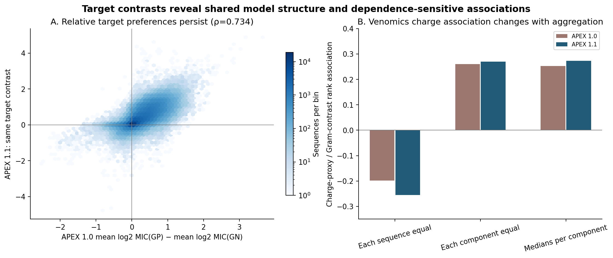

## Sequence-level disagreement extension

The focused explanation is [SEQUENCE_FINDINGS.md](05_sequence_responses.md).
[sequence_disagreement.py](../analysis_review/sequence_disagreement.py) reads existing predictions,
source assignments, the broader sequence-component map, and the earlier exact-
composition pairs. It performs no new model inference. The
[manifest](../analysis_review/outputs/sequence_disagreement/sequence_analysis_manifest.json) records
the raw/dependency hashes, software versions, definitions, and 15 passing checks.
All reported effects remain exploratory properties of the saved prediction matrix.

### Exact local edits

All equal-length one-substitution pairs with length at least eight are found
using equal-position deletion signatures. All members of a signature bucket
are paired, then source-mismatched pairs are excluded. This gives 41,253 pairs
in 3,354 represented components. It differs from the earlier component graph's
edge count because that graph used a sufficient set of linking edges rather
than enumerating every pair in a multi-member signature bucket.

Every pair's sequence identity, length, and mutated position are checked directly;
duplicate pairs are excluded, and both members must lie in the same precomputed
component. Components are still single-linkage connected groups, not independent
biological families. Most observed pairs come from the database and challenge
collections; the pair distribution is not a random sample of possible mutations.
Pairs and response fields are retained in a deterministic compressed
[CSV](../analysis_review/outputs/sequence_disagreement/single_substitution_pairs.csv.gz).

The main values are log2 MIC predictions, each model's within-cohort percentile,
and three disagreement scores: raw log range, model-median-centered log range,
and within-model percentile range. For models A and B and sequences s and t,

`change in log prediction gap = [z_A(t) − z_B(t)] − [z_A(s) − z_B(s)]`.

The same change is independently checked as the difference between the two
models' individual edit responses. An arbitrary constant intercept for either
model cancels, which is also checked. Thus local differential responses can be
examined without assuming that absolute model scales are experimentally calibrated.
Range and percentile scores remain definition-dependent and are reported separately.

### Local coherence reference

Let d(i) be a disagreement score and G(i) the other sequences from the same
source and exact length. The reference for anchor i is the mean of
`abs(d(i) − d(j))` over j in G(i), excluding i. Each observed neighbor pair uses
the average of its two anchor references. This conditions on the observed
anchors rather than comparing the neighbor set to an unmatched global sample.

Expected distances are computed by sorting within groups and using cumulative
sums, avoiding a quadratic distance matrix. The scalar and grouped formulas
are checked against explicit distance matrices, including grouped ties. A second
reference subtracts all contributions from the anchor's own component and excludes
cells without a remaining comparator. No randomization p value is inferred.

For the rank score, equal-pair means are 0.1134 locally and 0.2113 for the source/
length reference; equal-component means are 0.0910 and 0.2145. The ratio is below
one in all eight sources under both weightings. This shows local coherence of
disagreement, but one-substitution neighbors also share composition and may share
training exposure. The reference does not isolate a residue-order mechanism.

Evidence: [local/reference results](../analysis_review/outputs/sequence_disagreement/local_disagreement_coherence.csv),
locality and example figure.

The figure below places the ordinary local-neighbor/reference comparison beside one selected strong opposing edit. The example shows a possible exception, rather than the frequency of the ordinary response.

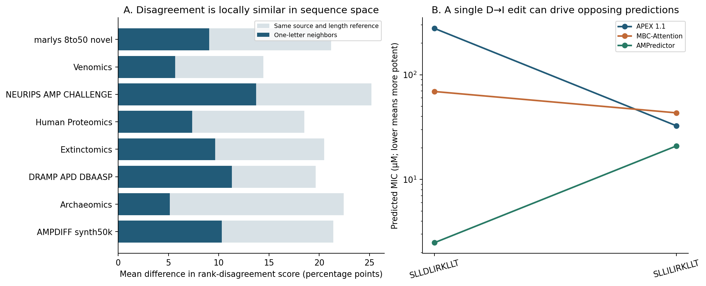

### Large responses and examples

A strong opposite response requires both models to change by at least the
specified absolute log2 margin and to change in opposite directions. At a
one-log2 margin, the APEX/AMPredictor count is 298 of all 41,253 pairs, spread
across 41 components. The 15.7% opposing fraction among its 1,902 eligible
large-response pairs must not be confused with its 0.72% fraction of all pairs.
Equal-component averaging further reduces the all-pair rate to 0.30%.

The other model-pair results and half-log2 margins are retained. These margins
describe response size; they do not estimate assay error or identify experimental
activity cliffs. A large change in disagreement can occur when models agree on
the direction but differ in response magnitude.

The D4I example is a selected illustration, not a representative edit. Both
sequences lack exact matches in the two cached exposure lists, but broader
homology, other models' training sets, chemistry, and complete inference provenance
remain unresolved. The K12L example in the same catalogue has an AMPredictor
training-list match for one member; it is expressly not an independent validation
case. Examples are restricted to cysteine-free sequences of length 8–39, with
at most one selected example per existing component. Selecting examples after
observing their responses cannot confirm a sequence rule.

Evidence: [opposing-response counts](../analysis_review/outputs/sequence_disagreement/single_substitution_opposite_responses.csv),
[score changes](../analysis_review/outputs/sequence_disagreement/single_substitution_score_changes.csv),
[example values and exposure flags](../analysis_review/outputs/sequence_disagreement/single_substitution_examples.csv),
[all mutation-type summaries](../analysis_review/outputs/sequence_disagreement/all_mutation_type_summaries.csv),
[source/component-subset summaries](../analysis_review/outputs/sequence_disagreement/mutation_source_and_component_subsets.csv).

### Rearrangement classes and order features

The 5,410 earlier two-member composition/source-matched pairs are classified
using only the two sequences. For mutually exclusive summaries, a letter rotation
is classified first, then an adjacent swap, a separated swap, and other reorderings.
A letter rotation is a string operation, not chemical peptide cyclization.
The exclusive adjacent category contains 284 pairs. Counting adjacent swaps
regardless of the rotation category adds one overlapping pair, giving 285;
the number of twofold responses remains 2, 53, and 24 for APEX, MBC, and AMPredictor.

Five arrangement features are retained: longest K/R run, longest run from the
hydrophobic proxy set A/I/L/M/F/W/V/Y, adjacent K/R pairs, the K/R count in the
first three minus last three positions, and a circular hydrophobic-run descriptor.
The circular descriptor is checked to be invariant under letter rotations. It
is a control for separating changed endpoints from rearranged internal order,
not a model prediction or an assertion that the peptides are cyclic.

Comparisons are oriented toward the sequence with the greater feature value.
They therefore estimate a within-composition descriptive association; several
features can change together. Five feature summaries are reported for raw,
centered, and rank scores. No claim is made that an exhaustive motif search
was performed or that the selected feature has an independent causal effect.

For dependence sensitivity, components touching a composition pair are linked
in a small additional graph, giving 2,187 pair components across the 5,410 pairs.
Equal-pair-component averaging uses those groups, which may contain different
old components joined through an anagram pair. They are not assumed independent.
Two deterministic component subsets and source strata are additional sensitivity
checks chosen after exploration, not held-out confirmation of a preregistered
hypothesis. Cysteine-free length-8–39 and non-rotation restrictions are reported.

The longest hydrophobic-run association remains negative across these checks,
but the mean effect is only about 0.02 rank-score units. Basic-run and terminal-
position associations are less consistent in some subsets. Neither agreement
nor a particular order feature has been validated against activity labels here.

Evidence: [exclusive edit classes](../analysis_review/outputs/sequence_disagreement/composition_matched_edit_classes.csv),
[all adjacent swaps](../analysis_review/outputs/sequence_disagreement/all_adjacent_swap_responses.csv),
[feature summaries](../analysis_review/outputs/sequence_disagreement/composition_matched_arrangement_features.csv),
[source/subset checks](../analysis_review/outputs/sequence_disagreement/arrangement_source_and_component_subsets.csv),
[disjoint component subsets](../analysis_review/outputs/sequence_disagreement/arrangement_disjoint_component_subsets.csv),
[pair classification](../analysis_review/outputs/sequence_disagreement/order_pair_classification.csv),
arrangement figure.

The figure below contrasts twofold responses by observed rearrangement category with rank-gap changes associated with simple arrangement features. Category sizes and weighting differ, so bar heights are not experimental edit effects.

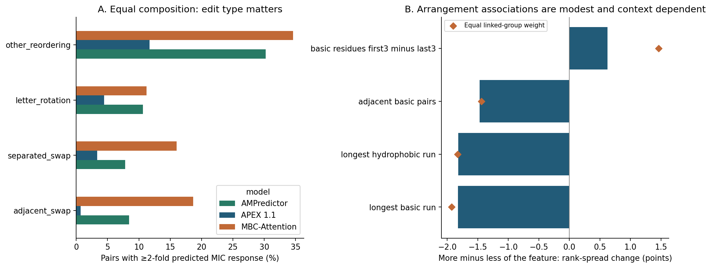

### Cysteine, charge, and global profiles

The first-cysteine analysis reorients all observed single substitutions so that
the cysteine-free member is the baseline and the other member introduces exactly
one C. Other residue identity changes at the same time, so this is not an isolated
effect of cysteine chemistry. The 1,667 pairs occupy 111 components; three supply
54.8% of the pairs. The mean rank-score change is −0.0359 per pair but +0.0219
under equal-component weighting, and centered-range signs also differ. This
prevents a universal first-cysteine disagreement rule. It does not establish
accuracy within or outside any model's training composition.

For a separate profile comparison, high/low tails are defined for each score and
compared only within source/exact-length cells containing both groups. A cell's
feature-mean difference receives weight equal to the smaller group mass. With
unit row weights, the sum of those masses is the maximum possible matching
capacity, not a particular randomly selected set of pairs. With inverse within-
source component-size weights, the mass is fractional and must not be called
a sample size. These comparisons do not condition on predicted potency.

The rank-tail comparison has 287 common cells and unweighted capacity 5,505.
Some pooled charge and cysteine associations remain, but source-specific signs
and the effect of weighting limit their interpretation. A between-sequence
composition association and the response to a local replacement are different
estimands and need not have the same sign. These results concern prediction
disagreement, not evidence that any sequence is biologically unreliable.

Evidence: [first-C summary](../analysis_review/outputs/sequence_disagreement/first_cysteine_introduction.csv),
[first-C source/subset checks](../analysis_review/outputs/sequence_disagreement/first_cysteine_source_and_component_subsets.csv),
[matched profiles](../analysis_review/outputs/sequence_disagreement/source_length_matched_sequence_profiles.csv),
[check results](../analysis_review/outputs/sequence_disagreement/sequence_analysis_checks.csv).

## Similar MIC predictions with divergent rankings: focused subanalysis

**Reading path:** the [agreement report](PRELIMINARY_ANALYSES.md#agreement-definitions-and-profiles) now presents the subgroup and its limitations as a current narrative; its interpretation remains supporting rather than central. The [curated core report](FINAL_ANALYSIS.md) emphasizes screening decisions; the main report uses the same seven section titles as its detailed companions. Exploratory target-panel and source-aggregation results have a current home in [wider output patterns](PRELIMINARY_ANALYSES.md#wider-output-patterns). Earlier duplicate report snapshots were removed after their substantive analyses were consolidated.

### Question, cohort, and thresholds

[similar_mic_different_ranks.py](../analysis_review/similar_mic_different_ranks.py) uses the same 194,947 unique complete-case sequences and the three E. coli export columns. All inputs remain unchanged. SHA-256 of the input TSV is `ef8ced4ef2a260fced7e47b2d6b2ca415793e356a2d94997b1329ce464cac600`.

For sequence i, define `MIC spread = max_j log2(MIC_ij) − min_j log2(MIC_ij)` and `rank gap = max_j percentile_ij − min_j percentile_ij`. Percentiles are average tied ranks divided by 194,947, calculated separately for each model on this identical set. Primary MIC agreement is spread ≤1 (largest/smallest MIC ≤2); primary divergent ranking is gap ≥0.50. These cutoffs are descriptive choices, not validated experimental error tolerances. They were not chosen by optimizing a sequence association.

Primary results: 1,478 MIC-agreed sequences, 1,155 meeting both criteria, 0.758% and 0.592% of the collection respectively. The conditional fraction is 78.146%. The median joint-group rank gap is 71.861 percentage points. Counts vary across MIC ratios 1.1, 1.25, 1.5, 2, 4, 8, and 16, crossed with rank gaps 25, 50, and 75 points; all 21 combinations are exported. None is a confirmatory hypothesis test.

All three pairwise comparisons use the same complete-case denominator. At twofold, agreement is 9,252 for APEX/MBC, 4,669 for APEX/AMPredictor, and 80,156 for MBC/AMPredictor. The corresponding joint ≥50-point counts are 5,240, 3,468, and zero. In all 1,155 three-model primary cases, APEX has the most favorable percentile. This distinction should accompany general claims about “the models”: the joint phenomenon is not equally represented in all pairs.

### Distribution explanation and example selection

The script looks up fixed MIC values in each model's original full-cohort distribution. At 32 µM the percentiles are 2.985%, 71.184%, and 81.069% for APEX, MBC, and AMPredictor. This directly explains how equal values can occupy different ranks. It is not an accuracy evaluation or a calibrated reference distribution. For observed values, lookup exactly reproduces average tied ranks; for unobserved reference values it uses the empirical fraction below that value.

Illustrative sequences are sorted by smallest MIC spread in the primary subgroup, keeping one per observed sequence component. The first is PLKRLLKLRLLL, with predictions 17.670568, 17.766088, and 17.453678 µM; percentiles 0.853%, 54.630%, and 67.006%. It is selected to illustrate the numerical point, not as an unbiased representative or a laboratory recommendation.

### Sequence descriptors and comparisons

Every sequence contributes equal weight to the primary profile. K/R and D/E are counted literally; hydrophobic fraction is A/I/L/M/F/W/V/Y divided by length. Charge proxy is `(K+R−D−E)/length`, without histidine, termini, pH, or modifications. Residue composition, Shannon composition entropy, cysteine presence, absence of D/E, and positive charge-proxy frequency are exported. Pooled-residue composition is separately labeled because it weights longer peptides more.

The subgroup median length is 14 (IQR 12–17), mean K/R fraction 28.133%, mean D/E fraction 1.096%, mean hydrophobic fraction 54.313%; 97.056% lack C and 86.753% lack D/E. It spans 762 observed broader sequence components; the largest five account for 9.870%. Components are defined by the pre-existing terminal-extension and eligible one-substitution graph. Connected components are an imperfect dependence control, not curated families.

Two controls answer different questions: (a) all 193,792 sequences outside the primary subgroup; (b) the 323 sequences satisfying MIC agreement but falling below the rank-gap cutoff. Matching dimensions are source and exact length, optionally adding floor(median of the three log2 MICs / bin width). Bin widths are 1, 0.5 (primary), and 0.25. Because the three-member median is used, this is also log2 of the middle predicted MIC. Fixed bins have boundary effects; the sensitivity grid assesses some of that dependence.

Within each common bin, calculate a weighted mean for target and control. The overall contrast is the average within-bin difference, weighted by the smaller target/control mass in that bin. The first weighting gives every sequence weight 1. The second gives weight `1 / number of complete-case sequences in that source-component`, reducing contributions from large related groups. It is not a bootstrap, propensity model, or effect estimate under a causal assignment mechanism. No p-values are reported for these selected exploratory contrasts.

Against the full remaining collection at primary bin width, differences in K/R, D/E, hydrophobic fraction, and cysteine-presence frequency are +0.953, −0.532, +2.227, and −6.848 percentage points. With source-component weighting they are +1.815, −0.508, +3.061, and −9.045 points. These directions persist under the implemented alternative bin widths, but magnitude is baseline-dependent. Exact-length matching necessarily produces zero length contrast; this is explicitly checked. Comparisons condition on predicted MIC and therefore cannot identify a causal sequence mechanism.

Support must be considered before interpreting control (b). The median middle MIC is 31.308 µM in the target group and 300.078 µM in control (b). At the primary matching width, 76 target sequences occur in common bins, and the sum of smaller unweighted bin counts is only 45 (3.896% of target n). These are overlap diagnostics, not actual paired samples or independent replicate counts. Different definitions of matching support are exported side by side. General claims about a distinctive motif separating the two kinds of MIC agreement are unsupported.

### A limited order-specific check within this subgroup

The script also calculates adjacent K/R-pair and adjacent hydrophobic-pair counts, subtracting the expected count under random permutation of the same sequence composition. For n residues of a type in a sequence of length L, the expected number of adjacent same-type pairs is `n(n−1)/L`; the excess is divided by L−1. This expectation is checked against exhaustive permutations of a toy sequence. These residuals describe local clustering, not helicity, amphipathicity, or a complete motif search.

The target mean excess is −0.00952 for K/R pairs and −0.02424 for hydrophobic pairs. Relative to the source/length/MIC-matched full remaining collection, the differences are −0.01032 and −0.01339; with component weighting, −0.01330 and −0.01119. Thus, the composition profile does not imply extra clustering of these residue types. These small selected contrasts do not establish a positional mechanism or a unique motif. Structural predictions, sliding-window scans, and position-specific enrichment have not been performed here.

### Population sensitivity and verification

| Population | MIC agreement / n | Joint cases using original rank reference | Joint fraction among MIC agreement |
|---|---:|---:|---:|
| Full common set | 1,478 / 194,947 | 1,155 | 78.15% |
| Cysteine-free, length 8–39 | 1,332 / 122,813 | 1,101 | 82.66% |
| Exclude exact cached APEX/AMPredictor corpus matches | 1,356 / 191,921 | 1,057 | 77.95% |
| One deterministic representative per broader component | 760 / 110,491 | 524 | 68.95% |

Representatives use the smallest SHA-256 sequence hash within a component, so selection does not use predictions. These population checks preserve the original reference ranks; the export separately recomputes ranks in each restricted population (changing the question). The recomputed joint counts are 1,009, 1,062, and 523 in the three restricted populations. Restricting cached exact matches cannot prove independence from all training or homologous data. The representative sensitivity shows that the headline conditional rate is partly collection-dependent; it remains a majority in this restriction.

An additional independent recomputation from the raw TSV, using sorted-value rank lookups instead of pandas ranks, confirmed exported subgroup membership, counts, the example ratio, median length, cysteine absence (1,121/1,155), and D/E absence (1,002/1,155).

All **12 automated checks passed**: denominator; finite positive log predictions and mapping coverage; direct ratios versus log differences; target subset inclusion; empirical tied ranks for each of three models; the adjacency expectation; source-count reconciliation; both disjoint-control definitions; and zero exact-length contrasts. These checks validate implementation identities, not experimental accuracy. The manifest records input hash, package versions, definitions, elapsed time, and scope.

Outputs: [manifest](../analysis_review/outputs/similar_mic_different_ranks/subanalysis_manifest.json), [checks](../analysis_review/outputs/similar_mic_different_ranks/subanalysis_checks.csv), [all agreed sequences](../analysis_review/outputs/similar_mic_different_ranks/peptides_with_similar_MIC.csv), [threshold grid](../analysis_review/outputs/similar_mic_different_ranks/prevalence_threshold_sensitivity.csv), [profiles](../analysis_review/outputs/similar_mic_different_ranks/sequence_profiles.csv), [matched contrasts](../analysis_review/outputs/similar_mic_different_ranks/matched_sequence_profiles.csv), [support](../analysis_review/outputs/similar_mic_different_ranks/matched_comparison_support.csv), [population sensitivity](../analysis_review/outputs/similar_mic_different_ranks/population_sensitivity.csv), and figure.

The figure below shows how common the defined concentration agreement is and illustrates why one nearly equal predicted concentration can occupy very different percentiles across models.

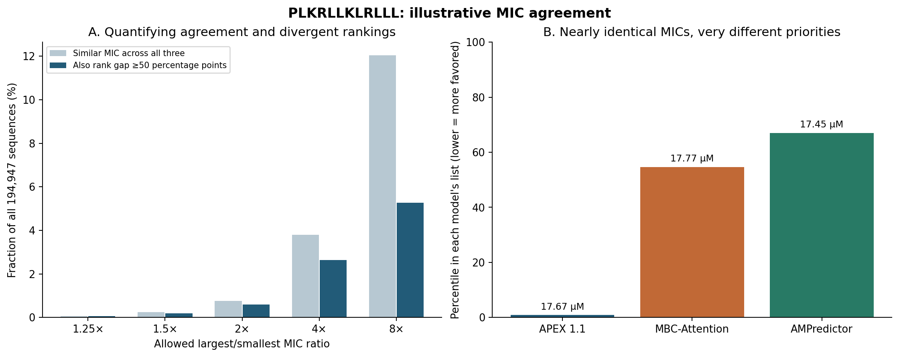

## Screening rules, matched targets, and controlled sequence-order responses

### Purpose and interpretive revision

The user questioned whether within-model relative placement was sufficiently informative and whether different outputs actually measured the same thing. The revised core reports reduce emphasis on the MIC-agreement/rank subgroup. A percentile is a function of a prediction and the model's full-cohort distribution; an equal MIC can occupy a different percentile without disagreement about that peptide's predicted concentration. The earlier frequencies remain correct under their definitions, but neither those frequencies nor their selected composition profile establish a new biological mechanism. The subgroup remains reproducible and is retained in the preliminary analyses.

The new [screening_decision_trends.py](../analysis_review/screening_decision_trends.py) investigates (1) fixed-concentration selection, (2) same-strain APEX and within-head DeepAMP decisions, (3) general AMP classifier decisions, and (4) composition-controlled DeepAMP order responses. This is exploratory analysis of the exported prediction table, not a model benchmark against independent measurements. No inference, calibration fitting, downloads, or input changes are performed.

### Cohorts and matching outputs

The full TSV contains 195,625 unique sequence rows. The three E. coli regressors share 194,947 complete cases. Each DeepAMP paired comparison has 190,876 complete cases, and the four classifiers have 195,620. Length/cysteine-restricted cohorts are formed within each comparison, not forced to have the E. coli cohort's denominator: for example, DeepAMP's cysteine-free length-8–39 set has 122,823 sequences, versus 122,813 for the three-regressor set. Missing predictions are never treated as rejections.

Eight APEX version targets are matched by metadata strain indices, excluding alias-unverified outputs in either version. DeepAMP CNN and LSTM are paired separately within their Gram-negative and Gram-positive output groups. These are matched declared output categories, not identical assay-condition predictions. APEX versions are related models; DeepAMP architecture, training, fitted weights, and preprocessing are not a controlled ablation. The earlier DeepAMP replay establishes a small sampled reconstruction of exported predictions, not general accuracy.

The pre-existing broader component map covers the 194,947-sequence E. coli common cohort. It covers 190,198 of the 190,876 DeepAMP-paired sequences, so component-representative sensitivities omit 678 eligible but unmapped sequences. No fictional singleton components are assigned. Representatives minimize a SHA-256 hash of the sequence, independently of predictions. DeepAMP yields 108,657 representatives. Component definitions capture observed extensions/substitutions, not all homology. Coverage is explicitly exported.

### Fixed-concentration selection and denominators

Cutoffs are 4, 8, 16, 32, 64, and 128 µM, with passage defined as `prediction ≤ cutoff`. They are illustrative operational choices, not experimentally justified breakpoints. Predictions are in declared exported µM; no new unit transformation is applied. A shared numeric cutoff does not make the E. coli endpoints biologically identical or compensate for different calibration/training-label conventions.

At 16 µM, APEX/MBC/AMPredictor pass 1,362/100,676/126,192 of 194,947 (0.699%/51.643%/64.731%). All three pass 897; at least one passes 144,361. Source-specific rates preserve the same ordering in all eight sources, and the implemented length/cysteine and component-representative populations preserve the broad contrast. These are not inferred active-peptide prevalences. Source collections have different histories and selection rules.

For each pair, four cells are exported: joint passage, left-only passage, right-only passage, joint rejection. Reporting only overall agreement can hide disagreement in the selected pool. APEX E. coli at 16 µM has 736 joint passages, 1,959 old-only, 626 new-only, and 192,304 joint rejections. Overall agreement is 98.679%, but 2,585 of the 3,321 sequences passing at least one version receive discordant decisions (77.838%). The low all-sequence discordance and high selected-pool discordance are both correct. Neither is an error rate against experiments.

A margin sensitivity counts discordance when one prediction is `≤T/m` and the other `>T*m`, for m=1, √2, and 2. At m=1 this must reproduce ordinary cutoff discordance, which is checked. At T=16,m=2 the criteria are ≤8 versus >32 µM. For APEX/MBC, APEX/AMPredictor, and MBC/AMPredictor the counts are 61,597, 84,324, and 13,429. The margins describe numerical separation, not experimental uncertainty or a universally acceptable MIC error.

### Target-matched decision differences

Here, **pass means predicted MIC ≤16 µM** and fail means >16 µM. **Discordance** means exactly one pass. The overall denominator is all 190,876 sequences with paired predictions; the selected-pool denominator includes only peptides passing at least one model. A strict twofold margin instead requires one prediction ≤8 µM and the other >32 µM. A head is the output trained for a particular target.

For DeepAMP at 16 µM, CNN/LSTM discordance is 41,165/190,876 (21.566%) for Gram-negative and 38,421/190,876 (20.129%) for Gram-positive. Within the union of passing sequences the corresponding fractions are 54.935% and 47.002%. Median per-peptide LSTM/CNN prediction ratios are 1.01362 and 0.94801. At the strict m=2 margin, counts are 11,646 and 11,685 (6.101%/6.122% of all paired eligible sequences; 28.291%/30.413% of ordinary discordances).

The cysteine-free length-8–39 restriction gives ordinary discordance 23.013%/21.067%; component representatives give 15.141%/14.650%. These sensitivities show collection dependence while retaining substantial differences. A near-unity median ratio does not characterize individual prediction agreement. The native Gram-head labels are retained for table lookup. The 9 November paper review identifies E. coli/B. subtilis training measurements for the two heads; broad pooled-species interpretations are not supported. Neither head provides an independently established exact assay match for arbitrary input sequences.

### Classifier decisions and pipeline interaction

A **positive vote** means exported classifier score ≥0.5. **Unanimity** includes either all four positive or all four negative; **mixed** means one, two, or three positive. Each fraction below divides by sequences with all four scores unless stated otherwise. These labels describe activity classifications rather than a concentration estimate.

The four exports are MACREL, AI4AMP, AMP-CLIP, and AMPlify. At a common exploratory 0.5 score rule, individual positive fractions are 46.829%, 60.947%, 47.659%, and 61.838%. Four-way outcomes are 42,645 unanimously positive (21.800%), 24,878 unanimously negative (12.718%), and 128,097 mixed (65.482%). These use 195,620 classifier-complete rows; the old MIC-common unanimity count of 42,643 uses a different denominator.

Observed four-way unanimity is 34.517%, versus 12.559% under independent labels with the same global model-specific positive fractions. Under independent within-source/exact-length label assignments preserving those model-specific stratum rates, expected unanimity is 19.009%. The expectation is computed analytically as the row-weighted product of four positive probabilities plus the product of four negative probabilities. These hypothetical random-label references do not provide ground truth or significance; shared sequence features beyond length and source, training information, and other factors can contribute to excess agreement. They prevent interpreting the mixed-decision fraction alone as evidence that the tools are unrelated. [All reference values](../analysis_review/outputs/screening_decision_trends/classifier_unanimity_independence_references.csv) are exported.

The 16 vote patterns and each model's only-positive/only-negative counts are exported. Pairwise agreement is 56.887–70.077%, with Cohen's kappa approximately 0.147–0.400. Positive agreement is `2*joint_positive/(left_positive+right_positive)`; negative agreement is the corresponding negative formula. Cohen's kappa uses chance agreement calculated from the two marginal positive fractions. It is not PABAK, not a correctness metric, and can be affected by prevalence.

At score rules 0.3 and 0.7, mixed-decision fractions are 63.770% and 70.389%. AMP-CLIP is exported as binary 0/1 and its rule is unchanged at these thresholds. This sensitivity therefore varies three classifiers' score cutoffs alongside a fixed fourth decision, not four calibrated operating points. At 0.5, mixed decisions remain 59.534% in the cysteine-free length-8–39 set and 64.723% among mapped component representatives. Different activity-label definitions and training data can contribute; these general classifiers do not predict the same numerical E. coli endpoint as the regressors.

The script also exports unanimous classifier outcomes within each MIC-cutoff selection. These bridge tables describe pipeline interactions. They do not validate regression errors, establish true inactive sequences, or prove the benefit of a consensus filter.

### Two additional classifier score rules

The [rule-sensitivity script](../analysis_review/classifier_rule_sensitivity.py) defines positive as score ≥0.3 or ≥0.7, with negative below the chosen boundary, alongside the baseline 0.5. AMP-CLIP's binary values remain unchanged. All three rules use the same 195,620 sequences and 41,253 observed one-substitution pairs. The script recalculates source/exact-length mean contrasts and the source/length neighbor reference after each reassignment; it does not reuse baseline group probabilities for the alternatives. Category weights are the smaller group count, and the pair summary weights every observed pair equally. Matched support can change with the score rule.

The [section 4 companion](04_classifier_sequences.md#4-do-two-other-positivenegative-definitions-change-the-findings) explains the findings alongside the plot. Counts, matching support, baseline-to-alternative group transitions, 22 checks, and input hashes are saved in [rule-sensitivity outputs](../analysis_review/outputs/classifier_sequences/rule_sensitivity/). These checks do not create independent pairs or calibrated score thresholds.

### Controlled sequence-order comparison

An **order response** compares predictions for two peptides with identical amino-acid counts in different orders. A twofold response counts a larger/smaller prediction ratio ≥2, regardless of direction. The percentage uses the retained pair count for each full or restricted comparison.

The pair list comes from the earlier additional-trends analysis: exactly two observed sequences per same-source composition group. Of 5,410 pairs, 5,306 have all four DeepAMP outputs. Each pair has identical amino-acid counts; length, composition-based charge proxy, hydrophobic fraction, and composition entropy are consequently fixed. Every sequence occurs in only one of these pairs, although related components can span multiple pairs.

For a canonical lexicographic pair orientation, compute `delta = log2(MIC_right / MIC_left)` for each model. Order-response size is `abs(delta)`, with twofold defined as ≥1 and fourfold as ≥2. CNN/LSTM twofold fractions are 30.739%/51.225% for Gram-negative and 27.045%/49.152% for Gram-positive. Median fold changes are 1.435/2.059 and 1.385/1.965, respectively.

The LSTM twofold fraction exceeds CNN in seven of eight sources for both targets. The exception, marlys (86 pairs), has 26.744%/20.930% for Gram-negative and 19.767%/18.605% for Gram-positive. This prevents a universal source- or architecture-level claim. Other sources include 2,279 Extinctomics pairs, so source composition could influence pooled magnitude; source-specific exports are retained.

A cysteine-free length-8–39 restriction keeps 4,296 pairs. Rates remain 30.261%/52.444% and 26.304%/49.092%. This is a conservative sequence sensitivity, not certification that these sequences lie in the DeepAMP training distribution.

For a stronger dependence sensitivity, sort pair identifiers by SHA-256 of `sequence_left|sequence_right`, then greedily retain a pair only if neither of its component IDs has appeared in a previously retained pair. If both sequences share a component, that component is counted once. This retains 2,197 pairs without component reuse across pairs. CNN/LSTM rates remain 33.091%/51.934% and 27.765%/48.157%. The greedy subset is deterministic and model-independent, but it is not a random sample, and graph components are not complete biological-family definitions.

Direction disagreement requires opposite signs of delta. Requiring each model to have `abs(delta)>1` yields 937 Gram-negative and 843 Gram-positive pairs; 335 (35.752%) and 284 (33.689%) have opposite signs. The > criterion for eligibility is deliberately distinguished from the ≥ criterion in the response-rate table. The same pairs are reused across targets, so the two outcomes are correlated rather than independent biological replications. Large responses and opposing preferences demonstrate learned-function differences; laboratory composition-matched measurements are needed to decide whether either response is appropriate.

### Exploratory sequence composition of discordant DeepAMP selections

At 16 µM, the script compares CNN-only versus LSTM-only passing sequences. It reports unadjusted profiles and source/exact-length-stratified differences. Stratum weights are the smaller of the two group counts; support and represented counts are exported. The matched CNN-only-minus-LSTM-only K/R differences are +1.986 percentage points for Gram-negative and +2.956 for Gram-positive, while other descriptors differ in direction or magnitude across targets. These are selected-output associations; they do not identify a mechanism, control chemistry, or establish a causal residue effect. They remain supplementary rather than a new headline motif claim.

### Verification, outputs, and reproduction

All **126 implementation checks passed**. They include declared units and cohort coverage, finite positive MICs, threshold-count monotonicity, complete vote partitions, equivalence of m=1 margin and ordinary discordance, binary AMP-CLIP values, classifier score bounds, exact-length matched differences, four-cell partitions, source equality, identical composition, and absence of sequence reuse in the controlled pair set. Repeated checks across thresholds are implementation safeguards, not 126 independent scientific validations.

An [independent raw-data recomputation](../analysis_review/outputs/screening_decision_trends/independent_verification.json) confirmed all primary cutoff counts/intersections, all ten matched-target decision tables at all six cutoffs, classifier consensus, controlled-pair composition/source/component annotations, absence of component reuse in the greedy subset, all four primary order-response tables by explicit sequence lookup, and the unchanged TSV hash. This is computational verification on the same data, not independent biological evidence.

Run `python analysis_review/screening_decision_trends.py` after the stress-test component map and additional-trends composition pairs have been generated. The script writes to [outputs/screening_decision_trends](../analysis_review/outputs/screening_decision_trends). The [manifest](../analysis_review/outputs/screening_decision_trends/manifest.json) records the unchanged input hash, package versions, cohort counts, cutoffs, execution time, and scope. The original notebook and older numerical analyses need not be rerun for presentation changes.

Primary tables: [MIC cutoff counts](../analysis_review/outputs/screening_decision_trends/MIC_cutoff_counts.csv), [pairwise cutoff partitions](../analysis_review/outputs/screening_decision_trends/MIC_cutoff_pairwise.csv), [source-specific counts](../analysis_review/outputs/screening_decision_trends/MIC_cutoff_by_source.csv), [matched-target decisions](../analysis_review/outputs/screening_decision_trends/matched_target_cutoff_decisions.csv), [coverage](../analysis_review/outputs/screening_decision_trends/matched_target_coverage.csv), [margin sensitivities](../analysis_review/outputs/screening_decision_trends/cutoff_margin_sensitivity.csv), [classifier decisions](../analysis_review/outputs/screening_decision_trends/classifier_decision_counts.csv), [pairwise classifier agreement](../analysis_review/outputs/screening_decision_trends/classifier_pairwise_agreement.csv), [controlled order responses](../analysis_review/outputs/screening_decision_trends/DeepAMP_composition_controlled_order.csv), [direction agreement](../analysis_review/outputs/screening_decision_trends/DeepAMP_order_direction_agreement.csv), and [pair membership](../analysis_review/outputs/screening_decision_trends/DeepAMP_composition_controlled_pairs.csv). The order-response figure shows the full and restricted pair comparisons. The decision figure summarizes cutoff, matched-target, and classifier patterns without interpreting them as experimental accuracy.

The figure below compares twofold order-response fractions in the full set and restricted pair sets. The retained counts make each percentage's denominator explicit.

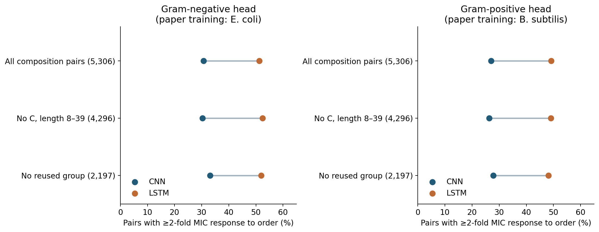

The figure below brings together the concentration-cutoff, within-target disagreement, and classifier-vote comparisons. These panels are different screening questions and do not share a single denominator.

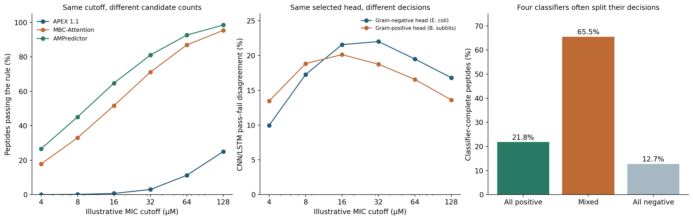

## Shortlist overlap and UpSet figure

An **UpSet plot** gives each exact selection combination its own bar. Filled dots name the models selecting that combination, while pale dots name models excluding it. Pair-only bars exclude triple-shared peptides; inclusive pairwise overlaps add them back. Fixed-budget lists have equal sizes; cutoff-selected lists need not.

The section-1 extension repeats the same complete-case calculation at top 2% and top 5%, using **3,899 and 9,748** entries per model after rounding upward. Triple intersections are **22 and 233**. Membership, exact intersections, and checks are retained in [top-2% outputs](../analysis_review/outputs/shortlist_overlap/top_2pct/) and [top-5% outputs](../analysis_review/outputs/shortlist_overlap/top_5pct/). The [section 1 report](01_shortlists.md#2-what-changes-at-top-2-and-top-5) displays both plots and compares overlaps with consistent denominators.

Spearman correlations compare the same sequences' prediction ranks across each model pair, both in the full 194,947-row cohort and separately within each source. Average tied ranks are used; agreement with Pearson correlation of those ranks and with the previous global estimates is checked. The correlations describe ordering over each stated population, not activity accuracy or ordering restricted to the shortlisted tail. [Correlations and denominators](../analysis_review/outputs/shortlist_overlap/spearman_correlations.csv) · [extension manifest](../analysis_review/outputs/shortlist_overlap/budget_extension_manifest.json). The [rank-agreement subsection](01_shortlists.md#3-rank-agreement-across-models-and-sources) shows every source alongside the pooled estimate.

The 9 November report asks the fixed-budget question before concentration-cutoff comparisons: which peptides would be tested if each tool could nominate the same number? [plot_shortlist_upset.py](../analysis_review/plot_shortlist_upset.py) independently rebuilds the three E. coli lists from the unchanged raw TSV. It sorts sequences lexicographically, takes exactly `ceil(0.01 × 194947) = 1950` lowest predictions per model, and enumerates the seven nonempty membership patterns. No selection boundary is tied. Native outputs remain only approximately matched: APEX ATCC 11775 versus broader E. coli targets in MBC/AMPredictor.

| Exact membership | Count |
|---|---:|
| APEX only | 1,881 |
| MBC only | 1,807 |
| AMPredictor only | 1,816 |
| APEX + MBC, excluding AMPredictor | 36 |
| APEX + AMPredictor, excluding MBC | 27 |
| MBC + AMPredictor, excluding APEX | 101 |
| All three | 6 |

The exclusive cells sum to 5,674 selected sequences. Multiplying each cell by its number of selecting models and summing gives 5,850 selections, exactly 3 × 1,950. For each individual model, its membership cells sum to 1,950. The inclusive pairwise intersections are 36+6=42, 27+6=33, and 101+6=107, reproducing previous results. The new plot therefore changes presentation and adds the previously unreported full intersection breakdown; it does not change the shortlist definition. This is the selected three-tool comparison, not an exhaustive intersection of all MIC outputs. The model review also identifies an E. coli training basis for the DeepAMP negative head; its exclusion from this predefined triad should not be justified by claiming that it has no species-level E. coli basis.

The UpSet figure uses a linear count axis, count labels on every bar, and a dot matrix marking selecting models. Zero/absent models are shown with pale dots. Exclusive bars must not be read as inclusive pairwise counts. Only selected peptides are in the union table; nonselected sequences are not another plotted intersection.

Eight checks cover the cohort, list sizes, partition of the union, reconstruction of total and per-model selections, prior pairwise counts, independent set algebra, and untied boundaries. All passed. Outputs are PNG, PDF, SVG, [exclusive counts](../analysis_review/outputs/shortlist_overlap/exclusive_intersections.csv), [inclusive pairwise counts](../analysis_review/outputs/shortlist_overlap/inclusive_pairwise_overlaps.csv), [all selected sequence memberships](../analysis_review/outputs/shortlist_overlap/shortlist_membership.csv), and [manifest](../analysis_review/outputs/shortlist_overlap/manifest.json). The same script creates separate concentration-cutoff, within-head decision, and classifier-vote panels from the already verified decision tables.

The shortlist plot below displays the seven exact membership cells just tabulated. Its filled dots identify every model selecting a cell, so pair-only bars exclude the triple intersection.

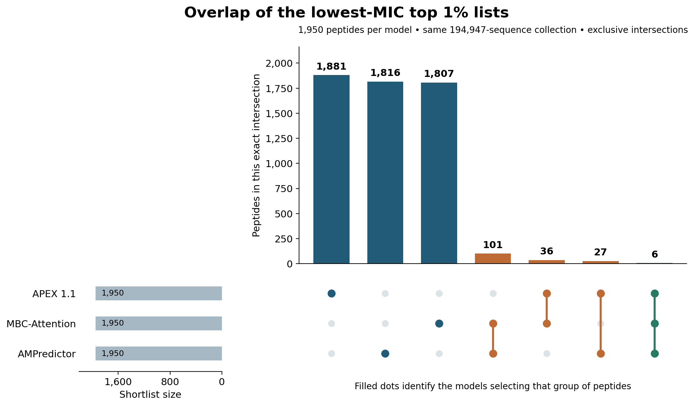

The cutoff plot below instead allows list size to change: it follows the fraction of the shared MIC cohort at or below each concentration.

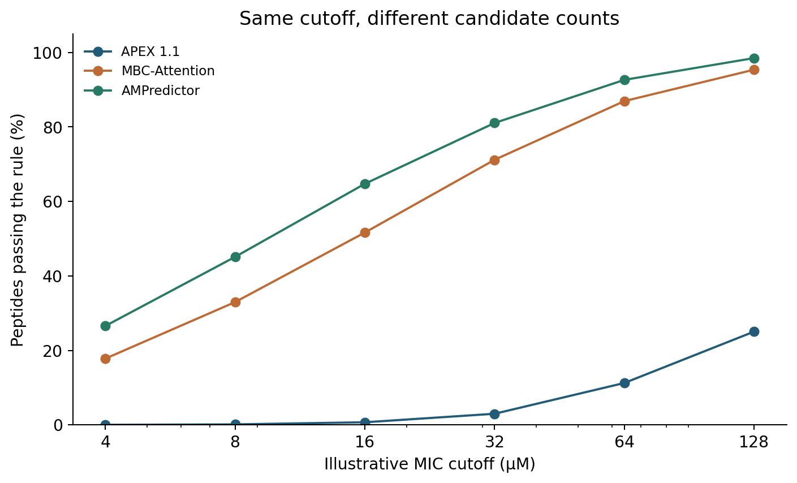

The within-head plot below follows exactly-one-pass fractions as the concentration rule changes, comparing CNN and LSTM for the same declared training target.

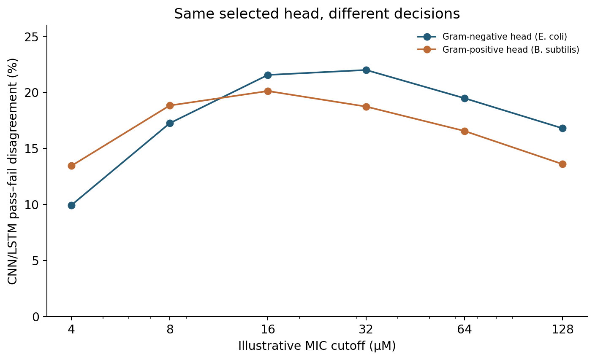

The classifier plot below separates overall all-positive/mixed/all-negative fractions from the distribution of positive-vote counts within the mixed subset.

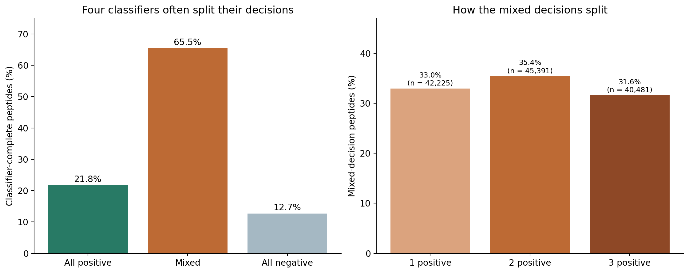

### Exact overlap at the 16 µM cutoff

The same plotting script now supports `python analysis_review/plot_shortlist_upset.py --cutoff-only`. It reads the unchanged primary three-model cohort and selects predictions ≤16 µM, then counts all eight membership combinations, including joint failures. The seven displayed passing combinations partition 144,361 peptides; 50,586 pass none. The individual totals are 1,362, 100,676, and 126,192, and the triple intersection is 897.

Seven checks verify cohort eligibility, the full and passing partitions, reconstructed model totals, agreement with prior cutoff totals, and independent set operations for every exact cell. [Counts](../analysis_review/outputs/shortlist_overlap/cutoff_16uM/exclusive_intersections.csv), [all-sequence memberships](../analysis_review/outputs/shortlist_overlap/cutoff_16uM/cutoff_membership.csv.gz), and [manifest](../analysis_review/outputs/shortlist_overlap/cutoff_16uM/manifest.json) preserve the calculation. The plot and its interpretation appear together in the [cutoff companion](02_concentration_rules.md#the-cutoff-comparison).

The cutoff UpSet below makes the exact membership breakdown visible. Its seven bars count peptides passing at least one tool; joint failures are reported separately above the plot.

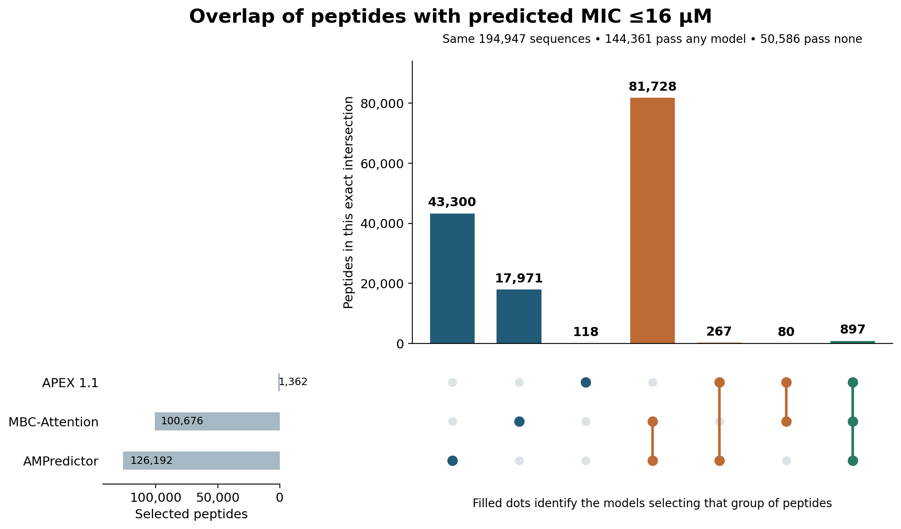

## Model review prompted by the comparison question

The [updated MIC comparability audit](03_matched_targets.md#model-targets-training-and-conversions) links each model's paper and pinned adapter. It distinguishes matched labels from matched biological assays, and paper descriptions from checkpoint-specific training provenance. The most consequential correction is DeepAMP: the paper's negative and positive models use E. coli and B. subtilis MIC measurements respectively, rather than establishing pooled activity across whole Gram classes. It also mixes MIC training with artificial log-MIC = 4 labels for non-AMP examples. Previous broad-Gram wording in the report was too strong. Export column names are preserved; plot titles now annotate the paper-reported species.

MBC-Attention's species-level target averages repeated measurements across conditions; it is not the same target as a strain-specific APEX head. AMPredictor's reported training composition excludes cysteine and lengths ≥40, even if adapters accept longer inputs. APEX 1.1 codes inactive labels at 512 µM. These differences do not invalidate a comparison of the tools' selections, but they prevent attributing every difference to model error, isolated architecture, or a biological residue mechanism. General AMP classifier agreement does not validate a quantitative MIC, and the 16 µM screening rule is not claimed to reproduce the models' native binary classifications.

The adapter review also confirms that MBC removes its configured scale/bias before inverse-log conversion, and that the exported concentration values should not be exponentiated a second time. Code review and the existing sampled DeepAMP replay do not constitute a complete reconstruction of all model exports. Metadata and the original table remain unchanged; a [separate review record](../analysis_review/outputs/model_scope_review/review_record.json) stores annotations and evidence URLs.

A sensitivity prompted by artificial inactive labels asks whether the order-response contrast also exists where both sequences' CNN/LSTM predictions are ≤128 µM within a head. It retains 2,963 pairs for the E. coli-trained head and 3,331 for B. subtilis. Twofold response rates are CNN/LSTM 17.95%/46.98% and 15.55%/45.21%. Thus the direction also occurs outside the high-prediction tail, but conditioning on model outputs cannot isolate a causal pseudo-label effect or supply validation. [review_mic_model_scope.py](../analysis_review/review_mic_model_scope.py) writes these and the 32 µM/10^3.5 sensitivities to [the supporting table](../analysis_review/outputs/model_scope_review/DeepAMP_order_low_prediction_sensitivity.csv).

## Venomics source comparison

- The [Venomics script](../analysis_review/venomics_subgroup.py) uses the same 194,947-sequence primary MIC cohort, including all 4,618 Venomics sequences. It compares that source with the other 190,329 sequences and with each source separately. Source-level classifiers are evaluated on this shared set, rather than mixing them with the larger classifier-only cohort.

- Feature averages first give each sequence equal weight. A second view uses inverse component size within each source, giving every represented source-group equal influence. The graph is the existing observed terminal-extension/one-substitution map. Its components are not independent evolutionary families, and a component can span sources.

- The matched comparison uses exact length and cysteine presence, then adds K/R bins ten percentage points wide. Within each shared category, other-source rates are averaged using Venomics' category mass. This standardizes the comparator to the Venomics population; it differs from the minimum-group weighting used for the section 4 classifier contrasts. Unweighted and inverse-group-weighted versions are both exported. Five- and twenty-point K/R bins and one-source-at-a-time comparisons check dependence on those choices. Coverage is reported as retained Venomics sequence count or group-weight mass, according to the weighting.

- Within-source shortlists take ceil(fraction × source count), with fractions 1%, 2%, 5%, and 10%. The 5% Venomics lists contain 231 entries. Exact membership cells include joint failures in the audit table, although the UpSet displays only the seven passing combinations. Group-median and twenty prediction-independent representative selections repeat the ranking comparison on 401 group entries, with 21 nominations each.

- The source paper and the repository's import code establish prediction-based selection history. The eleven-target APEX 1.0 median check is a diagnostic of that history, not a reconstruction of every original filtering step or a laboratory test. Its multi-target 32 µM rule differs from the current single-target APEX 1.1 16 µM rule.

- The [section 6 companion](06_venomics.md) embeds all four figures alongside definitions, denominators, and limitations. [The manifest](../analysis_review/outputs/venomics/manifest.json) records inputs and the primary checks; [the separate verification script](../analysis_review/verify_venomics_subgroup.py) uses raw sequence counts, NumPy sorting, explicit matched-cell loops, and earlier source correlations to check the reported arithmetic. New files are isolated in [outputs/venomics](../analysis_review/outputs/venomics/), preserving earlier numerical results.

## Source-stratified comparisons across the main dimensions

- The [source analysis](../analysis_review/source_stratified_analysis.py) extends the source-specific questions beyond Venomics. The [source comparison report](SOURCE_COMPARISONS.md) explains ranking, concentration decisions, matched-target decisions, classifier composition and neighbor agreement, and order-response findings with their own source counts.

- Within-source shortlists use ceil(fraction × eligible count), comparing 1%, 2%, 5%, and 10% on the 194,947-sequence primary MIC set. The 5% checks also use group-median predictions, twenty deterministic hash-selected representatives per source-group, and C-free length-8–39 restrictions. Group summaries change the eligible units, rather than estimate corrected peptide rankings. Representatives share the same group count but can choose different sequence variants. Their ranges are not uncertainty intervals.

- Matched-target tables separately use all paired DeepAMP outputs (190,876 sequences) or E. coli APEX versions (195,625). Counts of both-pass, both-fail, and exactly-one-pass decisions are computed at 8, 16, and 32 µM. A further check counts only disagreements where the predictions lie well to either side of the cutoff. Overall disagreement divides exactly-one-pass counts by every eligible pair of predictions; selected-pool disagreement divides by peptides passing either model. Group weights exclude unmapped entries and record that subset's size. All source rates are descriptive, not error estimates.

- The classifier sequence comparison uses the primary set. Within each collection, it compares positive and negative groups at the same length, then averages those differences. Each length receives weight based on how much of the smaller group is available, before or after reducing large related groups' influence. Observed one-residue neighbors reuse the existing 41,253-pair catalogue; the reference now considers peptides in the primary MIC set rather than the larger classifier-only set. Observed same-group fractions are unchanged; reference probabilities can differ slightly. Pair-group reweighting is also exported.

- Order responses are recomputed from raw DeepAMP concentrations for every source and target, using the 5,306 original composition-matched pairs, the 2,197-pair no-group-reuse subset, and target-specific subsets with all four predictions ≤128 µM. Source-balanced summaries average the eight fractions equally rather than pool the pairs. This changes sampling influence without creating independent experiments or identifying a correct biological average.

- Ten primary checks reproduce prior shortlist intersections and matched-target decisions and reconcile source/pair partitions. A [separate verifier](../analysis_review/verify_source_stratified_analysis.py) passes 226 arithmetic checks using raw-array nomination sets, independently chosen representatives, explicit length-category contrasts, and concentration-ratio response tests. [Definitions and hashes](../analysis_review/outputs/source_comparisons/manifest.json), [verification results](../analysis_review/outputs/source_comparisons/independent_verification.json), and [all new tables](../analysis_review/outputs/source_comparisons/) preserve the extension. Existing inputs, notebooks, and previous numerical results remain unchanged.

## Analysis map

The [detailed report](FINAL_ANALYSIS.md) follows one argument: prediction tools change screening choices, and sequence controls help describe how. Each final section now has one detailed companion, indexed in the [README](../README.md#focused-reports). [Other preliminary analyses](PRELIMINARY_ANALYSES.md) collects branches outside that argument, and [reproducibility](REPRODUCIBILITY.md) holds implementation results. This map gives each substantive analysis a current reading destination, including results that weakened an earlier interpretation. Earlier numerical calculations are preserved; current consolidated reports provide their reviewed interpretation.

### Follow the question that matters

If the concern is whether the shortlist differences survive reasonable challenges, read [the robustness report](01_shortlists.md). If it is why a peptide can look “agreed upon” under one rule and disputed under another, read [the agreement report](PRELIMINARY_ANALYSES.md#agreement-definitions-and-profiles). For shared target structure and collection effects, read [the wider output report](PRELIMINARY_ANALYSES.md#wider-output-patterns). For the recovered laboratory panel and the obstacles to an accuracy claim, read [experimental-data recovery](PRELIMINARY_ANALYSES.md#experimental-data-recovery).

The established focused reports cover [sequence changes](05_sequence_responses.md), [MIC variability](02_concentration_rules.md), [model differences](03_matched_targets.md#model-targets-training-and-conversions), and [validation](07_interpretation.md#2-existing-assay-matches-do-not-identify-a-winner). Supplementary here means a supporting result, sensitivity check, or provisional diagnostic; it does not mean every finding has equivalent evidential strength.

### The reviewed notebook, section by section

Section numbers refer to [damp_secondary_analysis.ipynb](../damp_secondary_analysis.ipynb). The table separates the question from its role in the report, so a result does not disappear merely because it is unsuitable as a headline.

| Notebook section | Question and current destination | Why it has that role |
|---|---|---|
| 1. Reproducibility and semantics | [Validation](07_interpretation.md#2-existing-assay-matches-do-not-identify-a-winner), [coverage and native outputs](PRELIMINARY_ANALYSES.md#1-coverage-is-part-of-the-comparison), [model conversions](03_matched_targets.md#4-the-unit-conversions-have-been-checked-at-the-adapter-level) | Establishes calculation and output meaning, rather than biological correctness. |
| 2. Provenance, composition, coverage | [Source composition and missingness](PRELIMINARY_ANALYSES.md#1-coverage-is-part-of-the-comparison) | Defines which collection and eligible sequences each result describes. |
| 3. APEX version drift | [Main matched-target result](FINAL_ANALYSIS.md#3-differences-remain-when-the-declared-target-is-matched), [label-scale check](03_matched_targets.md#5-apex-label-changes-give-a-concrete-scale-hypothesis-rather-than-a-correction) | Same strain is useful; changed labels and training prevent a simple causal interpretation. |
| 4. Approximate E. coli agreement | [Main shortlist and cutoff results](FINAL_ANALYSIS.md#1-different-models-choose-different-peptides), [budget and reference checks](01_shortlists.md#5-the-budget-matters-but-no-tested-budget-makes-the-lists-interchangeable) | Supports practical selection differences, with only approximate endpoint matching. |
| 5. DeepAMP outputs and extremes | [DeepAMP output patterns](PRELIMINARY_ANALYSES.md#5-deepamp-extremes-require-a-label-and-preprocessing-explanation) | Head meanings and artificial inactive labels qualify extreme-value interpretations. |
| 6. Classification disagreement | [Classifier-group sequence analysis](04_classifier_sequences.md), [pairwise metrics and native AMP-Read](PRELIMINARY_ANALYSES.md#6-classifier-agreement-has-structure-native-amp-read-remains-unresolved) | Classifier votes are separate from quantitative MIC estimates; sequence profiles and neighbor transitions describe their structure. |
| 7. Sequence associations | [Definition-dependent profiles](PRELIMINARY_ANALYSES.md#1-a-definition-can-reverse-the-apparent-sequence-trend), [Venomics weighting](PRELIMINARY_ANALYSES.md#4-venomics-shows-why-the-unit-receiving-weight-matters) | Pooled residue/length associations do not establish a general mechanism. |
| 8. APEX target spectrum | [Matched-panel decomposition](PRELIMINARY_ANALYSES.md#2-matching-the-target-panel-changes-the-apex-spectrum-story) | Full panels are unequal; a direct version comparison needs the same targets. |
| 9. Shortlist stability and limits | [Main cutoff result](FINAL_ANALYSIS.md#2-a-concentration-cutoff-changes-the-screening-decision), [robustness](01_shortlists.md) | Selection counts are operational results, not true active fractions. |
| 10. Target-coverage follow-up | [Matched spectrum and residuals](PRELIMINARY_ANALYSES.md#2-matching-the-target-panel-changes-the-apex-spectrum-story) | Corrects the initial impression created by comparing 34 with 11 targets. |
| 11. Budget and source composition | [Budget, source quotas, and population checks](01_shortlists.md) | Tests whether the headline depends on one budget or collection. |
| 12. Length-stratified source effects | [Source and weighting effects](PRELIMINARY_ANALYSES.md#wider-output-patterns), [source/length sensitivity table](../analysis_outputs/source_length_sensitivity.csv) | Describes conditional source differences; source is not a randomized treatment. |
| 13. Sanity checks | [Reproduction evidence](07_interpretation.md#2-existing-assay-matches-do-not-identify-a-winner), [stress tests](01_shortlists.md) | Arithmetic checks support implementation, not independent replication. |
| 14. Extreme-tail sequence neighbors | [Related-sequence audit](05_sequence_responses.md#5-related-sequences-and-opposite-model-preferences-qualify-the-pooled-result) | Motivated dependence checks; the selected 200-row tail is not a representative experiment. |
| 15. MIC comparability | [Model review](03_matched_targets.md#model-targets-training-and-conversions) | Corrects earlier DeepAMP target wording and checks unit adapters. |
| 16. Low disagreement and domain restriction | [Agreement definitions](PRELIMINARY_ANALYSES.md#agreement-definitions-and-profiles), [domain checks](01_shortlists.md#6-related-variants-and-collection-composition-explain-part-of-the-picture) | A low prediction spread is not validated confidence or an established training domain. |
| 17. Pinned-weight replay | [Validation](07_interpretation.md#2-existing-assay-matches-do-not-identify-a-winner), [padding sensitivity](PRELIMINARY_ANALYSES.md#5-deepamp-extremes-require-a-label-and-preprocessing-explanation) | A sampled inference route reproduces; other routes and all-model reconstruction remain open. |
| 18. Experimental error and correction | [Original diagnostic limits](PRELIMINARY_ANALYSES.md#4-the-original-disagreementerror-and-calibration-diagnostics-remain-exploratory) | A tiny exposed sample cannot validate a confidence score or a general calibration. |
| 19. Training overlap | [Original panel exposure](07_interpretation.md#2-existing-assay-matches-do-not-identify-a-winner), [discordant-family neighbors](../analysis_outputs/discordant_family_training_neighbors.csv) | Exact exposure and nearby training sequences qualify an apparent accuracy result. |
| 20. Symmetric disagreement tails | [Tail profiles, matching support, and controls](PRELIMINARY_ANALYSES.md#agreement-definitions-and-profiles) | Definitions and weighting change apparent sequence rules. |
| 21. MIC variability | [MIC-context report](02_concentration_rules.md) | Condition differences are relevant but do not supply a universal error allowance. |
| 22. Fixed-budget overlap | [Main UpSet result](FINAL_ANALYSIS.md#1-different-models-choose-different-peptides) | Exact membership is a direct screening result. |
| 23. Cutoff and consensus decisions | [Main sections 2–4](FINAL_ANALYSIS.md#2-a-concentration-cutoff-changes-the-screening-decision), [classifier detail](PRELIMINARY_ANALYSES.md#6-classifier-agreement-has-structure-native-amp-read-remains-unresolved) | Makes denominators and pipeline rules explicit. |
| 24. Controlled sequence order | [Main sequence result](FINAL_ANALYSIS.md#5-sequence-order-affects-models-differently-even-for-the-same-target), [sequence detail](05_sequence_responses.md) | Composition controls support fitted-function differences; biological validation is missing. |

The [early EDA](../damp_exploratory_analysis.ipynb) also preserves APEX per-sequence SD and CV, an individual extreme profile, ten largest spreads, collapsed-family comparisons, row disagreement scores, and pairwise statistics. These remain inspection tools. Family averages mix targets and versions, AMP-Read units remain unresolved, and selected extremes are not typical peptides. The [wider output report](PRELIMINARY_ANALYSES.md#6-classifier-agreement-has-structure-native-amp-read-remains-unresolved) explains why these should not be promoted into accuracy or assay-uncertainty claims.

### Later analyses that are not all executed inside the notebook

The notebook links later scripts without pretending their results came from its original saved execution. The table below is the reading and reproduction path for those extensions; scripts consume local inputs and dependencies described in the [README](../README.md#reproduce-numerical-analyses).

| Extension and code | Current narrative | Saved evidence |
|---|---|---|
| [Independent review](../analysis_review/review_analysis.py) | [Agreement definitions](PRELIMINARY_ANALYSES.md#agreement-definitions-and-profiles), [source structure](PRELIMINARY_ANALYSES.md#wider-output-patterns), [validation](07_interpretation.md#2-existing-assay-matches-do-not-identify-a-winner) | [Review summary](../analysis_review/outputs/review_summary.json), [checks](../analysis_review/outputs/independent_checks.csv) |
| [Original notebook reproduction](../analysis_review/reproduce_notebook.py) | [Validation](07_interpretation.md#2-existing-assay-matches-do-not-identify-a-winner) | [Per-table reproduction record](../analysis_review/outputs/notebook_reproduction.json) |
| [Stress tests](../analysis_review/stress_test_findings.py) | [Robustness](01_shortlists.md), [agreement controls](PRELIMINARY_ANALYSES.md#agreement-definitions-and-profiles), [label sensitivity](03_matched_targets.md#5-apex-label-changes-give-a-concrete-scale-hypothesis-rather-than-a-correction) | [Manifest](../analysis_review/outputs/sanity_checks/stress_test_manifest.json), [all tables](../analysis_review/outputs/sanity_checks) |
| [Additional trends](../analysis_review/explore_additional_trends.py) | [Target patterns and weighting](PRELIMINARY_ANALYSES.md#wider-output-patterns), [terminal position and composition](05_sequence_responses.md#4-terminal-changes-give-a-second-view-of-local-sensitivity) | [Manifest](../analysis_review/outputs/additional_trends/additional_trends_manifest.json), [all tables](../analysis_review/outputs/additional_trends) |
| [Local sequence extension](../analysis_review/sequence_disagreement.py) | [Sequence findings](05_sequence_responses.md) | [Manifest](../analysis_review/outputs/sequence_disagreement/sequence_analysis_manifest.json), [all tables](../analysis_review/outputs/sequence_disagreement) |
| [Similar-MIC subgroup](../analysis_review/similar_mic_different_ranks.py) | [Agreement definitions and subgroup limits](PRELIMINARY_ANALYSES.md#agreement-definitions-and-profiles) | [Manifest](../analysis_review/outputs/similar_mic_different_ranks/subanalysis_manifest.json), [all tables](../analysis_review/outputs/similar_mic_different_ranks) |
| [Screening decisions](../analysis_review/screening_decision_trends.py) | [Main report](FINAL_ANALYSIS.md), [directional sequence profiles](05_sequence_responses.md#5-related-sequences-and-opposite-model-preferences-qualify-the-pooled-result) | [Manifest](../analysis_review/outputs/screening_decision_trends/manifest.json), [all tables](../analysis_review/outputs/screening_decision_trends) |
| [Exact shortlist intersections](../analysis_review/plot_shortlist_upset.py) | [Main UpSet result](FINAL_ANALYSIS.md#1-different-models-choose-different-peptides) | [Membership and count tables](../analysis_review/outputs/shortlist_overlap) |
| [Model scope review](../analysis_review/review_mic_model_scope.py) | [Model report](03_matched_targets.md#model-targets-training-and-conversions) | [Review record](../analysis_review/outputs/model_scope_review/review_record.json), [low-output sensitivity](../analysis_review/outputs/model_scope_review/DeepAMP_order_low_prediction_sensitivity.csv) |
| [Classifier sequences](../analysis_review/classifier_sequence_analysis.py) | [Section 4 companion](04_classifier_sequences.md) | [Definitions and hashes](../analysis_review/outputs/classifier_sequences/manifest.json), [all profiles and neighbor tables](../analysis_review/outputs/classifier_sequences) |
| [Venomics source comparison](../analysis_review/venomics_subgroup.py) | [Section 6 companion](06_venomics.md) | [Manifest](../analysis_review/outputs/venomics/manifest.json), [separate checks](../analysis_review/outputs/venomics/independent_verification.json), [all tables](../analysis_review/outputs/venomics/) |
| [All-source comparisons](../analysis_review/source_stratified_analysis.py) | [Source comparison companion](SOURCE_COMPARISONS.md) | [Manifest](../analysis_review/outputs/source_comparisons/manifest.json), [separate verification](../analysis_review/outputs/source_comparisons/independent_verification.json), [all tables](../analysis_review/outputs/source_comparisons/) |
| [Experimental recovery](../analysis_review/curate_archaeasin_labels.py) | [Experimental curation](PRELIMINARY_ANALYSES.md#experimental-data-recovery) | [Source/identity manifest](../analysis_review/outputs/archaeasin_curation_manifest.json), [provisional diagnostics](../analysis_review/outputs/archaeasin_provisional_diagnostics.csv) |

Original notebook tables remain in [analysis_outputs](../analysis_outputs). The [scientific audit](METHODS.md) retains formulas, detailed restrictions, computational checks, and methodological history. Duplicate report snapshots have been removed after retaining the substantive analyses here. This separation keeps a focused argument in the main report while preserving the reasoning, useful secondary results, and unsuccessful explanations behind it.
