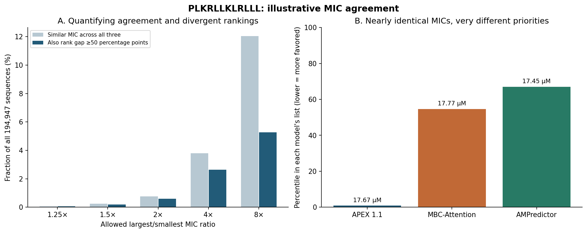
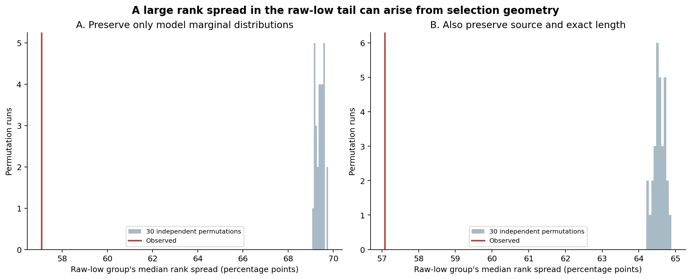
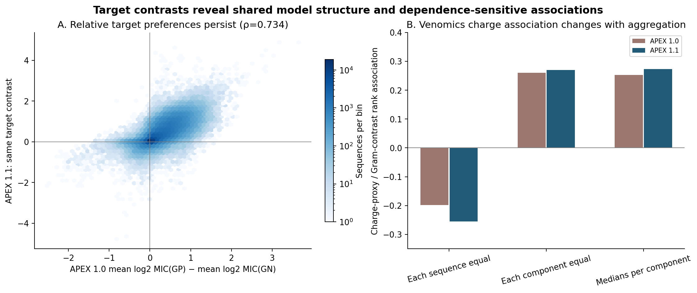

# Other preliminary analyses and why they remain secondary

These branches tested explanations and exposed limits without supplying equally strong headline findings. Their full reasoning, figures, and data links are collected here: agreement definitions, wider output patterns, and provisional experimental-data recovery. The [main report](FINAL_ANALYSIS.md) and its seven companions retain the central screening argument; [methods](METHODS.md) maps the notebooks and calculations.

A few terms recur across these branches. **Log2** expresses ratios in doubling steps: one unit means a factor of two. A **percentile** gives a peptide's position in a model's predictions, with lower values favoring selection. **Spearman correlation** compares ranks on a −1 to +1 scale: +1 means the same ordering, 0 no overall rank association, and −1 reversed ordering. None of these output summaries establishes biological accuracy.

## Agreement definitions and profiles

The earliest analysis searched for peptides with especially small or large disagreement. That is a reasonable starting point, but it leaves a question unanswered: agreement about concentration, relative placement, or biological correctness? This report preserves the tail analyses and the similar-MIC subgroup as explanations of that distinction. Their reduced prominence in the [main report](FINAL_ANALYSIS.md) reflects their interpretation, rather than failed calculations.

### 1. A definition can reverse the apparent sequence trend

The comparison uses the same **194,947 sequences** with APEX 1.1, MBC-Attention, and AMPredictor predictions. Three scores answer different questions:

- **Raw spread:** log2 of the largest/smallest predicted MIC. It measures disagreement in exported concentrations.
- **Centered spread:** the range after subtracting each model's median log2 prediction. It asks about relative deviations after aligning typical levels; the result is not a calibrated MIC.
- **Rank gap:** the highest minus lowest within-model percentile. It measures relative placement in this collection, in percentage points.

A **tail** is the lowest or highest 5% after sorting sequences by the chosen disagreement score. A sequence profile summarizes features such as length or amino-acid content within that selected group. The next table asks whether changing the score changes the apparent length pattern:

| Definition | Low-tail median length | High-tail median length |
|---|---:|---:|
| Raw spread | 14 | 36 |
| Centered spread | 26 | 17 |
| Rank gap | 24 | 20 |

The raw and centered tails each contain 9,748 sequences; the low rank-gap tail contains 9,749 because the quantile includes ties. These are separately selected groups, not the same groups renamed. The raw high tail also contains cysteine in **56.4%** of sequences versus **5.1%** in the raw low tail. That is a property of this selection rule, rather than a universal cysteine or length effect. [Tail profiles](../analysis_review/outputs/sequence_profiles_by_agreement_definition.csv), [group transitions](../analysis_review/outputs/agreement_definition_transitions.csv), and [original tail comparisons](../analysis_outputs/high_low_profiles.csv).

“Lowest disagreement” is also relative to the collection: the raw bottom 5% extends to approximately **4.63-fold spread**, so it is not the twofold-agreed subset examined below. In the raw high tail, the largest/smallest pair is APEX/AMPredictor in **66.3%** and APEX/MBC in **33.0%** of cases. A classifier gives an activity score or label rather than a concentration. Here, a positive vote uses score ≥0.5; **positive unanimity** means all four vote positive. This occurs for **54.0% in the raw low tail** versus **17.7% in the high tail**. These profiles connect output ranges with sequence preferences; they do not make the low tail biologically reliable. [Tail thresholds](../analysis_outputs/low_disagreement_summary.csv), [direction counts](../analysis_outputs/high_low_model_direction.csv), and [classifier profiles](../analysis_outputs/high_low_classifier_agreement.csv).

**Composition entropy** measures how evenly amino-acid types are represented, in bits; a higher value means a more diverse mix. It offers another warning, and shorter sequences have fewer opportunities to contain different residues. The raw high-minus-low entropy difference is **0.732 bits**; after subtracting source/exact-length means, it is **0.094 bits**. Direct matching by source, length, and predicted-MIC bin covers only **1,019 of 9,748** high-tail sequences. A striking unadjusted profile therefore does not establish an independent sequence mechanism. [Entropy sensitivity](../analysis_review/outputs/entropy_length_sensitivity.csv) and [matching results](../analysis_outputs/high_low_matched.csv).

### 2. Similar MICs with different ranks are common within a small selected subset

Define three-model MIC agreement as largest/smallest prediction ≤2, and divergent placement as a rank gap of at least 50 percentage points. These are descriptive cutoffs, not established error tolerances. **1,478/194,947 sequences (0.758%)** satisfy MIC agreement; **1,155 (0.592% of all sequences)** also satisfy the placement rule. The latter are **78.15% of the MIC-agreed subset**. The conditional percentage is large because the subset is small and the models' output distributions differ.

**Figure 1** contrasts the prevalence of concentration agreement with one selected example of nearly equal MIC predictions occupying different ranks.

*Figure 1. Left: prevalence uses all 194,947 shared sequences as denominator at each allowed ratio. Right: PLKRLLKLRLLL receives predictions near 17.5–17.8 µM from all three tools, but percentiles of approximately 0.85, 54.63, and 67.01. The bars measure placement, not concentrations or accuracy; the MIC annotations show the numerical agreement.*

The numerical explanation is direct. A fixed **32 µM** lies at about the **2.99th, 71.18th, and 81.07th percentiles** of these models' distributions. Equal values can therefore receive different placements without disagreeing about that sequence's predicted concentration. Percentiles become useful when a decision uses a fixed testing budget. They add less information when the decision already uses a common concentration rule. [Fixed-value lookup](../analysis_review/outputs/similar_mic_different_ranks/same_value_different_reference_percentiles.csv).

The phenomenon also differs by model pair:

| Pair | Predictions within twofold | Also ≥50-point rank gap |
|---|---:|---:|
| APEX/MBC | 9,252 (4.75%) | 5,240 |
| APEX/AMPredictor | 4,669 (2.40%) | 3,468 |
| MBC/AMPredictor | 80,156 (41.12%) | 0 |

Every percentage uses 194,947 as denominator. All 1,155 three-model joint cases have the most favorable percentile under APEX. This asymmetry is consistent with distribution differences; it should accompany any general phrase such as “agreement between models.” [Pairwise counts](../analysis_review/outputs/similar_mic_different_ranks/pairwise_agreement_and_ranks.csv) and [threshold grid](../analysis_review/outputs/similar_mic_different_ranks/prevalence_threshold_sensitivity.csv).

### 3. The subgroup has a recognizable composition, but no demonstrated special motif

Before comparing ingredients, **K/R content** is the percentage of residues that are lysine (K) or arginine (R), and **D/E content** is the percentage that are aspartic acid (D) or glutamic acid (E). **Hydrophobic content** counts A/I/L/M/F/W/V/Y residues divided by length; **cysteine presence** records whether a peptide contains any C. These are sequence summaries, not measured charge or structure.

The 1,155 joint cases have median length **14**, mean K/R fraction **28.13%**, mean D/E fraction **1.10%**, and mean hydrophobic fraction **54.31%**. **97.06% lack cysteine** and **86.75% lack D/E**. Each content percentage first divides a peptide's residue count by its own length, then averages across peptides, so longer sequences do not automatically receive greater weight.

To compare like sequence contexts, the analysis groups peptides by source, exact length, and similar predicted MICs (**bins**). It averages feature differences only within categories containing both the selected subgroup and controls, giving each category the smaller group's count as weight. This reduces those background differences, but cannot establish a causal sequence effect.

Against the remaining collection, this matching leaves modest differences: about **+0.95 percentage points in K/R**, **+2.23 in hydrophobic fraction**, and **−6.85 in cysteine presence**. Reducing the weight of large related groups retains these directions under the implemented bin choices. However, the more informative alternative control—other MIC-agreed peptides without large rank gaps—has poor support: only 76 target sequences share the primary bins, with a maximum matching capacity of 45. Its median middle prediction is about **300 µM**, versus **31 µM** in the target group. It cannot support a broad claim that a particular motif separates the two kinds of agreement.

**Adjacency** counts neighboring residues of a chosen type, such as two K/R residues side by side. Subtracting the average expected after randomly reordering the same ingredients asks whether they cluster beyond what composition alone predicts. These corrected counts provide no evidence of extra K/R or hydrophobic clustering in the selected group. Those descriptors subtract the expected adjacency under a random reordering of the same ingredients; they are not estimates of helicity or amphipathicity. Observed sequence groups join terminal extensions and one-residue substitutions, including chains of such links; they are not curated evolutionary families. The subgroup spans 762 such groups, and representative selection lowers its joint fraction among MIC-agreed sequences to **68.95%**. Composition and prevalence depend on the collection. [Profiles](../analysis_review/outputs/similar_mic_different_ranks/sequence_profiles.csv), [matched contrasts](../analysis_review/outputs/similar_mic_different_ranks/matched_sequence_profiles.csv), [support](../analysis_review/outputs/similar_mic_different_ranks/matched_comparison_support.csv), and [population sensitivity](../analysis_review/outputs/similar_mic_different_ranks/population_sensitivity.csv).

### 4. Destructive controls explain why the original interpretation was narrowed

Each model's predictions were independently reassigned to peptides, either globally or within source/exact-length strata, for 30 runs per construction. This preserves output distributions while destroying some peptide-specific alignment. The raw-low group's median rank gap is **57.1 points in the observed data**, versus roughly **69.4** under global reassignment and **64.6** under stratified reassignment.

**Figure 2** compares the observed low-tail rank gap with the values produced by these reassignments. It asks how much of the pattern can arise without preserving peptide-specific predictions.

*Figure 2. Red lines show the observed median; histograms summarize 30 constructed reassignments. Large rank gaps can arise from differing distributions and the rule selecting small concentration spreads. These controls are not a biological error model or a significance test.*

Source/length-preserving reassignments also retain a **20-residue** high-minus-low length difference, close to the observed **22**. Fine alignment to individual sequences is therefore unnecessary to generate a similar qualitative profile. The observed concentration spread is nevertheless smaller than in the controls, leaving evidence of shared peptide-aligned behavior. [Permutation summaries](../analysis_review/outputs/sanity_checks/agreement_geometry_permutation_summary.csv) and [alternative rank references](../analysis_review/outputs/sanity_checks/rank_reference_sensitivity.csv).

The reportable finding is a methodological one: agreement scores select different sequence regimes, so a low score cannot stand in for confidence or biological reliability. The [sequence report](05_sequence_responses.md) develops the more direct local-edit and composition-controlled comparisons; the [scientific audit](METHODS.md#similar-mic-predictions-with-divergent-rankings-focused-subanalysis) retains the full subgroup methods.

## Wider output patterns

The [source comparison report](SOURCE_COMPARISONS.md) now follows all eight collections through the main screening and sequence questions, including group-weighting and denominator checks. The patterns below preserve the broader exploratory history.

The main screening comparison deliberately chooses a few interpretable outputs. The repository also asks broader questions: how much target-specific information remains in APEX, how sources shape correlations, why DeepAMP has extreme values, and which classifiers tend to agree. This report preserves those patterns without treating unlike outputs as interchangeable measurements.

### 1. Coverage is part of the comparison

The input contains **195,625 unique sequences** from eight collections, with source sizes ranging from 4,618 Venomics sequences to 49,986 AMPDIFF sequences. Median length ranges from 18 in the database/challenge collections to 37 in Archaeomics. A pooled pattern can therefore reflect which sequence regimes a collection contributes.

Missing values are structured. MBC has **667 length-ineligible rows**; each DeepAMP output has **4,749**; MACREL has **five**. AMPredictor has **11 missing predictions not explained by its declared parser-length filter**. Accepted parser lengths do not certify the training domain: AMPredictor's reported training examples are cysteine-free and shorter than 40 residues. The [source summary](../analysis_outputs/source_summary.csv), [coverage audit](../analysis_outputs/coverage.csv), and [model review](03_matched_targets.md#model-targets-training-and-conversions) separate availability from interpretation. Missing scores are excluded from a comparison, rather than silently counted as rejections.

### 2. Matching the target panel changes the APEX spectrum story

The first APEX decomposition used all available targets: 34 in version 1.0 and 11 in version 1.1. It separated log-prediction variation into a peptide average, a target average, and a peptide-by-target remainder. Those fractions initially looked very different across versions. Comparing unlike panels made that impression misleading.

This decomposition asks whether predictions mainly change with the peptide, with the bacterial target, or with a specific peptide–target combination. The first three percentages divide each contribution's squared variation by the total squared variation in the matched log-prediction matrix. The last row instead asks how much variation remains aligned along one fitted direction after each target's average is removed; this direction is called the **first principal component (PC1)**. Its denominator is the variation in that target-centered matrix.

On the **same eight unambiguous targets**, the versions look much closer:

| Share of variation in the matched log-prediction matrix | APEX 1.0 | APEX 1.1 |
|---|---:|---:|
| Peptide average | 54.29% | 52.07% |
| Target average | 24.04% | 23.23% |
| Remaining peptide-by-target pattern | 21.67% | 24.69% |
| First principal component after target centering | 88.12% | 87.69% |

The first three rows partition variation under an additive decomposition; the last uses a different denominator and should not be added to them. A principal component is a fitted direction summarizing co-variation, not predictive accuracy or a biological mechanism. After removing peptide and target averages, target-specific cross-version rank correlations remain **0.443–0.856**. There is shared target-profile structure beyond a common overall level, with differing degrees of preservation. [Unmatched decomposition](../analysis_outputs/apex_spectrum_decomposition.csv), [matched decomposition](../analysis_outputs/matched_spectrum.csv), and [target residuals](../analysis_outputs/spectrum_residual_reproducibility.csv).

### 3. Some relative target preferences persist despite version scale changes

A second view compares the mean log2 prediction for four Gram-positive targets with the mean for four Gram-negative targets in that matched panel. This is the log2 ratio of their geometric-mean MICs. A positive contrast means the model predicts a higher typical MIC for the selected Gram-positive targets. It is a panel summary, not a universal bacterial-class selectivity score.

The right panel introduces a separate issue: weighting. Its **charge proxy** is `(K+R−D−E)/length`, using the amino acids defined above rather than a pH-dependent charge measurement. Related-sequence groups join observed substitutions and terminal extensions. Giving a whole group the same total weight prevents a densely sampled group from dominating simply because it supplies many variants.

**Figure 3** links two checks: preservation of the selected target contrast across APEX versions on the left, and its association with the charge proxy under different weighting on the right.

*Figure 3. Left: the same panel contrast in both APEX versions, with bin color indicating sequence count. Right: the charge-proxy association in Venomics changes sign when related-sequence groups receive equal influence. Both panels describe predictions and their sampling, not measured target preferences.*

Cross-version correlation asks whether peptides with a larger panel contrast in one version also have a larger contrast in the other. The Spearman correlation is **0.734** across all 195,625 sequences and positive in every source. Spearman measures consistency of ordering on a −1 to +1 scale. Using each related-sequence group's median contrast instead of every individual sequence gives **0.700**, but ranges **0.540–0.863** when one target is omitted. A further check removes a fitted cubic relationship between each version's contrast rank and its PC1 rank, reducing an association with the dominant overall prediction pattern. The remaining deviations, or **rank residuals**, have a **0.530 Pearson correlation**. Pearson measures linear association between these residuals, rather than directly comparing original ranks. That is a particular descriptive adjustment fitted on this collection, not another Spearman estimate or an experimental calibration. A shared developmental history can also preserve model structure.

The useful finding is that version drift does not erase every relative target pattern. The sensitivity to target choice prevents a broad claim of general Gram-class selectivity. [Panel contrasts](../analysis_review/outputs/additional_trends/Gram_contrast_reproducibility.csv), [leave-target-out checks](../analysis_review/outputs/additional_trends/Gram_contrast_leave_one_target_out.csv), [all target-pair contrasts](../analysis_review/outputs/additional_trends/target_pair_contrast_reproducibility.csv), and [potency-axis adjustment](../analysis_review/outputs/additional_trends/Gram_contrast_potency_axis_sensitivity.csv).

### 4. Venomics shows why the unit receiving weight matters

Within the common cohort, Venomics has **4,618 sequences in 401 observed groups**; its ten largest groups contain **57.2% of rows**. The charge proxy is `(K+R−D−E)/length`, without pH, terminal chemistry, or disulfide information.

Giving every sequence equal weight produces charge/target-contrast rank correlations of **−0.199 and −0.255** for the two APEX versions. Giving every represented group the same total weight changes them to **+0.260 and +0.270**; component medians give similar positive values. The question has changed from the average relationship among observed variants to a relationship with reduced influence from heavily sampled groups. Neither weighting is automatically the biological truth.

Ordinary adjustment for length, hydrophobicity, and cysteine does not remove the sign reversal problem: it does not address how many variants each group supplies. The graph captures observed terminal and substitution relationships, not all homology or independent families. This is a strong reason to disclose weighting, rather than evidence for a newly discovered charge mechanism. [Group concentration](../analysis_review/outputs/additional_trends/source_sequence_component_concentration.csv), [weighting comparisons](../analysis_review/outputs/additional_trends/charge_Gram_contrast_aggregation_sensitivity.csv), and [large-group omissions](../analysis_review/outputs/additional_trends/Venomics_large_component_sensitivity.csv).

**Covariance** measures whether two models' log predictions rise and fall together. Splitting it into variation between source averages and variation within sources asks how much the pooled association reflects collection differences. Between-source means supply **39.5% and 38.6% of pooled log covariance** for APEX 1.1 versus MBC and AMPredictor. Those are fractions of covariance, not explained variance or causal effects. Offsets estimated on the other seven sources reduce spread in every held-out source, but Archaeomics retains **5.39-fold** median spread versus **3.78-fold** using local centering. A prediction-only correction does not transfer identically everywhere. [Covariance decomposition](../analysis_review/outputs/source_covariance_decomposition.csv), [offset transfer](../analysis_review/outputs/source_offset_transfer.csv), and [within-source correlations](../analysis_review/outputs/within_source_correlations.csv).

### 5. DeepAMP extremes require a label and preprocessing explanation

The early length plot and quantiles show many high DeepAMP predictions near **10,000 µM** and a maximum of about **467,177 µM** in the LSTM B. subtilis-trained output. A maximum is one selected observation, rather than a typical concentration. The paper uses an artificial non-AMP training label corresponding to 10,000 µM, which makes that region interpretable as part of its training convention. It is not a hard output ceiling or evidence of a measured MIC at that value.

CNN and LSTM are two fitted neural-network designs. A DeepAMP **head** is the output trained for one target; comparing models within it keeps that target the same. A **within-twofold fraction** counts peptides whose larger prediction is at most twice the smaller, divided by all 190,876 paired sequences. Within-head rank correlations are about **0.766 for E. coli** and **0.801 for B. subtilis**, while only **48.63% and 50.43%** of paired predictions agree within twofold. Near-unity median per-sequence model ratios in the decision analysis do not imply agreement on individual peptides. The exported head names refer to the paper-reported training species, as clarified in the [model report](03_matched_targets.md#model-targets-training-and-conversions).

Preprocessing also matters. The sampled route comparison and its numerical results are collected in [reproducibility](REPRODUCIBILITY.md#2-a-sampled-deepamp-inference-route-matched-the-saved-table), rather than interpreted as biological validation here. [Output quantiles](../analysis_outputs/deepamp_quantiles.csv), [length summaries](../analysis_outputs/deepamp_by_length.csv), and [paired agreement](../analysis_outputs/deepamp_agreement.csv) retain the descriptive output evidence.

### 6. Classifier agreement has structure; native AMP-Read remains unresolved

A positive classifier decision here means score ≥0.5; **pairwise agreement** counts equal positive/negative decisions divided by the 195,620 sequences with all four scores. **Cohen's kappa** adjusts this agreement against an independence reference using each classifier's positive rate: 0 matches that reference and 1 means identical decisions. It is not accuracy.

At the illustrative 0.5 score rule, MACREL, AI4AMP, AMP-CLIP, and AMPlify give positive decisions for **46.83%, 60.95%, 47.66%, and 61.84%** of 195,620 complete sequences. Their pairwise agreement ranges from **56.89% to 70.08%**, with Cohen's kappa approximately **0.147–0.400**. Kappa compares observed agreement with an independence reference using marginal positive rates; it is neither accuracy nor an assay uncertainty measure.

All-positive plus all-negative decisions total **34.52%**, compared with hypothetical references that assign each model's votes independently while keeping its positive rate: **12.56% globally** and **19.01% keeping the rates separately within each source and exact length**. Thus frequent mixed votes coexist with shared structure. The full 16 vote patterns and only-positive/only-negative counts show which programs drive a split. Scores are not interchangeable calibrated probabilities, and AMP-CLIP is already binary. [Pairwise metrics](../analysis_review/outputs/screening_decision_trends/classifier_pairwise_agreement.csv), [vote patterns](../analysis_review/outputs/screening_decision_trends/classifier_vote_patterns.csv), [single dissent](../analysis_review/outputs/screening_decision_trends/classifier_single_dissent.csv), and [source outcomes](../analysis_review/outputs/screening_decision_trends/classifier_consensus_by_source.csv).

AMP-Read's native output was explored through rank associations, but its matched biological target and concentration unit remain unresolved. Those associations are retained as descriptive native-scale diagnostics; they do not justify µM comparisons or inclusion in the main MIC consensus. Similarly, the [early EDA](../damp_exploratory_analysis.ipynb) averages unlike targets and model variants within families to inspect the file. Its standard deviation (SD, spread around the mean), coefficient of variation (CV, SD divided by the absolute mean), and pairwise summaries remain an exploration of numerical dispersion, rather than a like-for-like model benchmark. [AMP-Read associations](../analysis_outputs/ampread_associations.csv) and [output semantics](../analysis_outputs/column_semantics.csv) document that boundary.

## Experimental-data recovery

The prediction disagreements naturally lead to a harder question: which tool is closer to measured activity? The [validation report](07_interpretation.md#2-existing-assay-matches-do-not-identify-a-winner) explains why the original 13 numeric matches cannot decide that. A separate search recovered a larger published peptide panel. It adds useful evidence, but the process of recovering identities and interpreting inactive labels is part of the result.

### 1. A larger panel was recovered, but it was already selected by a model

The archaeasin publication's Source Data Fig. 2 workbook contains an **80-peptide measured-activity table**; Extended Data Fig. 4 contains prediction/label pairs. Earlier supplementary composition tables are not MIC measurements. The paper selected the peptide panel using APEX 1.1, so even a perfectly reconstructed panel would answer a question conditional on that selection. It would not be a neutral discovery benchmark across all DAMP sources. [Publication](https://www.nature.com/articles/s41564-025-02061-0).

The numbered measurement rows do not themselves contain sequence strings. A **prediction vector** here is the set of eleven target-specific predictions for one peptide. Their identities were reconstructed by matching these published vectors to the corresponding TSV outputs. Every best match differs by less than **0.01 log2 units** at its worst target; every runner-up exceeds **0.05**. Omitting each target in turn preserves all 80 unique matches. Measurements were not used in this join.

This is strong evidence for the reconstruction, but it remains an inferred identity map rather than an author-confirmed join. The [download and hash manifest](../analysis_review/outputs/archaeasin_curation_manifest.json), [provisional identity map](../analysis_review/outputs/archaeasin_provisional_id_map.csv), and [curation script](../analysis_review/curate_archaeasin_labels.py) preserve the process. The source archive is linked through the [Mendeley dataset](https://data.mendeley.com/datasets/d8yzgtdrcp/3).

### 2. Checking chemistry and labels changes the usable sample

The synthesis certificates confirm **79 of the 80 reconstructed base sequences**. Archaeasin-31 is different: the prediction match is `KWKKLIKGFVINKF`, while its certificate specifies `VKWKKLIKGFVINKF`. The extra N-terminal valine is a chemical difference, so this row is excluded rather than silently trimmed. Terminal modifications remain independently unresolved even where the base sequence matches. [Certificate comparison](../analysis_review/outputs/archaeasin_certificate_sequences.csv).

For E. coli, the source workbook contains **38 numeric measurements and 42 blanks**. The extended data encode those blanks as **512 µM**. That is an inactive-label convention, not an exact measured concentration. After excluding Archaeasin-31, **37 numeric observations and 42 source-coded inactive rows** remain.

Those 79 accepted base sequences have zero exact matches to the two cached APEXDB and AMPredictor exposure lists. This improves on the original exposed 13-row panel, but does not rule out other training corpora, homologues, or exposure of particular checkpoints. [Accepted provisional records](../analysis_review/outputs/archaeasin_provisional_ecoli_labels.csv) and [label-coding comparison](../analysis_review/outputs/archaeasin_publication_label_coding.csv).

### 3. Different evaluation questions produce different apparent winners

**Mean absolute log2 error (MAE)** averages `abs(log2(prediction / measurement))`: zero is exact agreement, and one unit is a twofold discrepancy for an individual observation. It measures numerical closeness, whereas Spearman asks about ordering the measured peptides. On the 37 numeric observations, MAE is **1.121 for APEX 1.0, 1.271 for APEX 1.1, 1.562 for MBC, and 1.911 for AMPredictor**. Numeric rank correlations instead favor different outputs: Spearman is approximately **−0.003, 0.016, 0.322, and 0.387**, respectively. These are diagnostic results on a small, selected measurable range, not a model leaderboard. [Numeric and conditional diagnostics](../analysis_review/outputs/archaeasin_provisional_diagnostics.csv).

The disagreement between the error and ordering summaries is useful. Being close to a narrow range of measured concentrations and correctly ordering its members are different tasks. Neither result identifies performance on inactive peptides, unscreened peptide space, or a different assay target.

The numeric MICs lie on a **doubling grid**, meaning the tested concentrations increase by factors of two. Under a monotone threshold interpretation, a reported value M can be treated as a threshold in **(M/2, M]**. Distance to that interval is zero inside it and the nearest-boundary distance outside it, measured in log2 units. The table averages these interval distances over its stated 37 or 79 rows. For source-coded inactive rows, a separate sensitivity uses distance to **(64 µM, infinity)**, meaning strictly above 64 µM, conditional on interpreting the source as no inhibition through the documented maximum test concentration.

| Output | Numeric point MAE, 37 rows | Numeric interval distance, 37 rows | All-79 distance with conditional inactive bound |
|---|---:|---:|---:|
| APEX 1.0 | 1.121 | 0.665 | 1.011 |
| APEX 1.1 | 1.271 | 0.747 | 0.971 |
| MBC-Attention | 1.562 | 0.866 | 1.347 |
| AMPredictor | 1.911 | 1.107 | 1.650 |

All entries are log2 distances. Interval distances are compatibility losses or lower bounds on latent-threshold error; they are not actual MAE, replicate uncertainty, or estimated interval coverage. Zero distance at an open boundary is an infimum and does not establish compatibility with a strict inequality. The reported assays summarize replicates, so the interval model is a sensitivity assumption.

Including the conditional inactive bound changes the APEX version ordering relative to numeric-only error. Treating 512 as an exact measurement also changes the comparison, for the wrong reason. Leaving out each numeric peptide in turn gives point-MAE ranges **1.068–1.151 for APEX 1.0** and **1.207–1.302 for APEX 1.1**: one numeric outlier does not explain that conditional ordering, while systematic selection and identity limitations remain. [Loss sensitivities](../analysis_review/outputs/sanity_checks/experimental_label_loss_sensitivity.csv) and [one-peptide deletions](../analysis_review/outputs/sanity_checks/experimental_leave_one_numeric_out.csv).

### 4. The original disagreement–error and calibration diagnostics remain exploratory

This diagnostic asks whether peptides with larger cross-model disagreement also have larger prediction–measurement errors. A positive correlation describes an association in this selected sample; it does not yet make disagreement a reliable uncertainty estimate. On the original 13 numeric matches, these correlations reach about **0.73 for MBC** and **0.95 for AMPredictor**. A family-held-out median-offset diagnostic was also calculated across 12 observed families. It estimates a correction on other families before applying it to each held-out family.

Neither analysis establishes that disagreement is a validated confidence score or that calibration generalizes. The sample was small and selected, all 13 rows overlap the APEX development/evaluation corpus, one assay label differs from its corpus label, and chemistry remains partly unresolved. Holding out a small observed family during correction does not remove the predictors' prior exposure or create an independent final evaluation. The [original diagnostic table](../analysis_outputs/experimental_metrics.csv) is retained with that interpretation; its apparent small APEX 1.1 errors should not be generalized.

### 5. What this recovery contributes to the final analysis

The recovered panel shows why identifier verification, exact chemistry, cohort selection, and censored concentrations belong inside an accuracy analysis. It also supplies a useful provisional selected-cohort diagnostic, rather than an absent result or a definitive benchmark.

Promotion to a primary accuracy result requires confirmation of the numbered identities, resolution of the sequence discrepancy and terminal chemistry, explicit inactive bounds, and a broader training-exposure audit. A new independent panel should include candidates favored by each tool and controlled sequence variants. The [MIC-context report](02_concentration_rules.md) explains the assay conditions to preserve; the [main report](FINAL_ANALYSIS.md) retains the computational conclusions that do not depend on declaring an accuracy winner.
