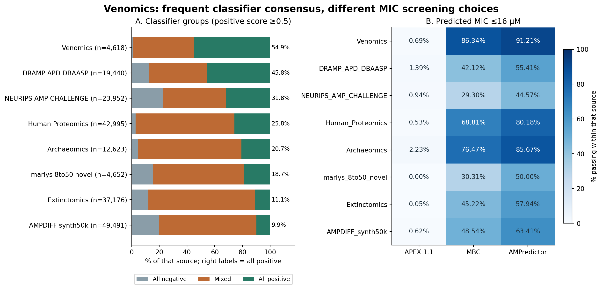
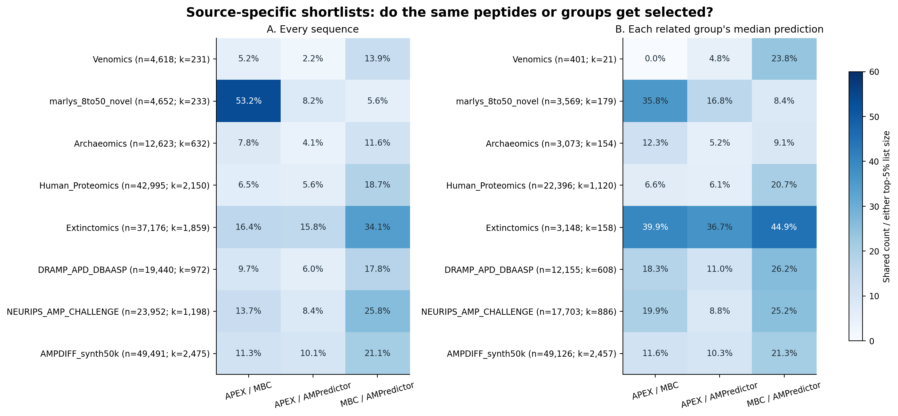
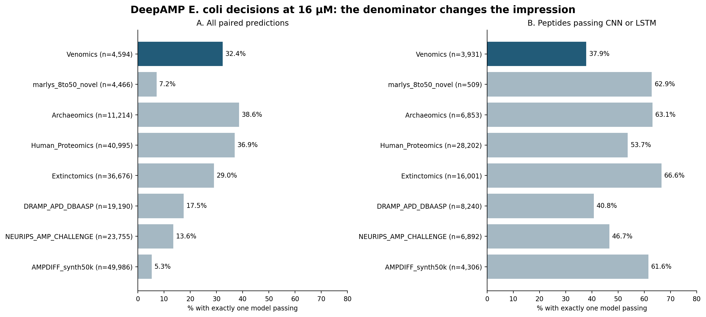
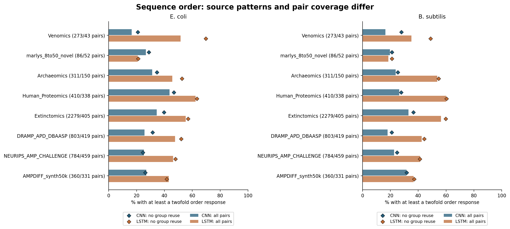

# Comparing the source collections across the DAMP findings

This report looks separately at the eight collections supplying DAMP's sequences. It extends the [Venomics section](FINAL_ANALYSIS.md#6-venomics-gets-more-unanimous-positive-votes-while-mic-shortlists-differ) across the questions in final-report sections 1–5: shortlists, concentration rules, comparisons for the same target, classifier decisions, and sequence edits. Venomics comes first below; other collections stand out on different dimensions.

## 1. Which peptides are included?

- The analysis looks at each collection separately, rather than mixing all peptides into one large set. This asks whether a result seen overall also holds in each collection. The collections differ in how their peptides were obtained and in how many similar variants they contain, so a difference between collections does not by itself reveal a biological cause.

- Most comparisons use **194,947 peptides** with predictions from all three main MIC models and all four classifiers. This keeps the starting set the same when comparing their choices. Section 4 of the final report also examines a larger **195,620-peptide classifier-only set**, so some percentages differ slightly.

- Other questions have different available data. Comparing APEX versions uses **195,625 peptides** with both predictions. Comparing DeepAMP CNN and LSTM uses **190,876**, separately for the E. coli and B. subtilis training targets. The sequence-order check has **5,306 pairs** whose members contain the same amino-acid counts in different orders.

| Collection | APEX-version sequences | Primary MIC/classifier sequences | DeepAMP-paired sequences | Order pairs |
|---|---:|---:|---:|---:|
| Venomics | 4,618 | 4,618 | 4,594 | 273 |
| marlys | 4,652 | 4,652 | 4,466 | 86 |
| Archaeomics | 12,623 | 12,623 | 11,214 | 311 |
| Human proteomics | 42,995 | 42,995 | 40,995 | 410 |
| Extinctomics | 37,176 | 37,176 | 36,676 | 2,279 |
| DRAMP/APD/DBAASP | 19,622 | 19,440 | 19,190 | 803 |
| NEURIPS challenge | 23,953 | 23,952 | 23,755 | 784 |
| AMPDIFF | 49,986 | 49,491 | 49,986 | 360 |

- The table shows how many peptides or pairs are available for each question. These counts cannot be substituted for one another. Many sequences and pairs are related, so they are also not counts of independent biological experiments.

- Details: [Coverage table](../analysis_review/outputs/source_comparisons/coverage.csv).

## 2. Different collections lead when different decisions are counted

- The classifier comparisons use the same rule as the final report: a score **≥0.5** is positive. Four positive votes means all four tools call the peptide positive; zero means all negative; one, two, or three means mixed. AMP-CLIP already gives a binary label. The other tools' scores are not established as comparable probabilities.

- **Venomics has the most four-positive decisions: 54.92%.** It also has the highest mean K/R content, **39.23%**—the share of residues that are lysine or arginine. Its ten largest related groups contain **57.19%** of its peptides. The Venomics companion checks how much those repeated variants and sequence ingredients contribute to its results.

- Details: [Venomics companion](06_venomics.md).

- A group links sequences differing by one residue or an addition at an end, including links through other observed sequences. Counting every group equally gives a large family of variants less influence. Venomics remains **52.35% all positive**, still the highest fraction. Its positive classifier pattern therefore persists under that change in counting.

- Other collections lead when a different decision is counted. **DRAMP/APD/DBAASP has the most unanimous decisions, 58.46%**, if both four-positive and four-negative cases are included, versus **55.76% in Venomics**. **Extinctomics has the most mixed decisions, 76.81%**. **NEURIPS challenge has the most four-negative decisions, 22.42%**. None of these percentages is a measured activity rate.

- **Figure 1** compares those classifier votes with selection at **predicted MIC ≤16 µM**. Venomics has the highest passing rates for MBC and AMPredictor, while **Archaeomics has the highest APEX 1.1 rate, 2.23%**. The collection with the most selected peptides changes with the model.

*Figure 1. Each source uses its primary MIC/classifier count from the table above. Left: all-negative, mixed, and all-positive groups at score ≥0.5. Right: predicted MIC ≤16 µM passing fractions. APEX's selected output specifies E. coli ATCC 11775, while MBC and AMPredictor use broader E. coli targets. These are screening outcomes, not measured active fractions.*

- The selection rule also matters. At **score ≥0.7**, **28.47%** of DRAMP/APD/DBAASP peptides are all positive, above **25.23%** in Venomics. The linked table keeps the **0.3, 0.5, and 0.7** results. It tests the consequences of using different cutoffs, rather than claiming that the same score means the same probability in every tool.

- Details: [score-rule table](../analysis_review/outputs/venomics/classifier_rule_sensitivity.csv) · [source profiles](../analysis_review/outputs/venomics/source_context.csv).

## 3. The tools choose and order peptides differently across collections

- Here, each tool chooses its lowest predicted MICs from **one collection at a time**, taking **5%** and rounding upward to a whole peptide. The shared percentage is the number chosen by both tools divided by either list's size, including any peptides also chosen by the third tool. This asks whether the tools would send the same candidates from that collection to the laboratory.

- **Venomics has the least overlap between APEX's list and the other two lists**: **12/231 with MBC (5.19%)** and **5/231 with AMPredictor (2.16%)**. In **marlys**, APEX/MBC share **124/233 (53.22%)**, the largest overlap for that pair. Yet marlys MBC/AMPredictor share only **13/233 (5.58%)**, the smallest for that pair. A collection cannot be called simply easy or difficult for model agreement; which pair is compared matters.

- The next check asks about broader choices among related peptides. It gives each group its **median prediction**—the middle value among its members—then takes the best **5% of groups**. **Figure 2** compares choosing exact sequences with choosing these groups. The list sizes and the items being selected change, so the group calculation answers a different question rather than correcting the original lists.

*Figure 2. Each row prints how many items are available (n) and how many each model selects (k). Items are exact sequences on the left and related groups on the right. A cell counts shared selections divided by that row's k. Each group uses its middle prediction; this changes the selection unit without making groups independent biological families.*

- APEX/MBC still share many marlys nominations when choosing groups: **64/179 (35.75%)**. Extinctomics is now slightly higher at **63/158 (39.87%)**, versus **305/1,859 (16.41%)** in its original sequence lists. Its APEX/AMPredictor overlap also rises from **15.82%** when choosing sequences to **36.71%** when choosing groups. Thus, the result changes substantially with the unit of selection (Figure 2).

- A separate check chooses **one actual sequence per group**, without consulting predictions, and repeats the choice **20 times**. Median APEX/MBC overlap is **35.75% in marlys** and **36.08% in Extinctomics**. The ranges, **34.64–37.43%** and **33.54–39.24%**, overlap. They describe these representative choices, not statistical confidence intervals. Both collections retain substantial overlap; their exact ordering is less informative.

- The rank comparison asks whether a peptide favored by one tool also tends to be favored by another across the full list. **Archaeomics shows little such agreement with APEX**: Spearman correlations are **−0.072 with MBC** and **−0.056 with AMPredictor**. Using one middle prediction per related group gives **−0.134 and −0.100**. These values are near zero, so the finding is weak shared ordering rather than a strong reversal.

- Restricting Archaeomics to **7,065 peptides without cysteine (C), of length 8–39**, gives APEX correlations of **−0.034 and +0.043**, still near zero. The lack of shared ordering persists, while the small negative sign does not. MBC/AMPredictor remain positively associated at **0.366** in that subset.

- The collections also contain different ingredients. **91.04% of marlys peptides contain C**, versus **2.23% of Venomics** and **0.35% of Archaeomics**. Only **413 marlys peptides** have no C and length 8–39. Their 5% lists contain **21 candidates** each, of which APEX/MBC share **16 (76.19%)**. This describes a small selected part of marlys; it does not show that removing C would make models agree.

- AMPredictor's reported training examples contain no C and are shorter than 40 residues. Most marlys peptides differ from at least that feature of its training examples. This helps frame why the predictions need care, without proving that cysteine causes the disagreement.

- Details: [model review](03_matched_targets.md#2-training-examples-help-explain-why-a-common-cutoff-is-difficult).

- [All raw budgets and group checks](../analysis_review/outputs/source_comparisons/shortlist_comparisons.csv), [representative-choice summaries](../analysis_review/outputs/source_comparisons/representative_shortlist_summary.csv), and [rank correlations](../analysis_review/outputs/source_comparisons/rank_correlations.csv) preserve the counts and selection-boundary checks. “Highest” and “lowest” here refer to this finite collection and rule, not statistically established differences in biological performance.

## 4. Agreement can come mostly from rejecting the same peptides

- This check compares DeepAMP CNN and LSTM for the **same training target**, either E. coli or B. subtilis. At **16 µM**, one model can pass a peptide while the other fails it. The disagreement percentage can count those cases among **all paired predictions**, or only among **peptides either model would select**. Those two questions use different denominators.

- **Archaeomics and Human proteomics have high E. coli decision disagreement**: **38.59% of 11,214 peptides** and **36.94% of 40,995**, respectively. Giving large related groups less influence leaves **36.35% and 37.46%** among the mapped peptides. Both remain high, but which is highest changes. For B. subtilis, the initial rates are **35.68% and 35.03%**.

- **AMPDIFF shows why agreeing on rejection can be misleading.** CNN/LSTM disagree on only **2,651/49,986 E. coli-paired peptides (5.30%)**, the lowest overall rate. They both fail **45,680/49,986 (91.39%)**. Among the **4,306 peptides either would select**, the same disagreements are **61.57%**. The tools can agree on most of the collection while disagreeing over much of the usable candidate list.

- **Figure 3** shows both denominators source by source. It demonstrates why the collection with the lowest overall disagreement need not have the most consistent selected candidates.

*Figure 3. Both panels count the same cases where one model passes a peptide and the other fails it, at ≤16 µM. The left divides by all peptides with both predictions; the right divides only by peptides passing at least one model. Each row prints the count used. These are differences in model decisions, not laboratory error rates.*

- The APEX-version check gives a smaller example. In marlys, only **four of 4,652 peptides** pass either version at 16 µM, all in the older version alone. The models therefore differ on **4/4 selected candidates**, but only **4/4,652** of the full collection. Saying “100% disagree” without these counts would obscure how small the selected set is. The versions also differ in training and label handling.

- [All source decision cells](../analysis_review/outputs/source_comparisons/matched_target_decisions.csv) include **8, 16, and 32 µM** cutoffs, both DeepAMP targets, the E. coli APEX versions, larger-margin disagreements, and group weights. DeepAMP has some eligible sequences outside the group map; weighted rates use only the mapped subset and report its count. Neither a source ranking nor a preferred cutoff establishes accuracy.

## 5. Similar sequence patterns appear in all eight collections

- This check compares the amino-acid content of all-positive and all-negative peptides **at the same length within each collection**. K/R counts lysine and arginine; D/E counts aspartic acid and glutamic acid. For each length, the all-negative mean is subtracted from the all-positive mean. The differences are averaged, giving greater influence to lengths with more examples in both groups.

- In every collection, all-positive peptides still contain **more K/R and less D/E** after the length comparison. The directions also persist when large related groups receive less influence. This is a pattern shared across the collections, rather than a Venomics-only sequence signature or proof of measured charge effects.

| Collection | K/R difference, percentage points | D/E difference, percentage points | Smaller-group counts added across lengths |
|---|---:|---:|---:|
| Venomics | +10.19 | -4.52 | 39 |
| marlys | +10.43 | -10.36 | 376 |
| Archaeomics | +7.03 | -2.15 | 43 |
| Human proteomics | +7.34 | -0.61 | 103 |
| Extinctomics | +11.66 | -1.40 | 2,141 |
| DRAMP/APD/DBAASP | +15.73 | -8.63 | 2,330 |
| NEURIPS challenge | +20.63 | -7.79 | 3,742 |
| AMPDIFF | +8.86 | -5.50 | 3,841 |

- The final column adds the smaller decision-group count at each compared length. It shows how much comparison is available, rather than how many independent experiments were performed. The counts are small for **Venomics (39)** and **Archaeomics (43)**. **NEURIPS challenge has the largest K/R difference, +20.63 points**, but that does not show that K/R causes accurate predictions.

- Details: [Profiles and weighting checks](../analysis_review/outputs/source_comparisons/classifier_length_matched_profiles.csv).

- The next check uses equal-length peptides from the same collection that differ at one amino-acid position. It asks whether they stay in the same all-positive, mixed, or all-negative group. The reference asks how often that would occur when choosing another peptide from the same collection and length, excluding the starting peptide. The reference here uses the MIC-complete set, rather than section 4's larger classifier-only set.

| Collection | Observed neighbor pairs | Pairs sharing a decision group | Expected from source and length |
|---|---:|---:|---:|
| Venomics | 638 | 89.03% | 62.58% |
| marlys | 1,108 | 87.36% | 58.13% |
| Archaeomics | 605 | 93.06% | 74.48% |
| Human proteomics | 839 | 92.13% | 72.29% |
| Extinctomics | 5,855 | 88.40% | 62.34% |
| DRAMP/APD/DBAASP | 21,762 | 72.13% | 52.53% |
| NEURIPS challenge | 10,142 | 82.87% | 42.91% |
| AMPDIFF | 304 | 89.47% | 61.05% |

- These near-identical pairs share a decision group more often than the reference in every collection. **Archaeomics has the highest observed agreement, 93.06%**, but also a high reference of **74.48%**. **NEURIPS challenge has the largest observed-minus-reference gap, about 39.96 points**. A high agreement rate and a large excess over the reference are different findings; neither proves biological stability.

- Some pairs reuse the same peptides or belong to the same related groups, so they cannot be counted as independent experiments. The linked table also reduces the influence of groups supplying many pairs. The overall finding is that similar sequences tend to receive similar decisions, while the strength of that pattern depends on the comparison being made.

- Details: [neighbor table](../analysis_review/outputs/source_comparisons/neighbor_agreement.csv).

## 6. Rearranging the same amino acids affects collections differently

- The sequence-order check compares peptides with **the same counts of every amino acid in different orders**. A twofold response means one receives a prediction at least twice the other's. Each percentage counts responding pairs out of the pairs retained for that collection, not out of all its peptides.

- **Rearranging the ingredients changes predictions particularly often in Human proteomics.** For E. coli, twofold changes occur in **43.66% of CNN** and **62.44% of LSTM** predictions across **410 pairs**, the highest rates for both models. Preventing reuse of related groups leaves **338 pairs**, with rates **46.75% and 63.31%**. Keeping only pairs with all four predictions **≤128 µM** leaves **261**, with rates **33.72% and 52.87%**. Frequent change does not establish that the predicted change is correct.

- **Figure 4** compares these responses for each collection and bacterial target. Bars use every observed pair; diamonds use pairs chosen so that no related group is reused. The labels show both counts. Venomics goes from **273 to 43 pairs**, and marlys from **86 to 52**, making the smaller amount of evidence visible.

*Figure 4. Bars use all observed pairs. Diamonds keep fewer pairs so that no related group is counted in two retained pairs. CNN and LSTM are compared for the same training target. Each label prints both pair counts, and each percentage uses its own count. These are observed variants, not randomized sequence edits or new laboratory tests.*

- In the full pair set, LSTM changes by at least twofold more often than CNN in **seven of eight collections**, for both targets. **marlys is the exception**, but its result changes with the subset. Without group reuse, its B. subtilis rates tie at **21.15%**. A lower-prediction check leaves only **22 E. coli pairs** and reverses the original pattern to **13.64% CNN versus 27.27% LSTM**. That is too small and changeable a basis for a general rule.

- **Extinctomics supplies 2,279/5,306 pairs (42.95%)**, so it has a large influence on the pooled rates. Averaging the eight collections' percentages equally still gives more frequent LSTM responses: **46.63% versus 28.81% CNN for E. coli**, and **43.04% versus 23.99% for B. subtilis**. This checks whether one large collection drives the result; it does not make the collections independent experiments or identify a uniquely correct average.

- [All source response counts](../analysis_review/outputs/source_comparisons/sequence_order_responses.csv) retain target, model, and restriction. [Source-balanced summaries](../analysis_review/outputs/source_comparisons/source_balanced_order.csv) distinguish averaging source percentages from pooling all observed pairs.

## 7. What these comparisons add

- **Venomics remains the first case to report:** it has the most four-positive votes at the baseline rule and the least raw overlap between APEX's 5% shortlist and the other MIC shortlists.

- **marlys:** APEX and MBC share many shortlisted candidates, while MBC and AMPredictor share few. Agreement depends on which pair of tools is considered.

- **Archaeomics:** APEX's ordering has little relationship to the other tools' ordering, even after several checks on which variants are counted.

- **Extinctomics:** the tools agree more when choosing groups of related peptides than when choosing exact variants.

- **Human proteomics:** changing residue order often produces a twofold or larger change in prediction.

- **DRAMP/APD/DBAASP:** the four classifiers most often agree when both positive and negative unanimity are counted.

- **NEURIPS challenge:** near-identical sequences share a decision group much more often than its source/length reference predicts.

- **AMPDIFF:** the DeepAMP models agree mainly by rejecting the same peptides; their choices among selected candidates differ much more.

- A collection can stand out on one question and not another. The answer can change when the cutoff moves, a different set of peptides is eligible, or repeated variants have less influence. These are exploratory findings about selected collections, rather than a ranking of biological difficulty or model accuracy.

- The linked scripts reproduce the results and check the arithmetic by separate calculations. The checks compare nomination sets, averages within length groups, and concentration ratios directly with the saved outputs. They help establish that the calculations are consistent, but do not replace independent biological measurements.

- Details: [analysis script](../analysis_review/source_stratified_analysis.py) · [separate verifier](../analysis_review/verify_source_stratified_analysis.py) · [The manifest](../analysis_review/outputs/source_comparisons/manifest.json) · [verification results](../analysis_review/outputs/source_comparisons/independent_verification.json).
